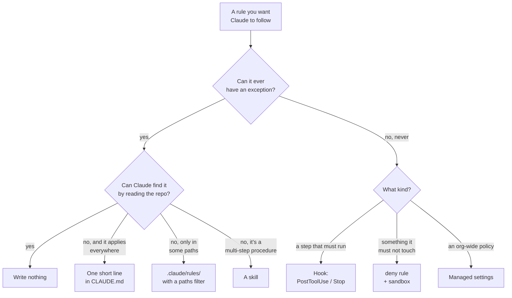
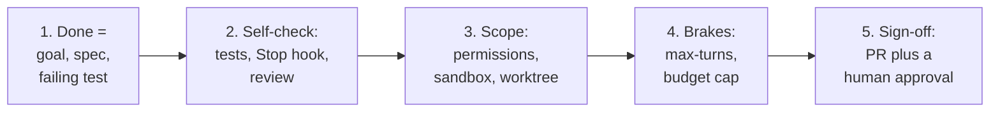

# Best Practices for Claude Code: Guide the Model, Enforce in the Harness

*A field guide built on one question: should this instruction be something Claude **weighs**, or something Claude Code **enforces**?*

> This is my own take on Anthropic's official page, [Best practices for Claude Code](https://code.claude.com/docs/en/best-practices), with examples from running a Markdown knowledge base and a CSDN publishing workflow through Claude Code. Commands and settings follow the official docs as of November 2026. Check them there before relying on any detail.

## Abbreviations

| Abbreviation | Full name |
|---|---|
| CLI | Command-Line Interface |
| MCP | Model Context Protocol |
| CI | Continuous Integration |
| PR | Pull Request |
| API | Application Programming Interface |
| JSON | JavaScript Object Notation |
| OS | Operating System |

---

## 1. The one idea that organizes everything

Everything you tell Claude Code ends up in one of two places:

| | **Guidance**: the model reads it and decides | **Enforcement**: the harness runs it every time |
|---|---|---|
| What to do | prompt, `CLAUDE.md`, skills | hooks, skills that only you can invoke |
| What it may touch | auto mode's classifier | `deny` rules, sandbox, managed settings |
| When it's done | "show me the test output", `/goal`, `/code-review` | tests, typecheck, a `Stop` hook, CI |
| How much it spends | effort level | `--max-turns`, `--max-budget-usd`, spend limits |

Guidance is the right default. The model sees the actual code and can judge when a rule doesn't fit, and that judgment is worth having. Enforcement is for the small set of things that must happen, or must never happen, **with zero exceptions**.

My rule of thumb:

- **A `CLAUDE.md` line that you keep adding emphasis to** ("IMPORTANT", "NEVER", all caps) is a hook or a deny rule in disguise. Move it.
- **A hook that encodes a preference** ("prefer named exports") is guidance in disguise. Delete it and let Claude weigh it.



## 2. Guidance: tell Claude only what it can't see

Current models read a codebase quickly and well: layout, conventions, test framework, existing patterns. Writing those down mostly costs attention on every task. What's worth writing down is what **isn't in the repo**, or what Claude would have to rediscover every session:

- decisions made in a meeting, deploy steps that live in one person's head;
- the exact commands that verify work (test, typecheck, lint, one test file);
- places where the code misleads: a legacy pattern that's everywhere but must not be copied, a directory that looks dead but isn't;
- anything you've had to correct twice.

Before adding a line, ask two questions: *could Claude find this by reading the code, and would it actually look?* If both answers are yes, leave it out.

### Keep `CLAUDE.md` short and factual

This repo's `CLAUDE.md` is a good example of what belongs there. Claude can't infer any of these from the files:

```markdown
- Never put a date or a Jira ticket id in an article filename.
- LATEST.md is generated: run `python3 scripts/gen-latest.py`, never hand-edit it.
- Refresh LATEST.md after the article commit lands; the generator reads committed history.
- macOS is case-insensitive: rename `Tools/` -> `tools/` via a temp name.
```

Each line is a fact or a decision, not a description of the folder structure. `/init` drafts a starting file from the codebase, and most of the editing afterwards is deleting lines. Personal preferences go in `CLAUDE.local.md`, kept out of git.

### Scope what's only sometimes relevant

- **Path-specific rules**: a file in `.claude/rules/` with a `paths:` glob loads only when Claude works on matching files. API-validation rules don't need to sit in context during a docs edit.
- **Skills** for procedures: a skill costs a name and a one-line description per session until a task needs it, and then Claude reads the full file. My CSDN publishing runbook (quotas, editor quirks, anti-bot pacing) is a skill. As a `CLAUDE.md` section it would sit in context on every unrelated task.
- For a skill with outside effects (publishing, releasing), set `disable-model-invocation: true` so it runs only when *you* type its slash command.

### Prompts: give facts and scope, not pep talk

- **Name the file, the symptom and what "fixed" means.** "Login fails after session timeout. Look at token refresh in `src/auth/`, write a failing test, then fix" saves a round of corrections that "fix the login bug" won't.
- **Hand over evidence instead of describing it**: `@path` to attach a file, paste a screenshot, `cat error.log | claude -p "…"`.
- **Say how big you want it.** Claude reads requests conservatively. "Be ambitious: empty and error states, keyboard navigation, not just the layout" tells it about scope, which only you know.
- **Not sure yet? Ask it to interview you** until there's enough for a spec file, then build from that spec in a fresh session.
- "Think step by step" and "be thorough" are ordinary text, not switches. How hard Claude thinks is controlled by the **effort level** (§5).

### Connect the systems the repo doesn't contain

If the system has a CLI (`gh`, `aws`, `kubectl`), Claude can usually use it directly, and `--help` is enough introduction. For systems without one, add an **MCP** server. Disable servers you aren't using, because each connected server's tool list takes up context.

## 3. Give Claude a check to run

Claude stops when the work *looks* done. Without something that returns pass or fail, you become the test suite. Give it any check whose result it can read: a test file, a build's exit code, a linter, a diff against a fixture, a screenshot next to the mockup. Then it can loop on its own: change, run, read the failure, fix, run again.

The strictness can be dialed up step by step:

| Level | How | Who decides when it's done |
|---|---|---|
| Ask in the prompt | "run the auth tests and keep going until they pass" | Claude |
| Set a goal | `/goal all tests in tests/auth pass` (a separate model checks after every turn) | Claude, checked by another model |
| `Stop` hook | the script runs whenever Claude tries to finish, and exit code 2 sends it back | the harness |
| Independent review | `/code-review`, or a reviewer subagent that never saw the conversation | a fresh reviewer |

Two habits matter more than the level you choose:

1. **Ask for evidence, not a verdict**: the command that ran and its output. "All tests pass" on its own tells you little, and for an unattended run the output is your only record.
2. **When reviewing against a spec, say "skip style."** A reviewer asked to find problems always finds some, and fixing every nit grows abstractions and tests for cases that can't happen.

In my repo the check is concrete: every Mermaid diagram is rendered with `mmdc` before committing. A parse error stops the work, and Claude sees exactly why.

## 4. Enforcement: the rules that can't have exceptions

### Hooks for steps that must run

Hooks run your command at fixed points: before or after a tool call, when Claude tries to stop, at session start. A formatter that has to run after every edit is the classic case:

```json
{
  "hooks": {
    "PostToolUse": [
      { "matcher": "Edit|Write",
        "hooks": [{ "type": "command",
          "command": "f=$(jq -r '.tool_input.file_path') && npx prettier --write --ignore-unknown \"$f\"" }] }
    ],
    "Stop": [
      { "hooks": [{ "type": "command", "command": "pnpm tsc --noEmit 1>&2 || exit 2" }] }
    ]
  }
}
```

- In a `Stop` hook, stderr goes back to Claude as the reason it can't finish yet. Send the compiler output there.
- `prompt` and `agent` hooks ask *another model* to decide, so they aren't deterministic. For real enforcement use `command` or `http` hooks, and consider `onFailure: "block"` so a crashed scanner blocks the action instead of letting it through.
- You don't have to write hooks by hand. Ask "write a hook that blocks edits to `migrations/`", then inspect the result with `/hooks`.

### Deny rules and the sandbox for what must never be touched

```json
{
  "permissions": {
    "allow": ["Bash(pnpm tsc --noEmit)"],
    "ask":   ["Bash(git push *)"],
    "deny":  ["Read(./.env)", "Read(./secrets/**)"]
  }
}
```

`deny` rules apply in every permission mode, auto and `bypassPermissions` included. Know where the edges are: a `Read` deny also catches common commands like `cat .env`, but not a script that opens the file, and a `WebFetch` deny doesn't stop `curl` to the same domain. For an OS-level boundary, turn on the **sandbox** (`/sandbox`). It also picks up your read-deny and domain rules. Use both for anything security-related.

### Where a rule lives decides who it binds

| File | Applies to |
|---|---|
| `~/.claude/settings.json`, `.claude/settings.local.json` | only you |
| `.claude/settings.json` (committed) | everyone in the repo (allows and hooks take effect once each person trusts the folder) |
| managed settings | the whole organization, and no one can override them |

Keep the enforced set **small**. Every hook will sometimes fire when it shouldn't, and someone has to maintain it.

## 5. Tune the defaults only when a task costs too much

New sessions already start in auto mode, run a strong default model at medium effort, delegate to subagents when that helps, and compact long conversations. Change something only when `/usage` shows a task costing more time, tokens or interruptions than it should.

- **Permission mode.** Manual approval wears you down until you approve without reading, and `bypassPermissions` belongs in a throwaway container. **Auto mode** sits between them: a classifier checks risky actions (piping a download into a shell, production deploys, force pushes, data going to external endpoints). It runs *after* your deny rules and hooks, so it adds to them and doesn't replace them. If it keeps blocking something that's routine for you, describe that in `autoMode` in `~/.claude/settings.json`. Keep `"$defaults"` in every list, or you replace the built-in protections instead of adding to them.
- **Effort.** `/effort high` or `xhigh` for subtle work: unfamiliar code, flaky tests, schema changes with many readers. `/effort low` for fast back-and-forth where you review every step anyway. Keep `max` for hard problems you leave running on their own. Put `ultrathink` in a single prompt for one deep turn.
- **Subagents.** They give you parallel work, keep noisy output out of your main thread, and provide a reviewer who didn't watch the code being written. They don't give you a *smarter* answer, and every one spends tokens. Set `model: haiku` for simple jobs, ask for short summaries back, and give a reviewer only `tools: Read, Grep, Glob`. A read-only reviewer enforced by tool list is stronger than one told "don't edit."
- **Context and cost.** Context windows rarely run out now, but you still pay to resend old history on every turn. Run `/clear` between unrelated tasks, and `/compact <focus>` when you want to keep a thread but drop the noise.

## 6. Steer early, reset rather than argue

- Watch the first minute of a session. Press **`Esc`** the moment it drifts. Work done so far is kept.
- Use **`/rewind`** (or `Esc` twice) to roll back code, conversation, or both. This makes "try the bold approach first" cheap. It doesn't undo files changed only by shell commands, so keep using git.
- **After two failed corrections, run `/clear` and write one better prompt.** A third correction just adds another failed attempt for Claude to keep re-reading.
- `/btw` answers a side question without adding to the history. `/rename` plus `claude --resume <name>` brings back a multi-day session.

## 7. Before you walk away: five questions for unattended runs



Supervised, a missing piece of context costs one message to fix. Unattended, it costs the whole night. For scripted runs:

```bash
claude --bare -p "Migrate $file to the new logger API and commit. Reply OK or FAIL." \
  --allowedTools "Read,Edit,Bash(git add *),Bash(git commit *)" \
  --permission-mode dontAsk --max-turns 20
```

- `--bare` skips local hooks, skills, MCP and `CLAUDE.md`, so the run behaves the same on any machine. Pass in what it needs explicitly. Don't use it when the run depends on hooks.
- Try it on three items, fix the prompt, *then* run the rest.
- Use `/loop` for repeated checks inside an open session and `/schedule` for cloud runs on a timer or event. Protect `main` with branch rules before leaving a scheduled task alone.
- For parallel work, give each session its own worktree (`claude -w <name>`). List small gitignored files such as `.env` in `.worktreeinclude` so they get copied in.

## 8. Habits you can drop

| Old habit | Why it's no longer needed |
|---|---|
| Aggressively managing the context window | Windows are large and compaction is automatic. `/clear` between tasks is still worth it, for focus and cost. |
| IMPORTANT / ALL CAPS in instructions | Plain wording is followed, and emphasis causes the rule to be over-applied. An unbreakable rule belongs in a hook or a deny rule. |
| "Think harder", "be thorough" | Use the effort level, or `ultrathink` for a single turn. |
| "Keep going, don't be lazy" | Current models finish agreed tasks. Give them a check to pass, or `/goal` or a `Stop` hook for unattended runs. |
| Delegating for a better answer | Delegation gives parallelism or a fresh reviewer, not more intelligence. |
| Describing your architecture in `CLAUDE.md` | Claude reads the repo itself. Write down only what isn't in it. |

## 9. Conclusions

1. **Sort every instruction**: guidance the model weighs, or enforcement the harness runs. Most belong in guidance, and only rules with no exceptions belong in hooks, deny rules or managed settings.
2. **Write down only what Claude can't see**, keep `CLAUDE.md` short, and move the rest into path rules and skills that load only when needed.
3. **A check Claude can run** turns "looks done" into "is done". Always ask for the evidence.
4. **Change defaults only when `/usage` shows a cost**, steer early with `Esc` and `/rewind`, and reset with `/clear` instead of correcting a third time.
5. **Unattended runs need all five**: a definition of done, a self-check, a limited scope, brakes, and a human sign-off.

*Source and further reading: [Best practices for Claude Code](https://code.claude.com/docs/en/best-practices) (Anthropic). Hooks, permissions, sandboxing, auto mode and headless mode each have their own pages in the same documentation.*
