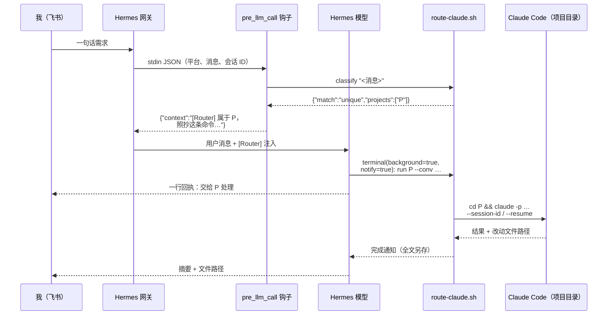
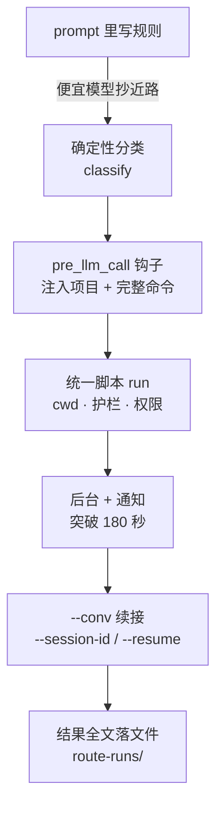

# 飞书一句话，自动派给对应项目的 Claude Code：把 Hermes 改造成项目路由器

我在 Mac mini 上常驻了一个 Hermes Agent（Nous Research 的开源 Agent Harness，代理运行框架），通过飞书和它聊天。机器上还有八个各自带 `CLAUDE.md`、skill 和约定的 Claude Code 项目：股票分析、iOS App、技术知识库、人文随笔库、菜谱库、交易复盘、skill 插件，以及一本第三方的参考书仓库。

目标很朴素：**我在飞书里随口说一件事，Hermes 自己判断它属于哪个项目，进到那个目录调用 Claude Code 做完，再把结果推回飞书。** Hermes 只做路由，干活的是 Claude Code。

第一版只靠 prompt 写规则，结果模型不听。最后靠一个关键词分类器、一个 `pre_llm_call` 钩子、一个统一的路由脚本，把"选哪个项目、跑什么命令"从**模型的判断**变成了**确定性的注入**。本文按踩坑顺序记录整个过程。

> 环境：Hermes Agent v0.21.0（主模型 DeepSeek V4 Flash，经 OpenRouter），Claude Code CLI（命令行界面），飞书长连接，macOS。
> 文中项目名、会话 ID、路径均为占位符。

## 缩写对照表 (Abbreviation Glossary)

| 缩写 | 英文全称 | 中文 |
|---|---|---|
| CLI | Command-Line Interface | 命令行界面 |
| LLM | Large Language Model | 大语言模型 |
| TTY | Teletypewriter (interactive terminal) | 交互式终端 |
| TCC | Transparency, Consent, and Control | macOS 隐私权限框架 |
| UUID | Universally Unique Identifier | 通用唯一标识符 |
| TTL | Time To Live | 存活时间 |
| WAL | Write-Ahead Logging | 预写日志 |
| JSON | JavaScript Object Notation | JSON 数据格式 |
| cwd | Current Working Directory | 当前工作目录 |

---

## 1. 目标架构：Hermes 是路由器，Claude Code 是工人

为什么不让 Hermes 自己干？因为每个项目的"大脑"在项目里：`CLAUDE.md` 里的约定、项目级 skill、目录结构、哪些事绝对不能做。**只有在项目目录里启动的 Claude Code 才会加载这些**。Hermes 用一个便宜的模型做调度很合适，但让它直接读写项目文件，就绕过了这些约定。

最终的数据流：



---

## 2. 第一版：只写 prompt，为什么不够

第一版做得很"正统"：在 Hermes 的人格文件 `SOUL.md` 顶部加了"你的首要角色是路由器"一节，再写一个 `project-router` skill，里面有路由表、流程图和退出码。结果踩了两个坑。

### 坑一：改了规则，飞书里的老会话完全看不到

Hermes 的 system prompt（`SOUL.md` + `AGENTS.md` + skill 索引）**每个会话只构建一次，然后存进 `state.db`**，之后每一轮都复用这份存档，**重启网关也不会重建**。我的配置是 `session_reset: mode: none`，飞书私聊会话从不过期，所以那几个聊天一直跑着几周前的 prompt：没有路由段，skill 索引里还列着早已删除的 skill。

| 内容 | 什么时候读 | 重启网关够不够 |
|---|---|---|
| `SKILL.md` 正文（`/name` 或 `skill_view`） | 每次调用时从磁盘读 | 不需要，总是最新 |
| skill **索引**（system prompt 里） | 会话的 prompt 构建时 | **不够**，需要新会话 |
| `SOUL.md`、`AGENTS.md` | 会话的 prompt 构建时 | **不够**，需要新会话 |
| 斜杠命令可用的 skill 列表 | 网关启动或 `/reload-skills` | 够 |

修复：在飞书里发 `/new`，并把 `session_reset` 改成 `mode: daily`（每天 04:00 重置）。代价是每天丢一次聊天上下文，但长期记忆本来就在 claude-mem 里。

> 排查 `state.db` 时又遇到一个小坑：用 `mode=ro` 只读打开 SQLite 时**看不到 WAL 里还没合并的新数据**，查出来像是"没有新会话"。正确做法是把 `state.db*` 三个文件复制到临时目录，再查副本。

### 坑二：便宜模型会抄近路

新会话里规则确实在了。我发"从参考书仓库里找关于医保的建议"，模型的做法是**自己 `ls` + `grep` 那本书**，然后作答，根本没调路由脚本，也没调 Claude Code。另一个旧会话里，它把 shell 命令塞进了 `execute_code`（Python 内核），报 `SyntaxError`。

结论：**写在 prompt 里的规则，对便宜模型只是"建议"。** 要可靠，有两件事不能再交给模型做：

1. "这条消息属于哪个项目"的判断，
2. 具体命令的拼写。

---

## 3. 一个脚本包办所有机械活：`route-claude.sh`

先把"怎么正确地调用 Claude Code"收敛到一个脚本里，让模型只需要说出项目名和任务：

```text
route-claude.sh list                                  # 注册表
route-claude.sh recall   <project> [n]                # 该项目的 claude-mem 历史（只读）
route-claude.sh check    <project>                    # 路径 + TCC 预检
route-claude.sh classify "<message>"                  # 分类，输出 JSON
route-claude.sh run      <project> --task-file f [--conv <key>] [--add-dir <project>]...
```

### 3.1 注册表：项目 → 路径 → 护栏

```bash
# name | dir | sync | 注入到每个任务里的护栏
REGISTRY='
stock-analysis|stock-analysis|gh-private|只做分析，绝不下单、改单、撤单。不要自己 git commit/push。
book-ref|book-ref|gh-upstream|第三方书籍仓库，只读：不改、不提交、不推送。按章节和条目号作答。
essays-vault|essays-vault|vault|iCloud 里的 Obsidian 库。绝不加 remote、绝不 push、绝不发布。
tech-kb|tech-kb|gh-public|公开知识库。在 feature 分支上工作；不 push，不发布到 CSDN。
...
'
```

`run` 做的事：

- `cd` 进项目目录。**cwd 错了就等于"大脑"错了**：从工作区根目录跑 `claude -p` 不会加载任何项目的 `CLAUDE.md`，文件也会写错地方。
- 拼出 prompt：`[Routed by Hermes to project: P — 路径]` + 护栏 + "只写在项目目录内；最后列出所有改动文件的绝对路径；被拦下的操作要明说" + 任务正文。
- 固定加 `--permission-mode acceptEdits`，否则无头模式下每次写文件都会被自动拒绝（见本目录的 [cmux-delegate](./cmux-delegate.md) 一文）。
- 跨项目时用 `--add-dir <project>` 授权读取另一个项目。例如从参考书提炼一篇随笔：**交付物落在哪个项目，就路由到哪个项目**，另一个项目只加 `--add-dir`。

退出码分清"谁的错"：

| 退出码 | 含义 | 模型该怎么做 |
|---|---|---|
| 0 | Claude Code 正常结束 | 核对路径，回报 |
| 1 | 项目名未知/有歧义，或用法错误 | 修正调用，绝不猜路径 |
| 4 | 项目不在这台机器上 | 告诉我，不要建目录 |
| 5 | 路径存在但不可读（iCloud 库的 TCC 墙） | 回报；修法是给启动进程授予完全磁盘访问权限 |
| 其他 | `claude` 自身失败 | 限额则用自己的模型兜底并注明，否则回报 |

> Bash 小坑：注册表是单引号字符串，护栏文字里写了一句 `someone's repo`，那个撇号直接把字符串截断了。改写成不带撇号的说法即可。

### 3.2 任务写文件，不要内联

多行任务直接塞进命令行，会触发 Hermes terminal 工具的解析拦截。所以约定**模型先 `write_file` 写任务文件，再 `--task-file` 传路径**。

---

## 4. 确定性分类：`classify`

分类器故意做得很笨：**关键词表 + 两条硬规则**，用 `python3 -I` 内联实现，一次约 20 ms。

```text
stock-analysis|A股,大盘,板块,个股,涨停,收盘分析,日报,持仓复盘,Tushare
book-ref|医保,社保,公积金,失业金,防骗,劳动仲裁,开公司,急救,养老金
recipes-vault|菜谱,做法,食材,焯水,炒糖色,红烧,清蒸,recipe
ios-app|SwiftUI,Xcode,App Store,TestFlight,iOS,DynamoDB,Lambda
...
```

规则：

- ASCII 关键词按**单词边界**匹配（避免 `iOS` 命中 `bios`），中文关键词按子串匹配。
- 硬规则：以 0/3/6 开头的 6 位数字 → A 股项目；`$TICKER` → 美股项目。
- 打分取命中数。只有一个项目命中，或第一名分数 ≥ 第二名的 2 倍，就是 `unique`；否则 `multi`；都没命中是 `none`。

```bash
$ route-claude.sh classify "医保怎么报销"
{"match": "unique", "projects": ["book-ref"], "hits": {"book-ref": ["医保"]}}
$ route-claude.sh classify "写篇文章讲我的 IBKR 复盘"
{"match": "multi", "projects": ["tech-kb", "trade-archive"], ...}
$ route-claude.sh classify "hi"
{"match": "none", "projects": [], "hits": {}}
```

为什么不用 LLM 分类？因为要的就是**确定性和可解释**：命中了哪几个词一目了然，漏了就往表里加一个词。注册表和关键词表放在同一个脚本里，是唯一的事实来源。

---

## 5. 关键一步：`pre_llm_call` 钩子

Hermes 支持 shell 钩子。`pre_llm_call` 在每轮调模型之前触发：钩子从 stdin 收到 JSON，**它输出的 `{"context": "..."}` 会追加到这一轮的用户消息后面**。这正好用来把分类结果和"可以照抄的完整命令"塞给模型。

### 5.1 配置与授权

```yaml
# ~/.hermes/config.yaml
hooks:
  pre_llm_call:
    - command: "/Users/<me>/.hermes/agent-hooks/route-hook.py"
      timeout: 10
```

网关在 launchd 下运行，**没有 TTY，新钩子无法弹出交互确认，会被静默跳过。** 要在 `~/.hermes/shell-hooks-allowlist.json` 里精确授权这一条，这比全局 `hooks_auto_accept: true` 的范围窄得多：

```json
{"approvals": [{"event": "pre_llm_call",
                "command": "/Users/<me>/.hermes/agent-hooks/route-hook.py"}]}
```

用 `hermes hooks doctor` 确认已授权；重启网关后，日志里应出现 `shell hook registered: pre_llm_call -> …route-hook.py`。

### 5.2 钩子逻辑

```python
payload = json.load(sys.stdin)
extra = payload.get("extra") or {}
if str(extra.get("platform") or "").lower() != "feishu":
    out()                                  # cron、CLI、其他平台：输出 {}，行为不变
msg = strip_reply_quote(extra["user_message"]).strip()
if not msg or msg.startswith("/"):
    out()                                  # /new 等命令不干预

conv = sanitize(payload["session_id"])     # Hermes 会话 ID 作为续接键
task_file = f"~/.hermes/tmp/route-{conv}-{turn}.md"
res = classify(msg)

if res["match"] == "unique":
    out(f"[Router] 本条属于 project={p}（命中：{hits}）。{how(p)}\n"
        f"命令：route-claude.sh run {p} --conv {conv} --task-file {task_file}")
```

`how(p)` 是写给模型的固定操作步骤：

1. 先用一句话回执（"→ 交给 P 的 Claude Code 处理"）；
2. 用 `write_file` 把原话写入任务文件；
3. 用 **terminal 工具**（不是 `execute_code`）运行命令，`background=true, notify=true`；
4. 不要自己读项目文件作答；
5. 完成通知到达后，回复摘要和文件路径。

四种分支：

| 分类结果 | 注入内容 |
|---|---|
| `unique` | 项目名 + 命中词 + 完整命令 |
| `multi` | 候选列表；交付物落在哪个项目就选哪个，另一个用 `--add-dir`；真判断不了才问我 |
| `none`，但本会话之前路由过 | 上次的项目名 + 同一个 `--conv` 的命令，"继续 / 改第二点"这类追问就能接上 |
| `none`，且从没路由过 | 一句提示：项目工作按路由表处理，闲聊直接回答 |

几个细节：

- **只对飞书生效。** 定时任务（每天的 A 股日报等）走 cron 平台，钩子输出 `{}`，完全不受影响。
- **剥掉回复引用。** 在飞书里"回复"某条消息时，文本会变成 `[Replying to: "<被引用的机器人消息>"]\n\n<我打的字>`。被引用的常常是一份列了好几个项目的日报，不剥掉就会误判。
- **失败即放行。** 输入坏了、分类超时，都输出 `{}`，绝不阻塞对话（`fail_closed=False`）。

### 5.3 测试

`hermes hooks test pre_llm_call --payload-file x.json` 可以离线验证。注意它要的是**扁平参数**（`session_id`、`platform`、`user_message`、`turn_id`），不是钩子在 stdin 实际收到的那层信封结构，照着 stdin 格式写测试载荷会得到空结果。

---

## 6. 长任务：后台运行 + 完成通知

Hermes terminal 工具的前台超时默认是 180 秒，而 Claude Code 的真实任务常常要 3–10 分钟，前台跑必然被杀。terminal 工具本身支持 `background=true, notify=true`：进程在后台运行，结束时网关把输出作为一条通知送回模型，模型再整理后回复飞书。

完成通知可能被截断，所以 `run` 会把每次的**完整回复另存一份**到 `~/.hermes/state/route-runs/<时间戳>-<项目>.md`，并在 stdout 最后一行打印路径。模型的摘要写短了也不怕，原文都在。

---

## 7. 会话接续：`--conv`

每次 `claude -p` 默认都是全新会话，飞书里说"继续"，Claude Code 根本不记得上一轮。解决办法是维护一张映射表：

```text
# ~/.hermes/state/route-sessions.tsv
<hermes-session-id>:<project>    <claude-session-uuid>    <last-used-epoch>
```

- 没有记录：生成一个 UUID，用 `claude -p … --session-id <uuid>` 开新会话。
- 有记录：`claude -p … --resume <uuid>` 接着聊。
- 恢复失败（Claude 那边的会话被清理了，输出含 `no conversation found`）：自动退回新会话，并在 stderr 说明。
- 只在成功后写入或更新映射；超过 7 天没用的条目自动清理。

验证方法很直接：第一轮让它"记住数字 42"，第二轮问"刚才的数字是几？"，答 42 就说明接上了。

> 注意飞书的会话粒度：主聊天是一个会话，**在某条消息下"回复成话题"会开一个独立会话**（会话键带上话题 ID）。所以续接只在同一个会话内生效。

---

## 8. 边界：谁能调用 skill，哪个仓库只读

这次顺手理清了两条边界。

- **我的 Claude Code skill 只给 Claude Code 用。** 之前 skill 插件目录被同时软链进了 `~/.claude/skills` 和 `~/.hermes/skills/`，于是 Hermes 的模型会直接照着 `SKILL.md` 去跑发布、上传类脚本，经常在无头环境里失败。现在删掉 Hermes 那边的软链：Hermes 只负责把请求路由进对应项目，**由 Claude Code 在项目里调用 skill**。
- **第三方仓库只读。** 参考书仓库不是我的，护栏写明"不改、不提交、不推送"。要从书里沉淀笔记，就路由到随笔库，再用 `--add-dir book-ref` 授权读取。

另一个插曲：Telegram 日志里有几千条 `getUpdates` 冲突。原因是旧的 OpenClaw 网关还在用同一个机器人 token 轮询。**同一个 Telegram bot 同时只能有一个轮询者**，把 OpenClaw 的 launchd 服务 `bootout` 并 `disable` 之后就恢复了。

---

## 9. 上线第一天的实测

第二天有两次真实的路由，正好形成对照。

| | 飞书（有钩子） | Telegram（无钩子） |
|---|---|---|
| 请求 | "AI power dictionary 的 trending words 为什么很久没更新？" | "把这段话整理成一篇随笔" |
| 路由结果 | iOS App 项目 ✅ | 随笔库 ✅ |
| `--conv` | Hermes 会话 ID（钩子给的） | 模型**自己编的**键 `<me>-tg` |
| 任务文件 | `~/.hermes/tmp/route-<会话>.md`（钩子指定） | 模型自建的另一个目录 |
| 运行方式 | terminal，`background=true, notify=true` | 同左 |
| 结果 | 结论：后端每天正常生成热词，是 App 在显示内置词表；附调查报告路径 | 新文章 + 索引更新，明确"没有 commit、没有 push" |

两点收获：

1. **关键词会漏。** 飞书那条消息分类结果是 `none`：表里有 `AI Power Dict`，但用户写的是 "AI power dictionary"，单词边界匹配要求 `Dict` 后面不能紧跟字母，于是没命中。好在 `none` 分支的提示 + skill 路由表兜住了，模型还是选对了项目。修法就是第 4 节说的：往表里补 `AI Power Dictionary`、`trending words`，补完后重新分类，结果变成 `unique`。
2. **没有钩子，模型也能做对，但细节靠"发挥"。** Telegram 没有接钩子，模型照着 skill 文档也完成了路由，但续接键、任务文件位置都是它临时想的，下一次可能就不一样。**确定性来自钩子，不来自模型。** 要扩展到其他平台，只需在钩子的 `PLATFORMS` 里加上平台名。

还有一个小偏差：飞书那次，回执是在后台任务**启动之后**才发出的，不是之前。因为是后台运行，体感上几乎没有差别，但说明"先回执"这条指令模型也只是大致遵守。

---

## 10. 小结



- **把判断从模型里拿出来。** 能用 20 ms 的关键词表决定的事，就别交给 LLM；模型只负责照抄命令、写任务、整理回复。
- **把调用细节收进脚本。** cwd、`--permission-mode acceptEdits`、`--add-dir`、护栏、退出码只写一次，模型不需要知道。
- **记住 Hermes 的 prompt 是按会话冻结的。** 改了 `SOUL.md` 或 skill 索引，重启网关没用，要 `/new` 或按天重置。
- **非交互环境的钩子要显式授权**，否则会静默不生效。
- **漏判就补词。** 分类器的价值在于可解释：看 `hits` 就知道为什么判错。

加一个新项目的成本是三行：注册表一行、关键词表一行、skill 路由表一行。
