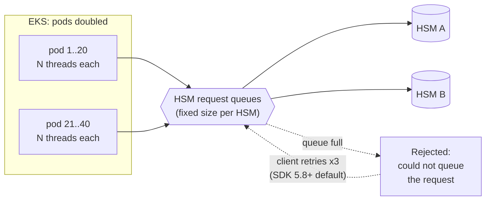
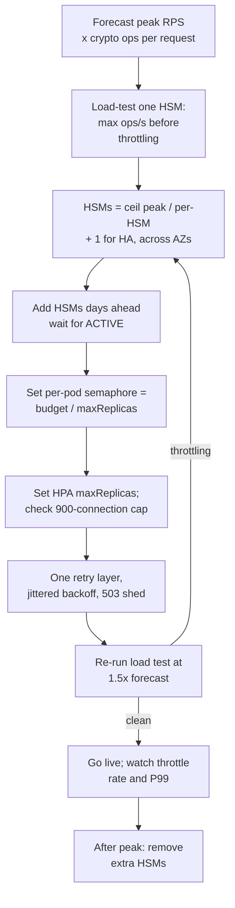

# Doubling EKS Pods Broke CloudHSM: "The HSM could not queue the request for processing"

*Why adding pods ahead of holiday traffic made a CloudHSM-backed API fail more often, and how to scale it properly.*

## Abbreviations

| Abbreviation | Full name |
|---|---|
| HSM | Hardware Security Module |
| EKS | Elastic Kubernetes Service |
| API | Application Programming Interface |
| SDK | Software Development Kit |
| JCE | Java Cryptography Extension |
| PKCS#11 | Public-Key Cryptography Standards #11 (the HSM client API) |
| HPA | Horizontal Pod Autoscaler |
| KEDA | Kubernetes Event-Driven Autoscaling |
| KMS | Key Management Service |
| RPS / TPS | Requests / Transactions Per Second |
| RSA | Rivest–Shamir–Adleman (public-key algorithm) |
| EC / ECDSA | Elliptic Curve / Elliptic Curve Digital Signature Algorithm |
| AZ | Availability Zone |
| P99 | 99th-percentile latency |

---

## 1. The incident

- **System:** a set of APIs on Amazon EKS that sign, encrypt and decrypt through an AWS CloudHSM cluster, using Client SDK 5 (JCE provider in the pods).
- **Change:** ahead of the holiday peak, the operations team **doubled the replica count** of the API deployments (for example 20 → 40 pods).
- **Symptom:** under load, crypto calls start failing with

  ```
  com.amazonaws.cloudhsm.jce.jni.exception.InternalException:
  The HSM could not queue the request for processing
  ```

  PKCS#11 clients see the same condition as `CKR_FUNCTION_FAILED`, with a client log line such as `Received error response code from Server. Response Code: 187`.

The team expected more pods to mean more capacity. Error rates went **up** instead.

## 2. What the error actually means

AWS's troubleshooting guide lists this exact message under **[HSM throttling](https://docs.aws.amazon.com/cloudhsm/latest/userguide/troubleshoot-hsm-throttling.html)**: the workload has gone over the HSMs' processing capacity. Each HSM keeps a bounded queue of pending operations. When the queue is full, the HSM **rejects** new requests instead of letting them wait.

It is a **server-side capacity** signal, not a client, network or authentication fault:

| Not this | Because |
|---|---|
| A connection-limit problem | Hitting the 900-connections-per-cluster cap shows up as connection or login failures when a pod starts, not as a queue rejection in the middle of a request. (Doubling pods does push you toward that cap too; see §4.4.) |
| A networking or security-group fault | The request reached the HSM. The HSM answered "busy". |
| A bug in the new pods | Old pods throw the same error, because they all share one cluster. |

## 3. Root cause: the pods were never the bottleneck



Four effects combine:

1. **Doubling pods doubles the offered concurrency, not the crypto capacity.** Each pod runs a thread pool (Tomcat or Netty workers, for example), and every thread can have one HSM operation in flight. 40 pods × 50 threads = 2,000 concurrent crypto calls against a cluster that was sized for the load 20 pods produced. The HSMs' throughput is fixed by **HSM count, instance type and algorithm**, and kubectl doesn't change any of those.
2. **Scaling the client tier removes the natural back-pressure.** Before the change, requests queued in the pods (in thread pools and on the load balancer), which kept HSM demand bounded. With twice the pods, more requests are admitted at once and the queueing moves to the HSM. The HSM's queue is small and **fails fast** when full.
3. **Retries amplify the overload.** Client SDK 5.8.0 and later retry throttled operations automatically ([`standard` retry mode](https://docs.aws.amazon.com/cloudhsm/latest/userguide/java-lib-configs-retry.html), exponential backoff, up to three attempts). Application-level retries, Resilience4j retries and upstream client retries then stack on top of that. At saturation, each rejected request can come back several times, so the HSMs receive more work exactly when they have no room for it: a **retry storm**.
4. **Load may sit on one HSM.** **Session keys** (non-token, created per session) exist on only one HSM, so every operation that uses them runs there, however many HSMs the cluster has. Only **token keys** are synchronized and load-balanced across HSMs. If the signing key was imported or generated as a session key, a 3-HSM cluster performs like a 1-HSM cluster for that key.

### Worked example

| | Before | After doubling pods |
|---|---|---|
| Pods × worker threads | 20 × 50 | 40 × 50 |
| Peak signing demand (RSA-2048) | ~1,800 signs/s | the holiday peak, ~3,500 signs/s, can now all reach the HSMs at once |
| Cluster | 2 × `hsm2m.medium` | unchanged |
| Approximate cluster capacity* | ~1,600–1,700 RSA-2048 signs/s | unchanged |
| Outcome | slow at peak but mostly working (requests waited in the pods) | HSM queues overflow → "could not queue" → retries → higher error rate |

\*Scaled from AWS's [published benchmark](https://docs.aws.amazon.com/cloudhsm/latest/userguide/performance.html) (≈ 5,000 RSA-2048 signs/s for 6 × `hsm2m.medium`). Your rates depend on algorithm, key size, payload and client layout. **Load-test for your own numbers.**

## 4. Fixes

Work through these in order. The first two remove the immediate errors, and the rest make the next peak safe.

### 4.1 Add HSMs. This is the actual capacity lever.

AWS's stated resolution for HSM throttling is to **[add HSMs to the cluster](https://docs.aws.amazon.com/cloudhsm/latest/userguide/add-remove-hsm.html)**. A token-key workload scales roughly linearly with HSM count.

```bash
# Add an HSM in another AZ; repeat per HSM needed
aws cloudhsmv2 create-hsm \
  --cluster-id cluster-xxxxxxxx \
  --availability-zone ap-southeast-1b

# Wait until State = ACTIVE before the traffic arrives
aws cloudhsmv2 describe-clusters \
  --filters clusterIds=cluster-xxxxxxxx \
  --query 'Clusters[0].Hsms[].{id:HsmId,az:AvailabilityZone,state:State}'
```

- **Size it as:** HSMs needed = ⌈peak ops/s ÷ measured ops/s per HSM⌉ **+ 1** for high availability, spread across AZs. The +1 means the cluster still meets peak load if one HSM or AZ is lost.
- **Pre-scale days before the event, not during it.** A new HSM has to be provisioned and then synchronized with the cluster's keys and users, and how long that takes grows with the number of keys. Clusters don't autoscale HSMs.
- Check the account quota for **HSMs per cluster** in [CloudHSM quotas](https://docs.aws.amazon.com/cloudhsm/latest/userguide/limits.html) before committing to a plan.
- HSMs are billed per hour. Remove the extra ones after the peak.

### 4.2 Cap concurrency to HSM capacity (a bulkhead)

Stop each pod from sending more in-flight crypto calls than the cluster can take. The cluster-wide budget is roughly *per-HSM concurrency that keeps queues healthy × HSM count*, measured in the load test. Divide it by the maximum replica count:

```java
// One permit pool per pod, sized: clusterBudget / maxReplicas
private final Semaphore hsmPermits = new Semaphore(Integer.getInteger("hsm.maxInFlight", 16));

public byte[] sign(byte[] data) throws Exception {
    if (!hsmPermits.tryAcquire(200, TimeUnit.MILLISECONDS)) {
        throw new ServiceBusyException(); // -> HTTP 503 + Retry-After, fail fast
    }
    try {
        Signature s = Signature.getInstance("SHA256withRSA", "CloudHSM");
        s.initSign(privateKey);
        s.update(data);
        return s.sign();
    } finally {
        hsmPermits.release();
    }
}
```

This puts queueing back in the pods, where you can see and control it. Excess load is rejected quickly with a 503 instead of becoming slow failures inside the HSM. **When you change replica counts, recompute the per-pod limit.** That step was missing in this incident.

### 4.3 Tame retries

- Allow **one** retry layer per call path. The SDK already retries throttling (5.8.0+). Don't wrap it in another tight retry loop.
- Any application-level retry must use **exponential backoff with full jitter** and a **retry budget** (for example, retries ≤ 10% of requests), so a saturated HSM isn't hit again in lockstep.
- Upstream, return `503` with `Retry-After` so callers back off as well.

### 4.4 Make the autoscaler HSM-aware

- Put a **ceiling on `maxReplicas`** in the HPA, derived from the HSM budget (§4.2) and the connection cap: with Client SDK 5, **each application process holds one connection**, and a cluster allows **900**. Count every process, including rolling-update surge pods, other services and batch jobs.
- Scale pods on **CPU or request rate only for the non-crypto part** of the work. Crypto throughput scales only with HSMs. If you use KEDA or custom metrics, include an HSM-side signal (crypto P99 latency, throttle-error rate) as a **stop condition**, not a reason to scale out.

```yaml
apiVersion: autoscaling/v2
kind: HorizontalPodAutoscaler
metadata: { name: payment-api }
spec:
  scaleTargetRef: { apiVersion: apps/v1, kind: Deployment, name: payment-api }
  minReplicas: 20
  maxReplicas: 40          # = f(HSM count); raise only together with HSMs
  behavior:
    scaleUp:
      policies: [{ type: Percent, value: 25, periodSeconds: 60 }]  # no 2x jumps
  metrics:
    - type: Resource
      resource: { name: cpu, target: { type: Utilization, averageUtilization: 60 } }
```

### 4.5 Make sure the load is spread across HSMs

- Use **token (persistent) keys** for production keys. Then the SDK can load-balance operations across every HSM in the cluster.
- Confirm that the client config lists the cluster and that the pods can reach **every** HSM ENI (elastic network interface): check security groups and the subnets in each AZ. An HSM the pods can't reach doesn't add capacity.

### 4.6 Send fewer operations to the HSM

The cheapest HSM operation is the one you never send:

| Technique | Effect |
|---|---|
| **Verify signatures in software** | Verification needs only the **public** key. Export it once and verify with the standard JCE provider. That removes the HSM from about half of a typical sign-and-verify workload. |
| **Envelope encryption + data-key caching** | The HSM only wraps and unwraps data keys. Bulk encryption runs in the pod with a cached data key, which cuts HSM calls by orders of magnitude (subject to your key-handling policy). |
| **Cache idempotent results** | For example, re-signing the same token or decrypting the same configuration secret. |
| **Batch asynchronous work** | Non-interactive signing goes through a queue to a small consumer fleet with capped concurrency, which smooths peaks. |
| **Prefer cheaper algorithms where allowed** | ECDSA P-256 signing usually gets more ops/s per HSM than RSA-2048 (see AWS's benchmark table). |

Where symmetric encryption alone is enough and the rate fits, **KMS with a CloudHSM key store** moves connection and session management to KMS. Note its own fixed per-key-store request rate. See [AWS Lambda and Connection-Bound Backends](../lambda/lambda-connection-exhaustion.md) for that option and the connection-cap details.

## 5. Observability: know before customers do

| Signal | Where | Alert on |
|---|---|---|
| Throttle-error count ("could not queue", `CKR_FUNCTION_FAILED`, code 187) | App logs → metric filter | any sustained non-zero rate |
| Crypto-call latency P50/P99, in-flight permits, permit-rejects | App metrics (Micrometer/Prometheus) | P99 climbing, or permits saturated |
| `HsmSessionCount`, `HsmUnhealthy` | CloudWatch `AWS/CloudHSM` | session count near the limit, any unhealthy HSM |
| Client connections (≈ pod processes) | Pod count × processes per pod | > 80% of 900 |

CloudHSM doesn't publish an "HSM busy %" metric, so the **client-side** throttle rate and latency are your primary saturation signals. Build dashboards from them.

## 6. Holiday readiness runbook



**Immediate actions if this is happening right now:**

1. Add one or two HSMs to the cluster (`create-hsm`). It's the only change that adds capacity.
2. Meanwhile, **scale the pods back** to the previous count, or lower worker threads, so less work reaches the HSMs and the retry storm stops. Fewer pods give *fewer* errors here.
3. Disable any extra application-level retry loops on crypto calls.
4. Once the new HSMs are `ACTIVE` and taking traffic, bring the pod count back up gradually and watch the throttle-error rate.

## 7. Conclusions

1. **"The HSM could not queue the request for processing" means HSM throttling.** The cluster's crypto capacity is exhausted, and the HSM is rejecting work.
2. **Pods are clients, not capacity.** Doubling them doubled the concurrent demand on a fixed-size cluster, moved queueing from the pods into the HSMs, and set off a retry storm.
3. **Capacity comes from HSM count** (token keys, spread across AZs, sized by load test + 1 for HA), and it has to be added **before** the peak.
4. **Tie client concurrency to HSM capacity**: per-pod semaphores, an HPA `maxReplicas` ceiling, one jittered retry layer, and fast 503 shedding.
5. **Send fewer operations to the HSM**: verify in software, use envelope encryption with data-key caching, cache and batch. These give the most headroom per dollar.

*Error strings, retry behavior and scaling guidance were checked against the AWS CloudHSM documentation (HSM throttling troubleshooting, Client SDK 5 retry configuration, performance, quotas) on 2026-11-22. Throughput figures are illustrative. Load-test your own workload.*
