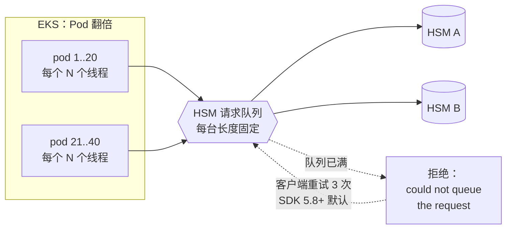
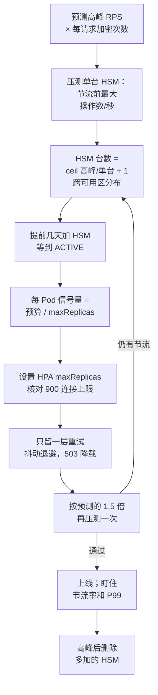

# EKS Pod 翻倍后 CloudHSM 报错："The HSM could not queue the request for processing"

*为应对节日流量把 Pod 数翻倍后，依赖 CloudHSM 的 API 反而错误率飙升：原因是什么，又该怎样正确扩容。*

> English version: [Doubling EKS Pods Broke CloudHSM](./cloudhsm-throttling-on-eks.en.md)

## 缩写对照表

| 缩写 | 英文全称 | 中文 |
|---|---|---|
| HSM | Hardware Security Module | 硬件安全模块 |
| EKS | Elastic Kubernetes Service | 亚马逊托管 Kubernetes 服务 |
| API | Application Programming Interface | 应用程序编程接口 |
| SDK | Software Development Kit | 软件开发工具包 |
| JCE | Java Cryptography Extension | Java 加密扩展 |
| PKCS#11 | Public-Key Cryptography Standards #11 | 公钥密码标准 #11（HSM 客户端 API） |
| HPA | Horizontal Pod Autoscaler | Pod 水平自动扩缩容 |
| KEDA | Kubernetes Event-Driven Autoscaling | Kubernetes 事件驱动自动扩缩容 |
| KMS | Key Management Service | 密钥管理服务 |
| HA | High Availability | 高可用 |
| RSA | Rivest–Shamir–Adleman | RSA 公钥算法 |
| ECDSA | Elliptic Curve Digital Signature Algorithm | 椭圆曲线数字签名算法 |
| AZ | Availability Zone | 可用区 |
| ENI | Elastic Network Interface | 弹性网卡 |
| P99 | 99th percentile | 第 99 百分位延迟 |

---

## 1. 事故经过

- **系统**：一组跑在 Amazon EKS 上的 API，签名、加密、解密都调用同一个 AWS CloudHSM 集群；Pod 内使用 Client SDK 5（JCE provider）。
- **变更**：为迎接节日高峰，运维团队把这些 Deployment 的**副本数翻倍**（例如 20 → 40 个 Pod）。
- **现象**：压力一上来，加密调用开始报错：

  ```
  com.amazonaws.cloudhsm.jce.jni.exception.InternalException:
  The HSM could not queue the request for processing
  ```

  PKCS#11 客户端看到的是同一情况的另一种形式：`CKR_FUNCTION_FAILED`，客户端日志里有 `Received error response code from Server. Response Code: 187`。

团队的预期是"Pod 多了，容量就多了"，结果错误率反而**上升**。

## 2. 这个错误到底是什么意思

AWS 的故障排查文档把这句报错原文归在 **[HSM 节流（HSM throttling）](https://docs.aws.amazon.com/zh_cn/cloudhsm/latest/userguide/troubleshoot-hsm-throttling.html)** 之下：负载已经超出 HSM 的处理能力。每台 HSM 内部维护一个长度有限的待处理请求队列，队列满了就直接**拒绝**新请求，而不是让它排队等待。

所以它是一个**服务端容量信号**，不是客户端、网络或认证故障：

| 不是这个问题 | 原因 |
|---|---|
| 连接数上限 | 触到"每集群 900 个客户端连接"的上限时，表现为 Pod 启动时连接或登录失败，而不是请求处理中途被队列拒绝。（不过 Pod 翻倍同样会把你推向这条上限，见 §4.4。） |
| 网络或安全组问题 | 请求已经到达 HSM，是 HSM 回答了"忙"。 |
| 新 Pod 的代码缺陷 | 老 Pod 也报同样的错，因为大家共用一个集群。 |

## 3. 根因：瓶颈从来不在 Pod



四个因素叠加在一起：

1. **Pod 翻倍，翻倍的是并发需求，不是加密算力。** 每个 Pod 有一个线程池（Tomcat 或 Netty 工作线程等），每个线程都可能有一个 HSM 操作在途。40 个 Pod × 50 个线程 = 2,000 个并发加密调用，打向一个只按 20 个 Pod 负载规划的集群。HSM 吞吐只由 **HSM 台数、实例类型和算法**决定，`kubectl scale` 改变不了其中任何一项。
2. **扩容客户端层等于拆掉了天然的背压。** 变更前，请求在 Pod 内部（线程池、负载均衡器）排队，HSM 侧的需求因此有上限。Pod 翻倍后同时放进来的请求变多，排队点转移到了 HSM。而 HSM 的队列很短，满了就**快速失败**。
3. **重试放大过载。** Client SDK 5.8.0 及以上版本默认会自动重试被节流的操作（[`standard` 重试模式](https://docs.aws.amazon.com/zh_cn/cloudhsm/latest/userguide/java-lib-configs-retry.html)，指数退避，最多 3 次）。应用层的重试、Resilience4j 重试、上游调用方的重试再叠加上去。在饱和点上，每个被拒的请求都可能回来好几次，HSM 恰恰在最没有余力的时候收到更多工作，形成**重试风暴**。
4. **负载可能全压在一台 HSM 上。** **会话密钥**（session key，非 token、按会话创建）只存在于一台 HSM 上，用它的所有操作都在那台机器上执行，集群有几台 HSM 都没用。只有 **token 密钥**会在集群内同步并在各 HSM 间负载均衡。如果签名密钥是以会话密钥的方式导入或生成的，那么对这把密钥来说，3 台 HSM 的集群只有 1 台的性能。

### 算一笔账

| | 变更前 | Pod 翻倍后 |
|---|---|---|
| Pod 数 × 工作线程 | 20 × 50 | 40 × 50 |
| 高峰签名需求（RSA-2048） | 约 1,800 次/秒 | 节日高峰约 3,500 次/秒，现在能同时全部打到 HSM |
| 集群 | 2 × `hsm2m.medium` | 不变 |
| 集群大致容量* | 约 1,600–1,700 次 RSA-2048 签名/秒 | 不变 |
| 结果 | 高峰时偏慢，但基本可用（请求在 Pod 里等待） | HSM 队列溢出 → "could not queue" → 重试 → 错误率更高 |

\*按 AWS [公开基准](https://docs.aws.amazon.com/zh_cn/cloudhsm/latest/userguide/performance.html)（6 × `hsm2m.medium` 约 5,000 次 RSA-2048 签名/秒）等比例估算。实际数值取决于算法、密钥长度、数据大小和客户端部署方式，**请用压测得出你自己的数字**。

## 4. 解决方案

按顺序推进：前两步消除眼前的报错，其余几步保证下一次高峰安全。

### 4.1 加 HSM：这才是真正的容量杠杆

AWS 对 HSM 节流给出的解决办法就是**[向集群添加 HSM](https://docs.aws.amazon.com/zh_cn/cloudhsm/latest/userguide/add-remove-hsm.html)**。使用 token 密钥的负载，吞吐大致随 HSM 台数线性增长。

```bash
# 在另一个可用区添加一台 HSM；需要几台就执行几次
aws cloudhsmv2 create-hsm \
  --cluster-id cluster-xxxxxxxx \
  --availability-zone ap-southeast-1b

# 等到 State = ACTIVE 再迎接流量
aws cloudhsmv2 describe-clusters \
  --filters clusterIds=cluster-xxxxxxxx \
  --query 'Clusters[0].Hsms[].{id:HsmId,az:AvailabilityZone,state:State}'
```

- **容量公式**：所需 HSM 台数 = ⌈高峰操作数/秒 ÷ 实测单台 HSM 操作数/秒⌉ **+ 1**（用于高可用），分布在多个可用区。多出的这一台保证损失一台 HSM 或一个可用区时仍能扛住高峰。
- **提前几天扩容，不要等到高峰当天。** 新 HSM 需要先创建，再同步集群里的密钥和用户，耗时随密钥数量增长。CloudHSM 集群不会自动扩缩 HSM。
- 制定计划前，先在 [CloudHSM 配额](https://docs.aws.amazon.com/zh_cn/cloudhsm/latest/userguide/limits.html)里确认账号的**每集群 HSM 数量**上限。
- HSM 按小时计费，高峰过后记得把多加的删掉。

### 4.2 按 HSM 容量限制并发（舱壁模式）

不要让每个 Pod 发出超过集群承受能力的在途加密调用。集群级预算大致是*单台 HSM 能保持队列健康的并发数 × HSM 台数*（压测得出），再除以最大副本数：

```java
// 每个 Pod 一个许可池，大小 = 集群预算 / maxReplicas
private final Semaphore hsmPermits = new Semaphore(Integer.getInteger("hsm.maxInFlight", 16));

public byte[] sign(byte[] data) throws Exception {
    if (!hsmPermits.tryAcquire(200, TimeUnit.MILLISECONDS)) {
        throw new ServiceBusyException(); // -> HTTP 503 + Retry-After，快速失败
    }
    try {
        Signature s = Signature.getInstance("SHA256withRSA", "CloudHSM");
        s.initSign(privateKey);
        s.update(data);
        return s.sign();
    } finally {
        hsmPermits.release();
    }
}
```

这样排队又回到了 Pod 里，看得见、管得住。多余的负载以 503 快速拒绝，而不是在 HSM 内部变成缓慢的失败。**调整副本数时，一定要重新计算每个 Pod 的上限。** 这次事故缺的就是这一步。

### 4.3 管住重试

- 每条调用链只保留**一层**重试。SDK 已经会重试节流错误（5.8.0+），不要再在外面套一层紧凑的重试循环。
- 应用层如果要重试，必须用**指数退避 + 全抖动（full jitter）**，并设**重试预算**（例如重试量 ≤ 请求量的 10%），避免所有客户端齐步重打一个已经饱和的 HSM。
- 对上游返回 `503` 加 `Retry-After`，让调用方也退避。

### 4.4 让自动扩缩容感知 HSM

- 给 HPA 的 **`maxReplicas` 设上限**，由 HSM 预算（§4.2）和连接数上限共同决定：Client SDK 5 下**每个应用进程占用一个连接**，每个集群最多 **900** 个。所有进程都要算进去，包括滚动更新时多出的 surge Pod、其他服务和批处理任务。
- 用 **CPU 或请求量**扩容，只能解决工作中的**非加密部分**，加密吞吐只能靠加 HSM。如果使用 KEDA 或自定义指标，要把 HSM 侧信号（加密调用 P99、节流错误率）当作**停止扩容的条件**，而不是继续扩容的理由。

```yaml
apiVersion: autoscaling/v2
kind: HorizontalPodAutoscaler
metadata: { name: payment-api }
spec:
  scaleTargetRef: { apiVersion: apps/v1, kind: Deployment, name: payment-api }
  minReplicas: 20
  maxReplicas: 40          # 由 HSM 台数决定；只能和 HSM 一起上调
  behavior:
    scaleUp:
      policies: [{ type: Percent, value: 25, periodSeconds: 60 }]  # 禁止一步翻倍
  metrics:
    - type: Resource
      resource: { name: cpu, target: { type: Utilization, averageUtilization: 60 } }
```

### 4.5 确保负载分摊到所有 HSM

- 生产密钥使用 **token（持久）密钥**，SDK 才能把操作均衡到集群里的每一台 HSM。
- 确认客户端配置指向整个集群，且 Pod 能访问**每一台** HSM 的 ENI：检查各可用区的安全组和子网。Pod 访问不到的 HSM 不贡献容量。

### 4.6 减少发往 HSM 的操作

最便宜的 HSM 操作，是根本不发出去的那一次：

| 手段 | 效果 |
|---|---|
| **在软件里验签** | 验签只需要**公钥**。导出一次公钥，用标准 JCE provider 验证，典型的"签名 + 验签"负载里约一半的 HSM 调用就省掉了。 |
| **信封加密 + 数据密钥缓存** | HSM 只负责包装和解包数据密钥，批量加密在 Pod 内用缓存的数据密钥完成，HSM 调用量可下降几个数量级（需符合你的密钥管理策略）。 |
| **缓存幂等结果** | 比如重复签发同一个 token、重复解密同一份配置密文。 |
| **异步任务批量处理** | 非交互的签名请求走队列，交给并发受限的小规模消费者，削平峰值。 |
| **在允许的前提下选更便宜的算法** | ECDSA P-256 签名通常比 RSA-2048 单台 HSM 每秒能做更多次（见 AWS 基准表）。 |

如果只需要对称加密、且速率在范围内，可以改用 **KMS + CloudHSM 密钥库**，由 KMS 负责连接和会话管理。注意它自身有固定的每密钥库请求速率上限。这个方案和连接数上限的细节见 [AWS Lambda and Connection-Bound Backends](../lambda/lambda-connection-exhaustion.md)。

## 5. 可观测性：赶在用户之前发现

| 信号 | 来源 | 告警条件 |
|---|---|---|
| 节流错误数（"could not queue"、`CKR_FUNCTION_FAILED`、code 187） | 应用日志 → 指标过滤器 | 持续非零 |
| 加密调用 P50/P99 延迟、在途许可数、许可拒绝数 | 应用指标（Micrometer/Prometheus） | P99 持续上升，或许可被占满 |
| `HsmSessionCount`、`HsmUnhealthy` | CloudWatch `AWS/CloudHSM` | 会话数接近上限，或出现不健康的 HSM |
| 客户端连接数（≈ Pod 进程数） | Pod 数 × 每 Pod 进程数 | 超过 900 的 80% |

CloudHSM 不提供"HSM 繁忙百分比"这类指标，所以**客户端侧**的节流错误率和延迟就是最主要的饱和信号，仪表盘要围绕它们来建。

## 6. 节日备战清单



**如果故障正在发生，立即这样做：**

1. 给集群加一到两台 HSM（`create-hsm`）。这是唯一能增加容量的操作。
2. 同时把 Pod **缩回**原来的数量，或调低工作线程数，减少打到 HSM 的工作量，止住重试风暴。在这种情况下，Pod 越少，错误越少。
3. 关掉加密调用外层多余的应用级重试。
4. 新 HSM 变成 `ACTIVE` 并开始承接流量后，再逐步把 Pod 加回去，同时观察节流错误率。

## 7. 结论

1. **"The HSM could not queue the request for processing" 就是 HSM 节流。** 集群的加密算力已经耗尽，HSM 在拒绝新的工作。
2. **Pod 是客户端，不是容量。** Pod 翻倍让固定规模的集群承受了翻倍的并发需求，把排队从 Pod 挪进了 HSM，还引发了重试风暴。
3. **容量来自 HSM 台数**：使用 token 密钥、跨可用区分布、按压测结果 + 1 台高可用来规划，并且要在高峰**之前**加好。
4. **把客户端并发和 HSM 容量绑定**：每 Pod 信号量、HPA `maxReplicas` 上限、只留一层带抖动的重试、用 503 快速降载。
5. **减少发往 HSM 的操作**：软件验签、信封加密配合数据密钥缓存、缓存与批处理，这是单位成本下最能腾出余量的手段。

*报错原文、重试行为和扩容建议已于 2026-11-22 对照 AWS CloudHSM 文档（HSM 节流排查、Client SDK 5 重试配置、性能、配额）核实。文中吞吐数字仅作示意，请以你自己的压测结果为准。*
