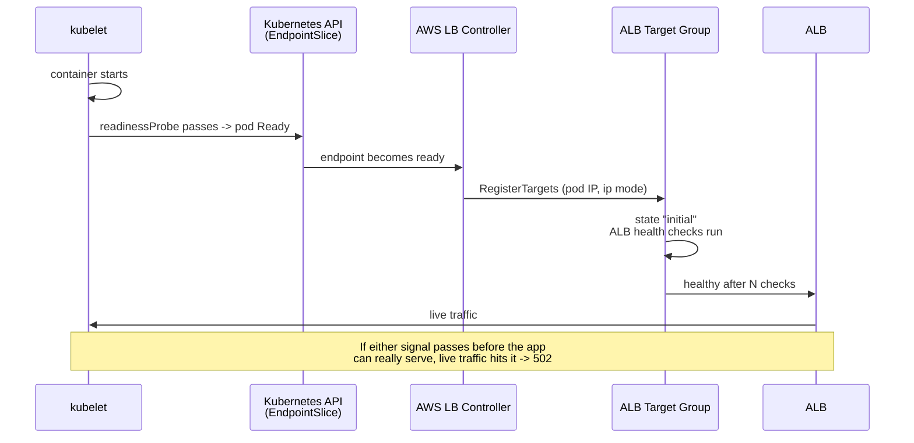
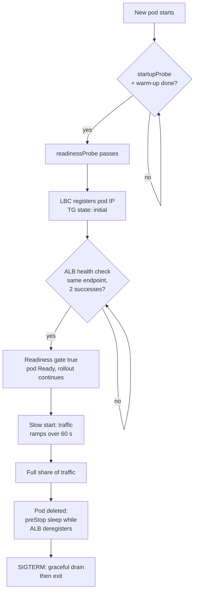

# 502s When New Pods Join an ALB Before They Can Serve

*Why the AWS Load Balancer Controller can send traffic to pods that aren't ready yet, and how to make "registered" mean "ready".*

> 中文版：[新 Pod 尚未就绪就被挂到 ALB 上导致 502](./alb-502-new-pods-not-ready.zh.md)

## Abbreviations

| Abbreviation | Full name |
|---|---|
| ALB | Application Load Balancer |
| EKS | Elastic Kubernetes Service |
| LBC | AWS Load Balancer Controller |
| TG | Target Group |
| HPA | Horizontal Pod Autoscaler |
| HSM | Hardware Security Module |
| JVM | Java Virtual Machine |
| JIT | Just-In-Time (compilation) |
| SIGTERM | Signal Terminate (the polite shutdown signal) |
| RPS | Requests Per Second |

---

## 1. The incident

After the pod count was raised for holiday traffic (see [Doubling EKS Pods Broke CloudHSM](../cloudhsm/cloudhsm-throttling-on-eks.en.md)), clients got **HTTP 502 Bad Gateway** errors every time new pods came up. The pattern:

- The 502 spikes line up with pods being created, by HPA scale-out or by a rolling deployment.
- In the ALB access logs, the failing requests have `elb_status_code = 502`, a `target:port` that belongs to a **new pod**, and `target_status_code = -`. That means the ALB opened a connection to the pod and got a refused or reset connection, or a malformed response. The application never produced an HTTP response.
- After a minute or two the errors stop, without anyone doing anything.

"The ALB sent traffic to pods that weren't ready to serve" is the right description. The work is in finding out **why the system thought they were ready.**

## 2. How a pod becomes an ALB target

With the LBC, the decision to send a pod traffic passes through **two separate health signals** that nobody keeps in sync for you:



| Signal | Who evaluates it | What it controls |
|---|---|---|
| Kubernetes **readinessProbe** | kubelet | Whether the pod's endpoint is *ready*, and so whether the LBC registers it. Also whether the Deployment counts the pod as available. |
| ALB **target-group health check** | the ALB | Whether the ALB routes requests to the registered target |

502s come from one of these signals turning green too early, or from the two disagreeing during a rollout.

## 3. Root causes, most common first

### 3.1 The readiness probe is weaker than "able to serve"

- **No readinessProbe at all.** The pod is Ready as soon as the container starts, so the LBC registers it right away.
- **The probe checks something trivial**, such as a TCP port check or a static `/` page, which passes while the app is still loading: Spring context still starting, connection pools empty, HSM login not done, caches cold.
- **The probe passes before the listener is actually accepting traffic**, for example a sidecar answers the probe instead of the app.

### 3.2 The ALB health check is weaker than "able to serve"

The LBC defaults are generic: path `/`, traffic port, `200` success code. If `/` returns 200 from a static handler, the ALB marks the target healthy before the real request paths work. If the health check path, port or protocol doesn't match the app, you get the opposite failure: targets stay unhealthy, and when **every** target is unhealthy the ALB **fails open** and routes to all of them, so you get 502s anyway.

### 3.3 "Healthy" isn't the same as "warm"

The JVM is technically up, but the first requests pay for class loading, JIT compilation, TLS handshakes, connection pool fill and the first HSM session. A full share of round-robin traffic arrives on a cold pod at once. Latency jumps, worker threads run out, and the pod resets connections or misses the ALB timeout, which also shows up as 502 (or 504).

### 3.4 Rollout races: Kubernetes and the ALB disagree

Without **pod readiness gates**, Kubernetes treats a new pod as *available* as soon as its readinessProbe passes, while the ALB is still running health checks on it (`initial`). The Deployment then **terminates old pods** that are still serving, so for a while the ALB has few or no healthy targets. That gives 502s or 503s, and possibly the fail-open behavior above.

### 3.5 Instance mode adds an extra hop

With `target-type: instance`, the ALB targets **nodes** on a NodePort, and kube-proxy forwards the request to any ready endpoint, possibly on another node. The ALB can't see pod readiness at all, and readiness gates aren't supported. Prefer `ip` mode with the VPC CNI.

### 3.6 The other side: pods leaving

The same 502 pattern appears on **scale-in and rollouts** when a pod is killed before the ALB has stopped sending to it. Deregistration from the ALB and SIGTERM to the container happen **in parallel**, so for a few seconds the ALB still sends requests to a process that is shutting down. It usually shows up together with the startup problem, so fix both.

## 4. Fixes

### 4.1 A readiness probe that means "can serve real traffic"

Point the probe at an endpoint that returns 200 only after startup has finished: the context is loaded, pools are filled, the HSM is logged in, and warm-up is done. Use a **startupProbe** for the slow start, so the liveness probe doesn't restart a pod that is still booting.

```yaml
containers:
  - name: payment-api
    ports: [{ containerPort: 8080 }]
    startupProbe:                # gives slow starts up to 5 min, then liveness takes over
      httpGet: { path: /actuator/health/readiness, port: 8080 }
      periodSeconds: 5
      failureThreshold: 60
    readinessProbe:
      httpGet: { path: /actuator/health/readiness, port: 8080 }
      periodSeconds: 5
      failureThreshold: 2
    livenessProbe:               # liveness: process is alive. Never include downstreams here.
      httpGet: { path: /actuator/health/liveness, port: 8080 }
      periodSeconds: 10
      failureThreshold: 3
```

For Spring Boot, the `readiness` group should turn UP only after `ApplicationReadyEvent` and any custom warm-up (an `ApplicationRunner` that runs a few HSM operations and pre-fills the connection pools).

**Be careful with downstream dependencies in readiness.** Checking startup-time dependencies once (the HSM login worked) is good. Failing readiness on *every* transient downstream error is risky: one HSM or database blip can mark every pod unready at the same time, which takes the whole service out or makes the ALB fail open.

### 4.2 Make the ALB health check match

Point the ALB at the **same readiness endpoint**, and require more than one success:

```yaml
apiVersion: networking.k8s.io/v1
kind: Ingress
metadata:
  name: payment-api
  annotations:
    alb.ingress.kubernetes.io/target-type: ip
    alb.ingress.kubernetes.io/healthcheck-path: /actuator/health/readiness
    alb.ingress.kubernetes.io/healthcheck-port: traffic-port
    alb.ingress.kubernetes.io/success-codes: "200"
    alb.ingress.kubernetes.io/healthcheck-interval-seconds: "10"
    alb.ingress.kubernetes.io/healthcheck-timeout-seconds: "5"
    alb.ingress.kubernetes.io/healthy-threshold-count: "2"
    alb.ingress.kubernetes.io/unhealthy-threshold-count: "2"
    alb.ingress.kubernetes.io/target-group-attributes: >-
      slow_start.duration_seconds=60,
      deregistration_delay.timeout_seconds=30
```

If you use a `Service` of type `LoadBalancer` (an NLB) or `TargetGroupBinding`, the same settings go in the matching `service.beta.kubernetes.io/aws-load-balancer-healthcheck-*` annotations or on the target group itself.

### 4.3 Turn on pod readiness gates (the key LBC feature)

Label the **namespace**, and the LBC's webhook adds a readiness gate to each new pod. The pod isn't **Ready** until its target is **healthy in the ALB target group**:

```bash
kubectl label namespace payments elbv2.k8s.aws/pod-readiness-gate-inject=enabled
kubectl rollout restart deployment/payment-api -n payments   # gates are injected only at pod creation
```

```bash
# Check: the pod shows a condition like target-health.elbv2.k8s.aws/<tg-name>
kubectl get pod <pod> -n payments -o jsonpath='{.status.conditions}' | jq
```

Now the Deployment's rollout waits until the ALB itself confirms the new pod is healthy before it removes an old pod. That closes the race in §3.4. Requirements: **`ip` target type**, the LBC managing that target group (Ingress, Service or TargetGroupBinding), and pods created after the label was added ([LBC docs](https://kubernetes-sigs.github.io/aws-load-balancer-controller/v2.8/deploy/pod_readiness_gate/)).

### 4.4 Slow start for cold pods

`slow_start.duration_seconds` (30–900 s) gives a newly healthy target a share of traffic that grows over the window, instead of a full share all at once. That fixes §3.3 for JVM-style warm-up. One restriction: **slow start works only with the round-robin algorithm.** It can't be combined with *least outstanding requests* or *weighted random* ([ALB target group attributes](https://docs.aws.amazon.com/elasticloadbalancing/latest/application/edit-target-group-attributes.html)). If you use least outstanding requests, rely on proper warm-up before readiness (§4.1) instead.

### 4.5 Rollout strategy

```yaml
spec:
  minReadySeconds: 15          # stay Ready for 15 s before counting as available
  strategy:
    rollingUpdate:
      maxSurge: 25%
      maxUnavailable: 0        # never go below current capacity during a rollout
```

For scale-out, a gentle HPA `scaleUp` policy (for example +25% per minute rather than doubling at once) keeps the share of cold pods small at any moment.

### 4.6 Graceful shutdown

```yaml
spec:
  terminationGracePeriodSeconds: 60     # > preStop sleep + app drain time
  containers:
    - name: payment-api
      lifecycle:
        preStop:
          exec: { command: ["sh", "-c", "sleep 20"] }   # wait while the ALB deregisters the pod
```

- The **preStop sleep** keeps the pod serving while the ALB finishes deregistering it. It should be roughly as long as the LBC reconcile time plus the ALB's propagation time. 15–30 s is typical.
- Set **`deregistration_delay.timeout_seconds`** to at least your longest normal request, and shorter than the grace period.
- The app should finish in-flight requests on SIGTERM. For Spring Boot, set `server.shutdown=graceful`.
- Set the app's **HTTP keep-alive idle timeout higher than the ALB's idle timeout** (60 s by default). Otherwise the app closes connections the ALB still thinks are open, which causes random 502s that have nothing to do with pod startup.

## 5. Diagnose before fixing

| Check | Command or source | What it tells you |
|---|---|---|
| Who returned the 502 | CloudWatch `HTTPCode_ELB_502_Count` vs `HTTPCode_Target_5XX_Count` | ELB-generated: connection or protocol failure to the target. Target-generated: the app itself returned 5xx. |
| Which targets were involved | ALB access logs: `target:port`, `target_status_code`, `target_processing_time` | `-` / `-1` on new pod IPs at startup means the pod was registered before it could serve |
| Target state over time | `aws elbv2 describe-target-health --target-group-arn …` | `initial`, `healthy`, `unhealthy` (with a reason such as `Target.FailedHealthChecks`), `draining` |
| Pod vs target timing | `kubectl get events`, pod conditions, LBC logs | Was the pod Ready, or a target, before the app logged "started"? |
| Health endpoint honesty | `kubectl exec … curl -s localhost:8080/actuator/health/readiness` during startup | Does it really return non-200 until the app is ready? |

## 6. Putting it together



**Checklist:**

1. `target-type: ip`, and the namespace labelled for **pod readiness gates**.
2. **readiness = really able to serve**: startup finished, pools filled, HSM logged in, warm-up done. Use a startupProbe for slow boots and keep liveness shallow.
3. The **ALB health check uses the same endpoint**, with a healthy threshold of 2 or more.
4. **Slow start** of 30–120 s (round robin only), or warm-up done inside the readiness gate.
5. Rollout with `maxUnavailable: 0`, `minReadySeconds`, and a gentle HPA scale-up policy.
6. Shutdown with a preStop sleep, a deregistration delay shorter than the grace period, graceful drain, and an app keep-alive timeout longer than the ALB idle timeout.

## 7. Conclusions

1. **A pod gets traffic when two signals agree it's ready**: the Kubernetes readinessProbe (which drives LBC registration) and the ALB health check. 502s mean at least one of them turned green before the app could serve.
2. **Make both signals honest and identical**: one readiness endpoint that turns UP only after startup and warm-up are done, used by both the probe and the ALB.
3. **Pod readiness gates connect the two worlds.** The rollout can't remove old capacity until the ALB has confirmed the new pod is healthy.
4. **Healthy isn't warm.** Ramp traffic with slow start, or warm up before readiness, and scale out gradually.
5. **Fix the shutdown path at the same time.** preStop sleep, deregistration delay, graceful drain and keep-alive timeouts remove the matching 502s on scale-in and rollout.

*LBC readiness-gate behavior and ALB slow-start restrictions were checked against the AWS Load Balancer Controller and Elastic Load Balancing documentation on 2026-11-22. Durations shown are starting points. Tune them from your own startup and request-time measurements.*
