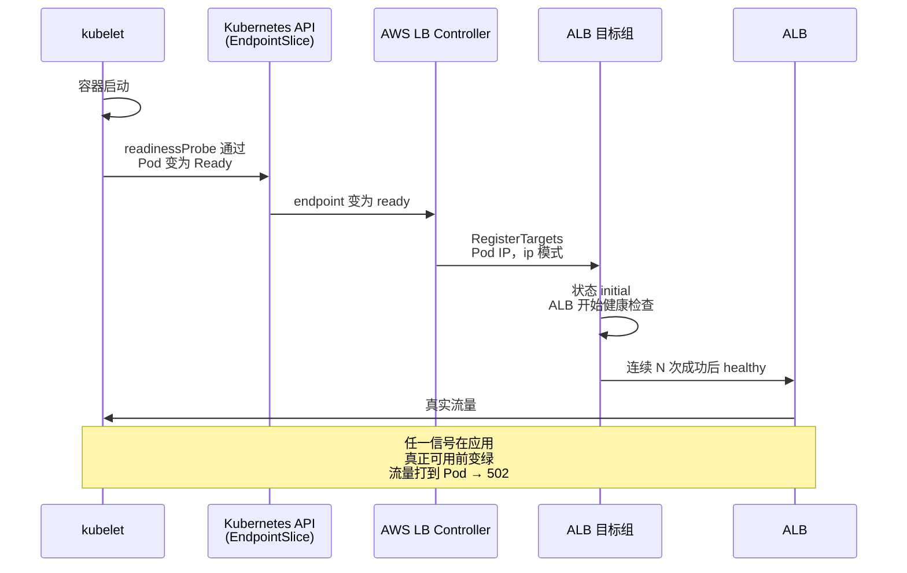
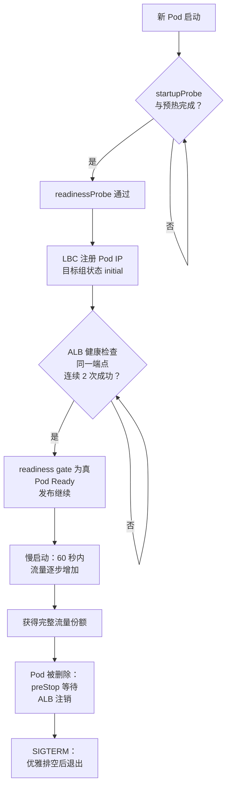

# 新 Pod 尚未就绪就被挂到 ALB 上导致 502

*AWS Load Balancer Controller 为什么会把流量发给还没准备好的 Pod，以及怎样让"已注册"真正等于"已就绪"。*

> English version: [502s When New Pods Join an ALB Before They Can Serve](./alb-502-new-pods-not-ready.en.md)

## 缩写对照表

| 缩写 | 英文全称 | 中文 |
|---|---|---|
| ALB | Application Load Balancer | 应用负载均衡器 |
| NLB | Network Load Balancer | 网络负载均衡器 |
| EKS | Elastic Kubernetes Service | 亚马逊托管 Kubernetes 服务 |
| LBC | AWS Load Balancer Controller | AWS 负载均衡控制器 |
| TG | Target Group | 目标组 |
| HPA | Horizontal Pod Autoscaler | Pod 水平自动扩缩容 |
| HSM | Hardware Security Module | 硬件安全模块 |
| JVM | Java Virtual Machine | Java 虚拟机 |
| JIT | Just-In-Time compilation | 即时编译 |
| CNI | Container Network Interface | 容器网络接口 |
| VPC | Virtual Private Cloud | 虚拟私有云 |
| SIGTERM | Signal Terminate | 终止信号（优雅关闭信号） |

---

## 1. 事故经过

为应对节日流量提高 Pod 数之后（见 [EKS Pod 翻倍后 CloudHSM 报错](../cloudhsm/cloudhsm-throttling-on-eks.zh.md)），每当有新 Pod 启动，客户端就会收到 **HTTP 502 Bad Gateway**。规律如下：

- 502 尖峰与 Pod 创建时间吻合，不论是 HPA 扩容还是滚动发布。
- ALB 访问日志里，失败请求的 `elb_status_code = 502`，`target:port` 属于某个**新 Pod**，`target_status_code = -`。也就是说 ALB 与 Pod 建了连接，却遇到连接被拒、被重置或响应格式错误，应用根本没有返回 HTTP 响应。
- 一两分钟后，错误在无人干预的情况下自行消失。

"ALB 把流量发给了还没准备好的 Pod"这个判断是对的。真正要查的是：**系统为什么认为它们已经准备好了。**

## 2. Pod 是怎样成为 ALB 目标的

在 LBC 下，"要不要给这个 Pod 发流量"要经过**两个相互独立的健康信号**，而且没有人替你保证它们一致：



| 信号 | 由谁判断 | 决定什么 |
|---|---|---|
| Kubernetes **readinessProbe** | kubelet | Pod 的 endpoint 是否 *ready*，进而决定 LBC 是否注册它；同时决定 Deployment 是否把这个 Pod 算作可用 |
| ALB **目标组健康检查** | ALB | ALB 是否把请求转发给已注册的目标 |

502 的来源，要么是其中一个信号过早变绿，要么是滚动发布期间两个信号对不上。

## 3. 根因（按常见程度排序）

### 3.1 readinessProbe 比"能处理请求"宽松

- **根本没配 readinessProbe。** 容器一启动 Pod 就是 Ready，LBC 立刻注册它。
- **探针只检查无关紧要的东西**，比如 TCP 端口检查或静态 `/` 页面。应用还在加载时它就已经通过了：Spring 上下文还在启动、连接池是空的、HSM 还没登录、缓存还是冷的。
- **探针通过时监听器其实还没在接收流量**，例如回应探针的是 sidecar 而不是应用本身。

### 3.2 ALB 健康检查比"能处理请求"宽松

LBC 的默认值很通用：路径 `/`、流量端口、成功码 `200`。如果 `/` 由一个静态处理器返回 200，ALB 会在真实业务路径可用之前就把目标标为 healthy。反过来，如果健康检查的路径、端口或协议与应用不匹配，目标会一直 unhealthy；而当**所有**目标都 unhealthy 时，ALB 会 **fail open（失效开放）**，把流量发给全部目标，结果同样是 502。

### 3.3 "健康"不等于"预热完成"

JVM 在技术上已经起来了，但最初的请求要承担类加载、JIT 编译、TLS 握手、连接池填充和第一次建立 HSM 会话的开销。轮询算法会一下子把完整份额的流量分给这个冷 Pod：延迟飙升、工作线程耗尽，Pod 开始重置连接或超过 ALB 超时，这同样表现为 502（或 504）。

### 3.4 滚动发布的竞态：Kubernetes 和 ALB 意见不一

没有 **Pod readiness gate（就绪门）** 时，readinessProbe 一通过，Kubernetes 就把新 Pod 当作*可用*，而 ALB 还在对它做健康检查（`initial`）。Deployment 于是**终止仍在服务的旧 Pod**，一段时间内 ALB 只剩很少甚至没有 healthy 目标，结果就是 502 或 503，还可能触发上面说的 fail open。

### 3.5 instance 模式多了一跳

使用 `target-type: instance` 时，ALB 的目标是 NodePort 上的**节点**，再由 kube-proxy 转发给任意一个 ready 的 endpoint，可能在另一台节点上。ALB 完全看不到 Pod 的就绪状态，也不支持 readiness gate。优先使用 VPC CNI 下的 `ip` 模式。

### 3.6 另一面：Pod 下线

**缩容和滚动发布**时也会出现同样的 502：Pod 在 ALB 停止向它发流量之前就被杀掉了。从 ALB 注销和向容器发送 SIGTERM 是**并行**发生的，所以有几秒钟 ALB 仍在把请求发给一个正在退出的进程。这个问题通常和启动问题一起出现，要一并修复。

## 4. 解决方案

### 4.1 readinessProbe 要表达"能处理真实流量"

把探针指向一个只有在启动全部完成后才返回 200 的端点：上下文加载完毕、连接池已填充、HSM 已登录、预热已完成。慢启动阶段交给 **startupProbe**，避免 liveness 探针把还在启动的 Pod 重启掉。

```yaml
containers:
  - name: payment-api
    ports: [{ containerPort: 8080 }]
    startupProbe:                # 最多给 5 分钟启动时间，之后交给 liveness
      httpGet: { path: /actuator/health/readiness, port: 8080 }
      periodSeconds: 5
      failureThreshold: 60
    readinessProbe:
      httpGet: { path: /actuator/health/readiness, port: 8080 }
      periodSeconds: 5
      failureThreshold: 2
    livenessProbe:               # liveness 只表示进程活着，绝不要检查下游依赖
      httpGet: { path: /actuator/health/liveness, port: 8080 }
      periodSeconds: 10
      failureThreshold: 3
```

在 Spring Boot 中，`readiness` 健康组应当在 `ApplicationReadyEvent` 以及自定义预热（例如用一个 `ApplicationRunner` 执行几次 HSM 操作、预先填满连接池）完成之后才变为 UP。

**在 readiness 中检查下游依赖要谨慎。** 启动时检查一次依赖（HSM 登录成功）是好的；但如果下游每次短暂出错都让 readiness 失败就很危险：一次 HSM 或数据库抖动可能让所有 Pod 同时变成未就绪，整个服务下线，或者让 ALB 进入 fail open。

### 4.2 让 ALB 健康检查与之一致

把 ALB 指向**同一个就绪端点**，并要求不止一次成功：

```yaml
apiVersion: networking.k8s.io/v1
kind: Ingress
metadata:
  name: payment-api
  annotations:
    alb.ingress.kubernetes.io/target-type: ip
    alb.ingress.kubernetes.io/healthcheck-path: /actuator/health/readiness
    alb.ingress.kubernetes.io/healthcheck-port: traffic-port
    alb.ingress.kubernetes.io/success-codes: "200"
    alb.ingress.kubernetes.io/healthcheck-interval-seconds: "10"
    alb.ingress.kubernetes.io/healthcheck-timeout-seconds: "5"
    alb.ingress.kubernetes.io/healthy-threshold-count: "2"
    alb.ingress.kubernetes.io/unhealthy-threshold-count: "2"
    alb.ingress.kubernetes.io/target-group-attributes: >-
      slow_start.duration_seconds=60,
      deregistration_delay.timeout_seconds=30
```

如果使用 `LoadBalancer` 类型的 `Service`（NLB）或 `TargetGroupBinding`，相同的设置写在对应的 `service.beta.kubernetes.io/aws-load-balancer-healthcheck-*` 注解里，或直接设置在目标组上。

### 4.3 开启 Pod readiness gate（LBC 的关键特性）

给**命名空间**打标签后，LBC 的 webhook 会为每个新建的 Pod 注入一个 readiness gate。在其目标于 **ALB 目标组中变为 healthy** 之前，Pod 不会是 **Ready**：

```bash
kubectl label namespace payments elbv2.k8s.aws/pod-readiness-gate-inject=enabled
kubectl rollout restart deployment/payment-api -n payments   # gate 只在 Pod 创建时注入
```

```bash
# 验证：Pod 上应出现类似 target-health.elbv2.k8s.aws/<tg-name> 的 condition
kubectl get pod <pod> -n payments -o jsonpath='{.status.conditions}' | jq
```

这样，Deployment 的滚动发布要等 ALB 亲自确认新 Pod healthy 之后才会移除旧 Pod，§3.4 的竞态就此消除。前提条件：**`ip` 目标类型**；该目标组由 LBC 管理（Ingress、Service 或 TargetGroupBinding）；Pod 在打标签之后创建（[LBC 文档](https://kubernetes-sigs.github.io/aws-load-balancer-controller/v2.8/deploy/pod_readiness_gate/)）。

### 4.4 用慢启动照顾冷 Pod

`slow_start.duration_seconds`（30–900 秒）让刚变为 healthy 的目标在这段时间内逐步获得递增的流量份额，而不是一下子拿到完整份额。这解决了 §3.3 中 JVM 类应用的预热问题。有一个限制：**慢启动只能与轮询（round robin）算法配合使用**，不能和*最少未完成请求（least outstanding requests）*或*加权随机（weighted random）*一起用（[ALB 目标组属性](https://docs.aws.amazon.com/zh_cn/elasticloadbalancing/latest/application/edit-target-group-attributes.html)）。如果你用的是最少未完成请求，就改为依赖就绪前的充分预热（§4.1）。

### 4.5 滚动发布策略

```yaml
spec:
  minReadySeconds: 15          # Ready 持续 15 秒后才算可用
  strategy:
    rollingUpdate:
      maxSurge: 25%
      maxUnavailable: 0        # 发布过程中容量永远不低于当前水平
```

扩容时，给 HPA 设置平缓的 `scaleUp` 策略（例如每分钟 +25%，而不是一次翻倍），让任何时刻冷 Pod 的占比都保持在较低水平。

### 4.6 优雅关闭

```yaml
spec:
  terminationGracePeriodSeconds: 60     # 大于 preStop 等待时间 + 应用排空时间
  containers:
    - name: payment-api
      lifecycle:
        preStop:
          exec: { command: ["sh", "-c", "sleep 20"] }   # 等 ALB 完成注销
```

- **preStop sleep** 让 Pod 在 ALB 完成注销期间继续提供服务。时长大致等于 LBC 协调时间加上 ALB 的生效时间，通常 15–30 秒。
- **`deregistration_delay.timeout_seconds`** 至少要覆盖你最长的正常请求，同时短于优雅终止期。
- 应用在收到 SIGTERM 后要处理完在途请求。Spring Boot 设置 `server.shutdown=graceful` 即可。
- 应用的 **HTTP keep-alive 空闲超时要大于 ALB 的空闲超时**（默认 60 秒）。否则应用会关闭 ALB 仍认为打开着的连接，产生与 Pod 启动无关的随机 502。

## 5. 先诊断，再动手

| 检查项 | 命令或来源 | 能说明什么 |
|---|---|---|
| 502 是谁返回的 | CloudWatch `HTTPCode_ELB_502_Count` 对比 `HTTPCode_Target_5XX_Count` | ELB 产生：到目标的连接或协议失败；目标产生：应用自己返回了 5xx |
| 涉及哪些目标 | ALB 访问日志：`target:port`、`target_status_code`、`target_processing_time` | 新 Pod IP 在启动阶段出现 `-` / `-1`，说明 Pod 在能服务之前就被注册了 |
| 目标状态随时间的变化 | `aws elbv2 describe-target-health --target-group-arn …` | `initial`、`healthy`、`unhealthy`（附带原因，如 `Target.FailedHealthChecks`）、`draining` |
| Pod 与目标的时间线 | `kubectl get events`、Pod conditions、LBC 日志 | Pod 变为 Ready 或成为目标，是否早于应用日志里的 "started"？ |
| 健康端点是否诚实 | 启动期间执行 `kubectl exec … curl -s localhost:8080/actuator/health/readiness` | 应用就绪之前它是否真的返回非 200？ |

## 6. 串起来看



**检查清单：**

1. 使用 `target-type: ip`，并给命名空间打上 **Pod readiness gate** 标签。
2. **readiness = 真正能服务**：启动完成、连接池已填充、HSM 已登录、预热完成。慢启动交给 startupProbe，liveness 保持简单。
3. **ALB 健康检查使用同一端点**，健康阈值 ≥ 2。
4. **慢启动** 30–120 秒（仅限轮询算法），或在 readiness gate 之内完成预热。
5. 发布策略：`maxUnavailable: 0`、`minReadySeconds`，HPA 扩容策略平缓。
6. 关闭流程：preStop sleep、短于优雅终止期的注销延迟、优雅排空、应用 keep-alive 超时大于 ALB 空闲超时。

## 7. 结论

1. **Pod 要同时通过两个信号才会接到流量**：Kubernetes readinessProbe（决定 LBC 是否注册）和 ALB 健康检查。出现 502，说明至少有一个信号在应用能服务之前就变绿了。
2. **让两个信号既诚实又一致**：用同一个只在启动和预热完成后才变为 UP 的就绪端点，同时供探针和 ALB 使用。
3. **Pod readiness gate 把两个世界连了起来。** 在 ALB 确认新 Pod healthy 之前，发布流程不能移除旧容量。
4. **健康不等于预热完成。** 用慢启动逐步放量，或在就绪前完成预热，并且平缓地扩容。
5. **同时修好下线路径。** preStop sleep、注销延迟、优雅排空和 keep-alive 超时，消除缩容和发布时对应的那一类 502。

*LBC readiness gate 行为和 ALB 慢启动限制已于 2026-11-22 对照 AWS Load Balancer Controller 与 Elastic Load Balancing 文档核实。文中时长只是起点，请根据你自己测得的启动时间和请求耗时调整。*
