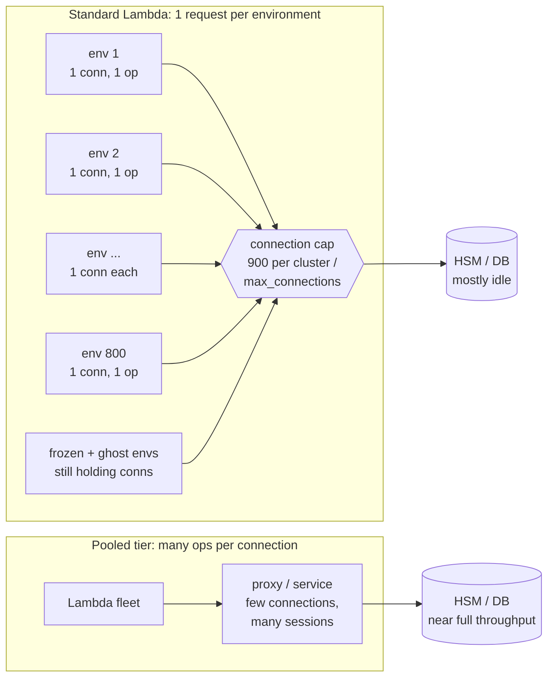
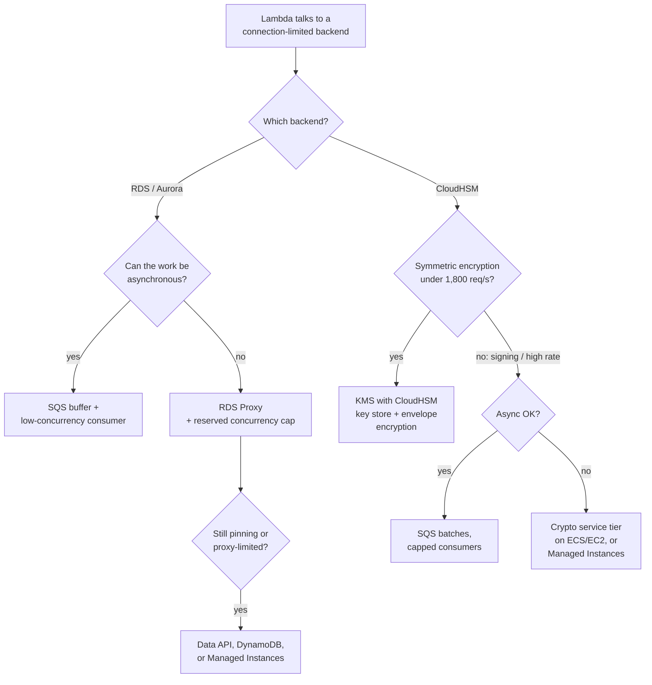

# AWS Lambda and Connection-Bound Backends (CloudHSM, Relational Databases)

*Why Lambda exhausts connection limits before it uses the backend's capacity, and how to fix it.*

## Abbreviations

| Abbreviation | Full name |
|---|---|
| HSM | Hardware Security Module |
| KMS | Key Management Service |
| RDS | Relational Database Service |
| SDK | Software Development Kit |
| PKCS#11 | Public-Key Cryptography Standards #11 (the HSM client API) |
| JCE | Java Cryptography Extension |
| RPS | Requests Per Second |
| PC | Provisioned Concurrency |
| SQS | Simple Queue Service |
| ESM | Event Source Mapping |
| ECS | Elastic Container Service |
| EC2 | Elastic Compute Cloud |
| TCP | Transmission Control Protocol |

---

## 1. The problem, stated precisely

The concern is real, with one correction. A connection is **not** opened per *invocation*, as long as the code opens it during Init (outside the handler) and reuses it. It is opened per **execution environment**. But in standard Lambda, an execution environment serves **exactly one request at a time**, so:

> **Open connections ≈ number of execution environments ≈ peak concurrency** (plus idle and leaked ones).

That has three consequences, which together explain both halves of the problem: running out of connections, and still not using the backend's full capability.

1. **Connection count follows concurrency, not useful work.** Concurrency = RPS × average duration (Little's law). A function that spends 200 ms per request but only 5 ms talking to the HSM or database still holds one connection for the whole 200 ms. It also keeps holding it while the environment is frozen between requests, which can last minutes. At 4,000 RPS that is ~800 environments and ~800 connections, each busy only a few percent of the time.
2. **Each connection carries at most one operation in flight.** Backends like CloudHSM and PostgreSQL get throughput from *many concurrent operations over few connections*: multi-threaded clients, many sessions, pipelining. A single-concurrency Lambda environment never puts more than one request on its connection, so per-connection throughput is low by construction.
3. **Connections leak past the environment's life.** When Lambda reclaims an environment, the process is not given a reliable chance to close its sockets (only an external extension receives a `SHUTDOWN` event). The backend keeps the session until its own idle timeout, so for a while the count also includes "ghost" connections from environments that no longer exist.

### The hard limits involved

| Backend | Limit | Source |
|---|---|---|
| CloudHSM cluster | **900 concurrent client connections per cluster**, not adjustable. With Client SDK 5, *one application (process) = one connection*, so **each Lambda execution environment counts as one**. | [CloudHSM quotas](https://docs.aws.amazon.com/cloudhsm/latest/userguide/limits.html) |
| CloudHSM throughput (reference) | A 6-HSM `hsm2m.medium` cluster ≈ 7,000 EC P256 signs/s or ≈ 5,000 RSA-2048 signs/s, measured with **one multi-threaded Java client on one EC2 instance** | [CloudHSM performance](https://docs.aws.amazon.com/cloudhsm/latest/userguide/performance.html) |
| RDS / Aurora | `max_connections`, derived from instance memory unless set explicitly; each connection costs database memory even when idle | RDS/Aurora user guides |

AWS's benchmark makes the mismatch concrete: the cluster reaches its full rate from **one** connection. A Lambda fleet can reach the 900-connection ceiling while the HSMs are mostly idle.

### Worked example (ShopFast `checkout`)

`checkout` has reserved concurrency 800 and, at the Friday peak, signs each payment token on CloudHSM.

- At peak, 800 environments hold **800 of the cluster's 900 connections**. A second application (for example a batch re-keying job) and the frozen and ghost environments share the remaining 100. A redeploy that briefly runs old and new environments side by side pushes it over the limit, and new environments fail during Init.
- Each environment does about 1 sign per 200 ms request: 800 × 5 = **~4,000 signs/s**. That is under what the cluster could do, and adding HSMs does not help, because the connection cap is the binding limit.

---

## 2. Picture: why the connection ceiling arrives first

The fix always takes one of two forms: **put more operations on each connection** (a pooling tier, or multi-concurrency in one environment), or **stop needing a persistent connection** (an HTTP API in front of the backend).

---

## 3. Mitigations

### 3.1 Baseline hygiene (always do these; they don't solve the problem on their own)

- **Open the connection once, in Init, and reuse it.** Never connect inside the handler without closing. Use a pool size of **1** in standard Lambda; a bigger pool only multiplies connections.
- **Cap concurrency to the connection budget.** Reserved concurrency is effectively a connection quota: set it to (backend limit − other clients − headroom for deploy overlap). For SQS triggers, set the ESM's **maximum concurrency** so a backlog cannot fan out past it.
- **Set short idle timeouts on the backend** (database `wait_timeout` / `idle_session_timeout`) so ghost connections from reclaimed environments are reaped quickly.
- **Mind PC.** Every provisioned environment runs Init in advance, so **PC 400 opens 400 connections before the first request arrives** and holds them all day.

### 3.2 Databases

| Option | How it helps | Caveats |
|---|---|---|
| **RDS Proxy** (first choice for RDS/Aurora) | Lambda connects to the proxy; the proxy multiplexes many client connections onto a small back-end pool sized by `MaxConnectionsPercent` of `max_connections`. Also absorbs connection storms and failovers. | **Pinning**: session state (temp tables, `SET`, prepared statements in some drivers) pins a client to a back-end connection and defeats multiplexing; watch `DatabaseConnectionsCurrentlySessionPinned`. Requests wait up to `ConnectionBorrowTimeout` when the pool is full. Adds cost and a little latency. |
| **Aurora Data API** | HTTPS calls instead of a persistent connection; AWS manages the pooling. | Aurora only; per-call overhead; result-size limits; not ideal for chatty transactions. |
| **Queue-buffer the writes** | Writes go to SQS; a consumer with low, capped concurrency writes them in batches. Connection count = consumer concurrency, decoupled from front-end traffic. | Only for work that can be asynchronous. |
| **Move suitable access patterns to DynamoDB** | Plain HTTPS API, no connection limit. | A data-model change, not a drop-in fix. |
| **Lambda Managed Instances** (launched 2025) | Each environment handles **many requests concurrently**, so one thread-safe pool per environment is shared by many in-flight requests, and the connection count drops roughly by the multi-concurrency factor. | Handler and clients must be thread-safe; different pricing and capacity model. See the [AWS docs](https://docs.aws.amazon.com/lambda/latest/dg/lambda-managed-instances-runtimes.html). |

### 3.3 CloudHSM

CloudHSM has **no managed proxy equivalent to RDS Proxy**, and the 900-connection cap cannot be raised, so architecture matters more here.

| Option | How it helps | Caveats |
|---|---|---|
| **AWS KMS with a CloudHSM key store** | Keys still live in *your* CloudHSM cluster, but Lambda calls KMS over HTTPS and **KMS** holds the HSM connections. No per-environment HSM connection at all. | Only **symmetric** keys (`SYMMETRIC_DEFAULT`); **1,800 requests/s per key store, not adjustable**; also counts toward the account's KMS crypto quota. Suits envelope encryption well; it cannot do RSA/EC signing. |
| **A crypto service tier** (long-running ECS/EC2 service in front of CloudHSM) | A handful of processes, each one connection with many PKCS#11 sessions and threads (up to 1,024 sessions per application), the way AWS benchmarks it. Lambda calls it over HTTPS/gRPC. This is how you get the cluster's **full** throughput. | You now operate a service: scaling, health, mTLS, its own availability. It's the right answer for high-rate asymmetric signing. |
| **Envelope encryption + data-key caching** | Use the HSM only to wrap and unwrap data keys; do the bulk crypto in-process with cached data keys (e.g. the AWS Encryption SDK's caching). HSM calls drop by orders of magnitude. | Only for encryption workloads, not signing; plaintext data keys sit in memory for the cache lifetime, which your security policy must accept. |
| **Batch through SQS** | One invocation signs a batch of N items over its single connection, so useful work per connection rises N-fold. | Asynchronous only; latency rises with batch window. |
| **Lambda Managed Instances** | One connection per environment now serves many concurrent requests, so the CloudHSM client's multi-session design is actually used. | Thread safety; check that the CloudHSM SDK and your language binding support concurrent use in one process. |
| **Use token keys, not session keys** | Token keys are synchronized across HSMs and load-balanced; session keys pin all throughput to one HSM. | Doesn't reduce connection count, but makes sure the operations you do run are spread across HSMs. |

---

## 4. Choosing

## 5. Conclusions

1. **The limitation is real and structural.** In standard Lambda, connections scale with *concurrency*, not with backend work, and each connection carries at most one operation at a time. Connection limits are hit while the backend is underused.
2. **More concurrency or more HSM/DB capacity won't fix it.** The binding limit is the connection count (900 per CloudHSM cluster, `max_connections` per database).
3. **There are two ways to fix it:** put more operations on each connection (RDS Proxy, a crypto service tier, Managed Instances, batching), or remove the persistent connection (Data API, KMS-fronted CloudHSM keys, DynamoDB).
4. **Hygiene is still required:** connect once during Init, pool size 1, reserved concurrency set to the connection budget, short idle timeouts, and remember that PC pre-opens connections.
5. **For CloudHSM specifically:** use a KMS CloudHSM key store when symmetric keys and ≤1,800 req/s suffice; otherwise put a long-running crypto service in front of the cluster.

*Quota values were checked against AWS documentation on 2026-10-15 (CloudHSM quotas and performance pages, KMS request quotas, RDS Proxy connection settings). Performance figures are AWS's approximate benchmarks; load-test your own workload.*
