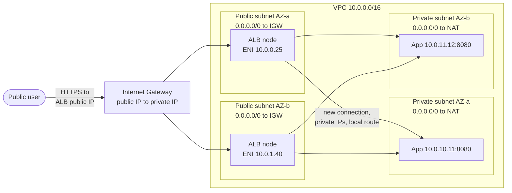
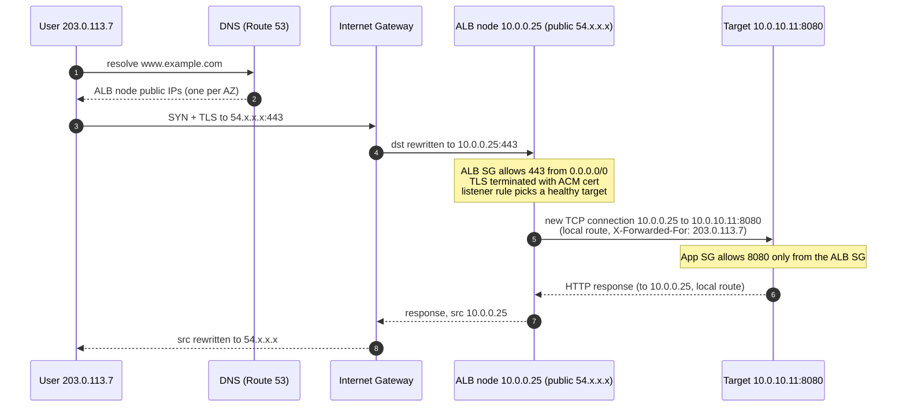

# Exposing a Service in Private Subnets Through an Internet Gateway and a Public ALB

## Abbreviations

| Abbreviation | Full name | Meaning |
|---|---|---|
| VPC | Virtual Private Cloud | Your isolated network in AWS |
| IGW | Internet Gateway | The VPC's connection to the public internet |
| ALB | Application Load Balancer | Layer-7 (HTTP/HTTPS) load balancer |
| NLB | Network Load Balancer | Layer-4 (TCP/UDP) load balancer |
| AZ | Availability Zone | An isolated data-centre group within a region |
| ENI | Elastic Network Interface | A virtual network card in a subnet |
| NAT | Network Address Translation | Rewriting IP addresses in packet headers |
| SG | Security Group | Stateful firewall attached to an ENI |
| NACL | Network Access Control List | Stateless firewall attached to a subnet |
| TLS | Transport Layer Security | The "S" in HTTPS |
| ACM | AWS Certificate Manager | Issues and stores TLS certificates |
| DNS | Domain Name System | — |
| WAF | Web Application Firewall | — |
| EKS | Elastic Kubernetes Service | — |
| CIDR | Classless Inter-Domain Routing | IP range notation, e.g. `10.0.0.0/16` |

## 1. The short answer

The internet gateway and the public ALB each do half of the job, and neither can do it alone:

- The **IGW** is the VPC's door to the internet. It does not route, balance or filter. It translates between public IP addresses and the private IP addresses of network interfaces in **public subnets**. A subnet is public *only because* its route table sends `0.0.0.0/0` to the IGW.
- The **internet-facing ALB** puts its nodes (ENIs with a public IP each) in those public subnets, so the IGW can reach them. It **terminates** the client's connection and opens a **new** connection to your service using **private IPs**, over the VPC's built-in `local` route.

So the service in the private subnets never needs a public IP and never needs a route to the IGW. The ALB is the only thing the internet can talk to, and it is a proxy, not a router: packets from users never reach your instances directly.



*This diagram answers: which component sits where, and which hops use public versus private addresses?*

## 2. The pieces and their jobs

| Piece | Lives in | Job | What it does *not* do |
|---|---|---|---|
| Route 53 alias record | Global | Maps `www.example.com` to the ALB's DNS name | Hold IPs — ALB IPs change, always alias the DNS name |
| Internet Gateway | Attached to the VPC (one per VPC) | 1:1 translation between public and private IPv4 of ENIs in public subnets; managed, redundant, no bandwidth limit of its own | Route between subnets, load-balance, filter traffic |
| Public route table | Associated with public subnets | `0.0.0.0/0 → igw-…` plus `10.0.0.0/16 → local` | — |
| Internet-facing ALB | One node per selected AZ, in public subnets | Terminate TLS, apply listener rules, health-check and pick a target, proxy the request | Give you a static IP (use NLB or Global Accelerator for that) |
| Target group | Logical | List of targets (instance IDs, private IPs, or Lambda) plus health-check settings | — |
| Private subnets | Per AZ | Run the service; no IGW route | Accept connections from the internet |
| NAT gateway (optional) | Public subnet | Lets private targets make **outbound** calls (patches, image pulls, third-party APIs) | Allow any **inbound** connection — it is not part of the request path |

Two facts in that table explain most confusion:

1. **The ALB must sit in public subnets.** "Internet-facing" is a scheme you choose, but it only works if the subnets you give the ALB route to an IGW. Put an internet-facing ALB in private subnets and nothing can reach it.
2. **The NAT gateway is not how users get in.** It is only for traffic the private instances *start*. A site served by a public ALB works without any NAT gateway; the instances just cannot reach the internet themselves.

## 3. Packet walk: one request, end to end



*This diagram answers: at each hop, which addresses are on the packet and which component changes them?*

Step by step:

1. **DNS.** The ALB's DNS name resolves to the public IPs of its nodes, one per enabled AZ. Your own domain points at it with a Route 53 alias record.
2. **Internet → IGW.** The client sends to an ALB node's public IP. That address is not configured on any interface; the IGW holds the mapping.
3. **IGW → ALB node.** The IGW rewrites the destination to the node ENI's private IP (`10.0.0.25`) and delivers it into the public subnet. The ALB's security group and the subnet's NACL decide whether it is accepted.
4. **The ALB terminates the connection.** TLS is decrypted with the ACM certificate. Listener rules (host, path, header) pick a target group, and the load-balancing algorithm picks a healthy target. Cross-zone load balancing is always on for ALBs, so a node in AZ-a can pick a target in AZ-b.
5. **ALB → target is a brand-new connection.** Source is the ALB node's private IP, destination the target's private IP. It travels on the VPC `local` route, which every route table has; no gateway is involved. The original client IP is passed in the `X-Forwarded-For` header, because the target only ever sees the ALB's address.
6. **Response, target → ALB.** The target answers the ALB node's private IP: again the `local` route. **This is why the private subnet needs no route to the IGW.** The target never replies to the user directly.
7. **Response, ALB → user.** The ALB sends from its private IP; the public subnet's route table sends `0.0.0.0/0` to the IGW, which rewrites the source to the public IP and forwards it to the user.

## 4. Security: two firewalls, chained

### Security groups (stateful): chain them by reference

| SG | Direction | Rule |
|---|---|---|
| `alb-public` | Inbound | TCP 443 (and 80 for redirect) from `0.0.0.0/0` (and `::/0` if dual-stack) |
| `alb-public` | Outbound | TCP 8080 to `app-private` (SG reference) |
| `app-private` | Inbound | TCP 8080 **from `alb-public`** (SG reference, not a CIDR) |
| `app-private` | Outbound | As needed (e.g. 443 via NAT, database port) |

Referencing the ALB's security group, instead of a CIDR such as the public subnets' range, means "only traffic from the ALB's ENIs", even as the ALB scales and its IPs change. Health checks come from the same ALB nodes, so this one rule covers them too.

### NACLs (stateless): mind the return ports

The default NACL allows everything, and many teams leave it that way. If you do tighten NACLs, remember they are stateless, so every reply needs its own rule:

| Subnet | Inbound | Outbound |
|---|---|---|
| Public (ALB) | 443/80 from `0.0.0.0/0`; ephemeral 1024–65535 from private subnets | Ephemeral 1024–65535 to `0.0.0.0/0`; 8080 to private subnets |
| Private (app) | 8080 from public subnets; ephemeral from `0.0.0.0/0` if using NAT | Ephemeral 1024–65535 to public subnets; 443 to `0.0.0.0/0` for NAT |

A forgotten ephemeral-port rule is the classic cause of "the health check times out, but the security groups look right".

## 5. A minimal Terraform example

Two AZs, an IGW, public and private subnets, a NAT gateway for outbound only, chained security groups, an HTTPS listener and an HTTP-to-HTTPS redirect. Syntax-checked with `terraform fmt`; run `terraform validate` / `plan` against your own account before applying.

```hcl
provider "aws" { region = "ap-southeast-1" }

variable "certificate_arn" { type = string }

data "aws_availability_zones" "available" { state = "available" }

locals {
  azs = slice(data.aws_availability_zones.available.names, 0, 2)
}

# --- VPC and the front door -------------------------------------------------
resource "aws_vpc" "main" {
  cidr_block           = "10.0.0.0/16"
  enable_dns_hostnames = true
}

resource "aws_internet_gateway" "igw" {
  vpc_id = aws_vpc.main.id
}

# --- Public subnets: only the ALB (and NAT gateways) live here --------------
resource "aws_subnet" "public" {
  count             = 2
  vpc_id            = aws_vpc.main.id
  cidr_block        = cidrsubnet(aws_vpc.main.cidr_block, 8, count.index) # 10.0.0.0/24, 10.0.1.0/24
  availability_zone = local.azs[count.index]
}

resource "aws_route_table" "public" {
  vpc_id = aws_vpc.main.id
  route {
    cidr_block = "0.0.0.0/0"
    gateway_id = aws_internet_gateway.igw.id # this route is what makes the subnet "public"
  }
}

resource "aws_route_table_association" "public" {
  count          = 2
  subnet_id      = aws_subnet.public[count.index].id
  route_table_id = aws_route_table.public.id
}

# --- Private subnets: the application; no route to the IGW -----------------
resource "aws_subnet" "private" {
  count             = 2
  vpc_id            = aws_vpc.main.id
  cidr_block        = cidrsubnet(aws_vpc.main.cidr_block, 8, count.index + 10) # 10.0.10.0/24, 10.0.11.0/24
  availability_zone = local.azs[count.index]
}

resource "aws_eip" "nat" {
  domain = "vpc"
}

resource "aws_nat_gateway" "nat" { # outbound only (patches, image pulls); one AZ for brevity
  allocation_id = aws_eip.nat.id
  subnet_id     = aws_subnet.public[0].id
}

resource "aws_route_table" "private" {
  vpc_id = aws_vpc.main.id
  route {
    cidr_block     = "0.0.0.0/0"
    nat_gateway_id = aws_nat_gateway.nat.id
  }
}

resource "aws_route_table_association" "private" {
  count          = 2
  subnet_id      = aws_subnet.private[count.index].id
  route_table_id = aws_route_table.private.id
}

# --- Security groups: internet -> ALB -> app, chained by SG reference -------
resource "aws_security_group" "alb" {
  name   = "alb-public"
  vpc_id = aws_vpc.main.id
}

resource "aws_vpc_security_group_ingress_rule" "alb_https" {
  security_group_id = aws_security_group.alb.id
  cidr_ipv4         = "0.0.0.0/0"
  ip_protocol       = "tcp"
  from_port         = 443
  to_port           = 443
}

resource "aws_vpc_security_group_ingress_rule" "alb_http" {
  security_group_id = aws_security_group.alb.id
  cidr_ipv4         = "0.0.0.0/0"
  ip_protocol       = "tcp"
  from_port         = 80
  to_port           = 80
}

resource "aws_vpc_security_group_egress_rule" "alb_to_app" {
  security_group_id            = aws_security_group.alb.id
  referenced_security_group_id = aws_security_group.app.id
  ip_protocol                  = "tcp"
  from_port                    = 8080
  to_port                      = 8080
}

resource "aws_security_group" "app" {
  name   = "app-private"
  vpc_id = aws_vpc.main.id
}

resource "aws_vpc_security_group_ingress_rule" "app_from_alb" {
  security_group_id            = aws_security_group.app.id
  referenced_security_group_id = aws_security_group.alb.id # only the ALB may connect
  ip_protocol                  = "tcp"
  from_port                    = 8080
  to_port                      = 8080
}

resource "aws_vpc_security_group_egress_rule" "app_out" {
  security_group_id = aws_security_group.app.id
  cidr_ipv4         = "0.0.0.0/0"
  ip_protocol       = "-1"
}

# --- The ALB itself ----------------------------------------------------------
resource "aws_lb" "web" {
  name               = "web-public"
  load_balancer_type = "application"
  internal           = false                   # internet-facing
  subnets            = aws_subnet.public[*].id # >= 2 AZs, PUBLIC subnets
  security_groups    = [aws_security_group.alb.id]
}

resource "aws_lb_target_group" "app" {
  name        = "app"
  port        = 8080
  protocol    = "HTTP"
  vpc_id      = aws_vpc.main.id
  target_type = "ip" # targets addressed by PRIVATE IP
  health_check {
    path    = "/health"
    matcher = "200"
  }
}

resource "aws_lb_listener" "https" {
  load_balancer_arn = aws_lb.web.arn
  port              = 443
  protocol          = "HTTPS"
  ssl_policy        = "ELBSecurityPolicy-TLS13-1-2-2021-06"
  certificate_arn   = var.certificate_arn # ACM certificate
  default_action {
    type             = "forward"
    target_group_arn = aws_lb_target_group.app.arn
  }
}

resource "aws_lb_listener" "http_redirect" {
  load_balancer_arn = aws_lb.web.arn
  port              = 80
  protocol          = "HTTP"
  default_action {
    type = "redirect"
    redirect {
      port        = "443"
      protocol    = "HTTPS"
      status_code = "HTTP_301"
    }
  }
}

output "alb_dns_name" { value = aws_lb.web.dns_name } # point a Route 53 alias record here
```

Registering targets is left out: attach an Auto Scaling group with `target_group_arns`, register ECS tasks through the service's `load_balancer` block, or let Kubernetes do it (next section).

## 6. The same pattern on EKS

On EKS, the AWS Load Balancer Controller builds exactly this from an `Ingress`:

```yaml
apiVersion: networking.k8s.io/v1
kind: Ingress
metadata:
  name: web
  annotations:
    alb.ingress.kubernetes.io/scheme: internet-facing   # ALB in public subnets
    alb.ingress.kubernetes.io/target-type: ip           # pod IPs in private subnets
    alb.ingress.kubernetes.io/listen-ports: '[{"HTTP":80},{"HTTPS":443}]'
    alb.ingress.kubernetes.io/ssl-redirect: "443"
    alb.ingress.kubernetes.io/certificate-arn: arn:aws:acm:...:certificate/...
spec:
  ingressClassName: alb
  rules:
    - host: www.example.com
      http:
        paths:
          - path: /
            pathType: Prefix
            backend:
              service: { name: web, port: { number: 80 } }
```

The controller finds the subnets by tag: public subnets need `kubernetes.io/role/elb = 1`, private ones `kubernetes.io/role/internal-elb = 1`. A missing tag is the usual reason for the error "unable to resolve at least one subnet".

## 7. Common mistakes

| Symptom | Cause | Fix |
|---|---|---|
| ALB DNS name times out | Internet-facing ALB placed in private subnets, or the public route table has no `0.0.0.0/0 → igw` | Give the ALB public subnets in at least 2 AZs |
| `502 Bad Gateway` | Target closed the connection or returned a malformed response; app keep-alive timeout shorter than the ALB idle timeout (60 s default) | Set the app's keep-alive timeout above the ALB idle timeout |
| `503 Service Unavailable` | Target group has no healthy (or no registered) targets | Fix the health-check path/port/matcher; check registration |
| `504 Gateway Timeout` | ALB cannot reach the target: SG/NACL blocks 8080 or the return ephemeral ports | SG-reference rule on the app; NACL ephemeral ports |
| Targets healthy, but the app logs every request from `10.0.x.x` | Expected: the ALB is a proxy | Read `X-Forwarded-For` (configure your framework's trusted proxies) |
| Instances cannot `yum update` or pull images | No outbound path from private subnets | Add a NAT gateway (or VPC endpoints for AWS services) |
| Someone added `0.0.0.0/0 → igw` to the private route table "to fix" it | That turns the subnets public; instances with public IPs become directly reachable | Remove it; outbound goes through NAT |
| Partner needs a fixed IP to allowlist | ALB IPs change | NLB with Elastic IPs in front, or AWS Global Accelerator |
| ALB creation fails with not enough free IPs | ALB needs room to scale in each subnet | Use at least /27 public subnets with 8+ free IPs |

## 8. Conclusion

- **The IGW is the door; the ALB is the receptionist.** The IGW only maps public IPs to private IPs for interfaces in public subnets. The ALB, sitting in those public subnets, is the only thing it lets the internet reach.
- **The ALB bridges public and private by proxying, not routing.** It ends the user's connection and opens a new one to private IPs over the VPC `local` route, so the private subnets need neither public IPs nor an IGW route, and replies come back the same way.
- **Security is a chain:** `0.0.0.0/0 → ALB SG → (SG reference) → app SG`. Nothing else in the private subnets is reachable from outside.
- **The NAT gateway is for outbound only** and is not part of serving the site.

For the wider VPC picture (route tables, NAT vs. IGW, endpoints, Transit Gateway), see [A Practical Tour of AWS Networking](./AWS-Network.md).

## References

- AWS: Internet gateways — <https://docs.aws.amazon.com/vpc/latest/userguide/VPC_Internet_Gateway.html>
- AWS: Application Load Balancers (scheme, subnets, availability zones) — <https://docs.aws.amazon.com/elasticloadbalancing/latest/application/application-load-balancers.html>
- AWS: Security groups for your Application Load Balancer — <https://docs.aws.amazon.com/elasticloadbalancing/latest/application/load-balancer-update-security-groups.html>
- AWS: Troubleshoot your Application Load Balancers (HTTP 502/503/504) — <https://docs.aws.amazon.com/elasticloadbalancing/latest/application/load-balancer-troubleshooting.html>
- AWS Load Balancer Controller: subnet discovery — <https://kubernetes-sigs.github.io/aws-load-balancer-controller/latest/deploy/subnet_discovery/>
