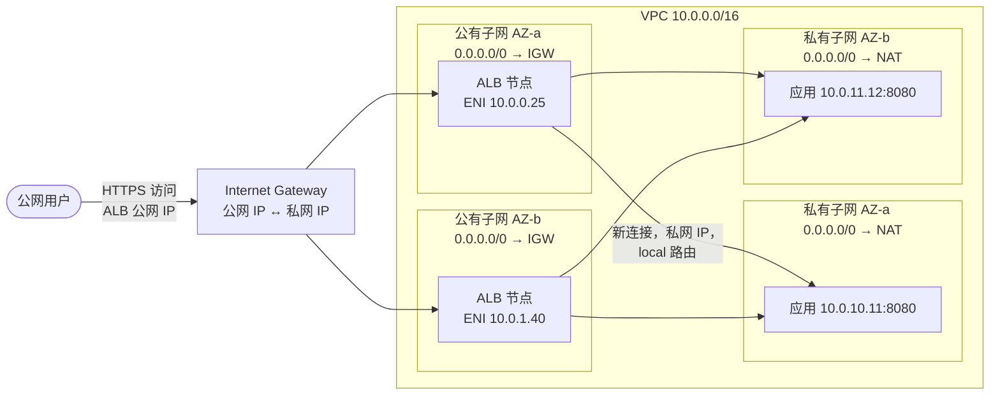
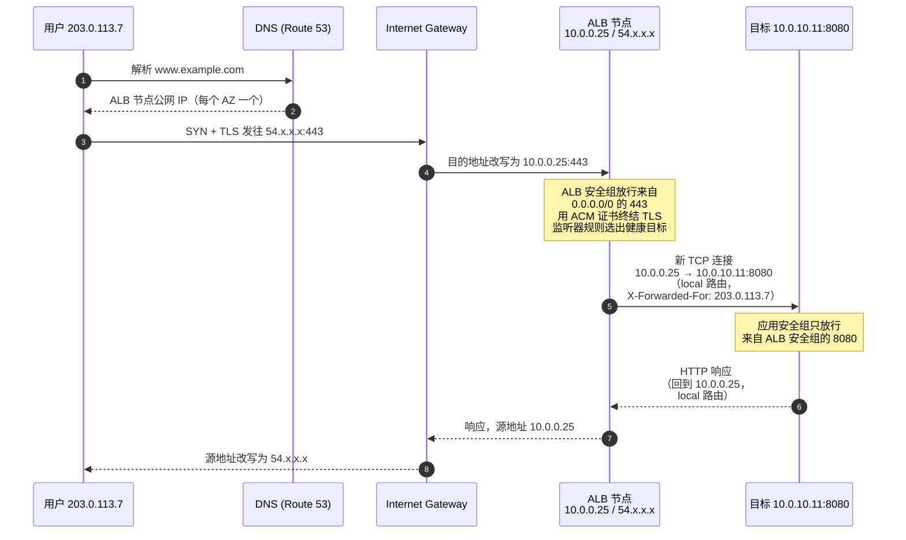
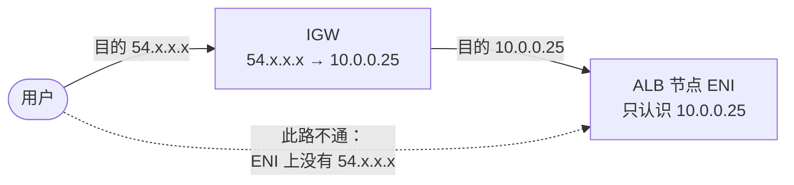
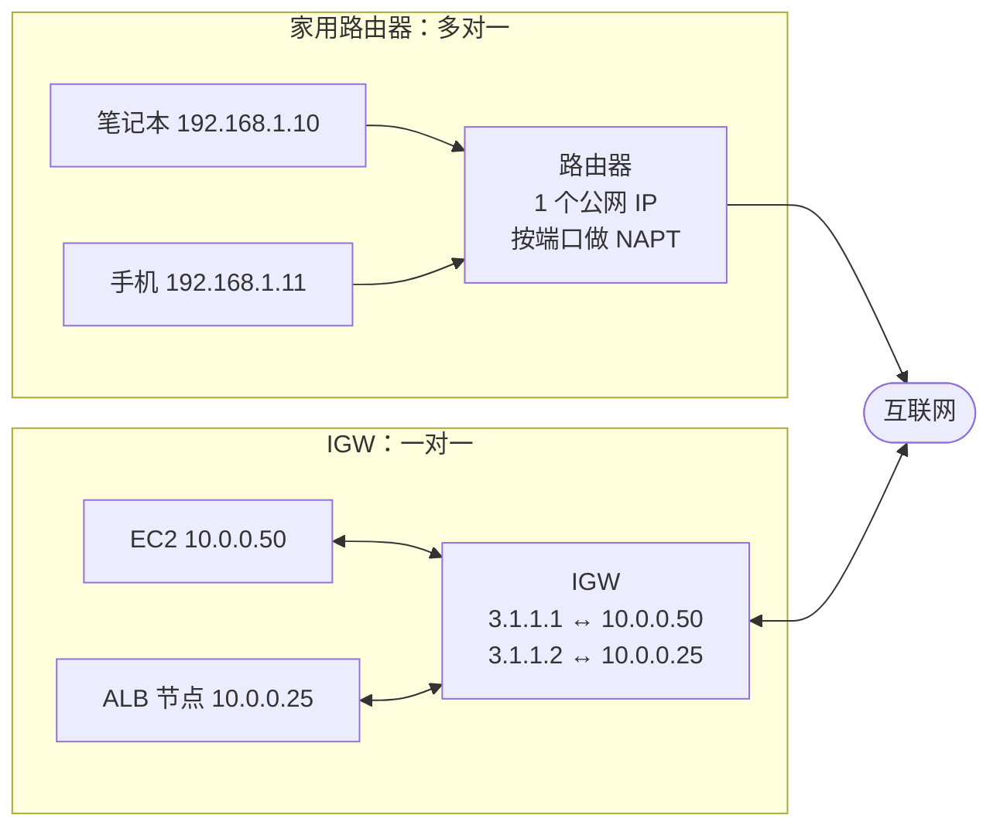
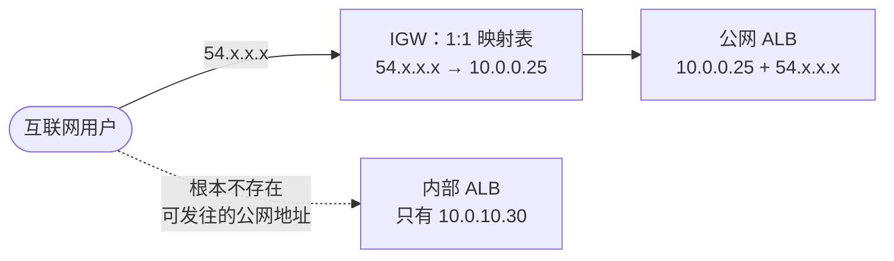
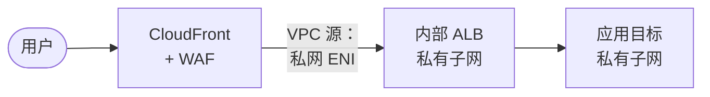

# 用 Internet Gateway 和公网 ALB 把私有子网里的服务暴露给公网用户

## 缩写对照表

| 缩写 | 英文全称 | 中文 |
|---|---|---|
| VPC | Virtual Private Cloud | 虚拟私有云（你在 AWS 上的隔离网络） |
| IGW | Internet Gateway | 互联网网关（VPC 通往公网的出入口） |
| ALB | Application Load Balancer | 应用负载均衡器（七层，HTTP/HTTPS） |
| NLB | Network Load Balancer | 网络负载均衡器（四层，TCP/UDP） |
| AZ | Availability Zone | 可用区（同一区域内相互隔离的机房组） |
| ENI | Elastic Network Interface | 弹性网络接口（子网里的虚拟网卡） |
| NAT | Network Address Translation | 网络地址转换 |
| NAPT | Network Address and Port Translation | 网络地址端口转换（多对一 NAT） |
| SG | Security Group | 安全组（挂在 ENI 上的有状态防火墙） |
| NACL | Network Access Control List | 网络访问控制列表（挂在子网上的无状态防火墙） |
| TLS | Transport Layer Security | 传输层安全协议（HTTPS 里的 "S"） |
| SNI | Server Name Indication | 服务器名称指示（TLS 握手中携带的域名） |
| ACM | AWS Certificate Manager | AWS 证书管理服务 |
| DNS | Domain Name System | 域名系统 |
| WAF | Web Application Firewall | Web 应用防火墙 |
| CDN | Content Delivery Network | 内容分发网络 |
| EKS | Elastic Kubernetes Service | AWS 托管 Kubernetes 服务 |
| CIDR | Classless Inter-Domain Routing | 无类别域间路由（如 `10.0.0.0/16`） |
| BGP | Border Gateway Protocol | 边界网关协议 |
| BYOIP | Bring Your Own IP | 自带 IP 地址段 |
| ISP | Internet Service Provider | 互联网服务提供商 |

## 一、一句话回答

IGW（Internet Gateway，互联网网关）和公网 ALB（Application Load Balancer，应用负载均衡器）各干一半活，缺了谁都不行：

- **IGW 是 VPC 通往互联网的门。** 它不做路由决策、不做负载均衡、也不做过滤，只做一件事：在公网 IP 和**公有子网**里网卡的私网 IP 之间做转换。一个子网之所以叫"公有子网"，*仅仅因为*它的路由表把 `0.0.0.0/0` 指向了 IGW。
- **面向公网（internet-facing）的 ALB** 把自己的节点（每个节点是一张带公网 IP 的 ENI）放在这些公有子网里，于是 IGW 能把流量送到它们。ALB 会**终结**客户端连接，然后用**私网 IP** 经由 VPC 内置的 `local` 路由**另起一条新连接**去访问你的服务。

所以私有子网里的服务既不需要公网 IP，也不需要通往 IGW 的路由。互联网唯一能对话的对象是 ALB，而 ALB 是**代理**而不是路由器：用户的数据包永远不会直接到达你的实例。



*这张图回答：每个组件放在哪里，哪几跳用公网地址、哪几跳用私网地址？*

## 二、各组件及其职责

| 组件 | 位置 | 职责 | 它**不**做什么 |
|---|---|---|---|
| Route 53 别名记录 | 全局 | 把 `www.example.com` 指向 ALB 的 DNS 名称 | 不存 IP——ALB 的 IP 会变，永远用别名指向 DNS 名称 |
| Internet Gateway | 挂在 VPC 上（每个 VPC 一个） | 在公有子网 ENI 的公网 IPv4 与私网 IPv4 之间做 1:1 转换；托管、冗余、自身无带宽上限 | 子网间路由、负载均衡、流量过滤 |
| 公有路由表 | 关联到公有子网 | `0.0.0.0/0 → igw-…` 加上 `10.0.0.0/16 → local` | — |
| 公网 ALB | 每个选定 AZ 一个节点，位于公有子网 | 终结 TLS、执行监听器规则、健康检查并选出目标、代理请求 | 不提供固定 IP（需要固定 IP 用 NLB 或 Global Accelerator） |
| 目标组 | 逻辑对象 | 目标列表（实例 ID、私网 IP 或 Lambda）加健康检查配置 | — |
| 私有子网 | 每个 AZ 一个 | 运行服务；没有通往 IGW 的路由 | 不接受来自互联网的连接 |
| NAT 网关（可选） | 公有子网 | 让私有子网里的目标发起**出站**访问（打补丁、拉镜像、调第三方 API） | 不放行任何**入站**连接——它不在请求路径上 |

表里有两个事实能解释大部分困惑：

1. **ALB 必须放在公有子网。** "面向公网"是你选的 scheme，但只有当你给 ALB 的子网有通往 IGW 的路由时才有效。把面向公网的 ALB 放进私有子网，谁也访问不到它。
2. **用户不是从 NAT 网关进来的。** NAT 网关只服务于私有实例*主动发起*的流量。一个由公网 ALB 提供服务的站点，没有 NAT 网关照样能工作；只是实例自己上不了网而已。

## 三、数据包之旅：一个请求从头到尾



*这张图回答：每一跳上数据包带的是什么地址，由谁来改写？*

逐步说明：

1. **DNS。** ALB 的 DNS 名称解析为其各节点的公网 IP，每个启用的 AZ 一个。你自己的域名通过 Route 53 别名记录指向它。
2. **互联网 → IGW。** 客户端把请求发往某个 ALB 节点的公网 IP。这个地址并没有配置在任何网卡上，映射关系由 IGW 持有。
3. **IGW → ALB 节点。** IGW 把目的地址改写成该节点 ENI 的私网 IP（`10.0.0.25`），投递进公有子网。是否接收由 ALB 的安全组和子网的 NACL 决定。
4. **ALB 终结连接。** 用 ACM 证书解密 TLS；监听器规则（按主机、路径、请求头）选出目标组，负载均衡算法再选出一个健康目标。ALB 始终开启跨可用区负载均衡，所以 AZ-a 的节点也可能选中 AZ-b 的目标。
5. **ALB → 目标是一条全新的连接。** 源地址是 ALB 节点的私网 IP，目的地址是目标的私网 IP，走的是每张路由表都有的 VPC `local` 路由，不经过任何网关。由于目标只能看到 ALB 的地址，原始客户端 IP 通过 `X-Forwarded-For` 请求头传递。
6. **响应：目标 → ALB。** 目标回复给 ALB 节点的私网 IP，依旧走 `local` 路由。**这就是私有子网不需要 IGW 路由的原因。** 目标从不直接回复用户。
7. **响应：ALB → 用户。** ALB 以自己的私网 IP 发出响应；公有子网的路由表把 `0.0.0.0/0` 交给 IGW，IGW 把源地址改写为公网 IP 后转发给用户。

## 四、安全：两道防火墙，串成一条链

### 安全组（有状态）：用"引用"把它们串起来

| 安全组 | 方向 | 规则 |
|---|---|---|
| `alb-public` | 入站 | 来自 `0.0.0.0/0` 的 TCP 443（以及用于跳转的 80）；双栈时再加 `::/0` |
| `alb-public` | 出站 | TCP 8080 到 `app-private`（引用安全组） |
| `app-private` | 入站 | TCP 8080，**来源为 `alb-public`**（引用安全组，而不是 CIDR） |
| `app-private` | 出站 | 按需（例如经 NAT 访问 443、数据库端口） |

引用 ALB 的安全组，而不是写公有子网网段这样的 CIDR（Classless Inter-Domain Routing，无类别域间路由），含义是"只放行来自 ALB 网卡的流量"——即使 ALB 扩缩容、IP 变化也依然准确。健康检查也来自同样的 ALB 节点，所以这一条规则把它也覆盖了。

### NACL（无状态）：别忘了回程端口

默认 NACL 全部放行，很多团队也就一直这么用。如果你要收紧 NACL，记住它是无状态的，每个方向的回包都需要单独放行：

| 子网 | 入站 | 出站 |
|---|---|---|
| 公有（ALB） | 来自 `0.0.0.0/0` 的 443/80；来自私有子网的临时端口 1024–65535 | 到 `0.0.0.0/0` 的临时端口 1024–65535；到私有子网的 8080 |
| 私有（应用） | 来自公有子网的 8080；若使用 NAT，再放行来自 `0.0.0.0/0` 的临时端口 | 到公有子网的临时端口 1024–65535；经 NAT 访问 `0.0.0.0/0` 的 443 |

漏掉临时端口规则，是"安全组看着都对，健康检查却一直超时"的经典原因。

## 五、最小 Terraform 示例

两个 AZ、一个 IGW、公有和私有子网、仅用于出站的 NAT 网关、串联的安全组、一个 HTTPS 监听器和一个 HTTP→HTTPS 跳转。已用 `terraform fmt` 做过语法检查；在真正 apply 之前，请在你自己的账号里跑一遍 `terraform validate` / `plan`。

```hcl
provider "aws" { region = "ap-southeast-1" }

variable "certificate_arn" { type = string }

data "aws_availability_zones" "available" { state = "available" }

locals {
  azs = slice(data.aws_availability_zones.available.names, 0, 2)
}

# --- VPC 与大门 ---------------------------------------------------------------
resource "aws_vpc" "main" {
  cidr_block           = "10.0.0.0/16"
  enable_dns_hostnames = true
}

resource "aws_internet_gateway" "igw" {
  vpc_id = aws_vpc.main.id
}

# --- 公有子网：只放 ALB（和 NAT 网关） ------------------------------------------
resource "aws_subnet" "public" {
  count             = 2
  vpc_id            = aws_vpc.main.id
  cidr_block        = cidrsubnet(aws_vpc.main.cidr_block, 8, count.index) # 10.0.0.0/24, 10.0.1.0/24
  availability_zone = local.azs[count.index]
}

resource "aws_route_table" "public" {
  vpc_id = aws_vpc.main.id
  route {
    cidr_block = "0.0.0.0/0"
    gateway_id = aws_internet_gateway.igw.id # 正是这条路由让子网成为"公有"
  }
}

resource "aws_route_table_association" "public" {
  count          = 2
  subnet_id      = aws_subnet.public[count.index].id
  route_table_id = aws_route_table.public.id
}

# --- 私有子网：放应用；没有通往 IGW 的路由 --------------------------------------
resource "aws_subnet" "private" {
  count             = 2
  vpc_id            = aws_vpc.main.id
  cidr_block        = cidrsubnet(aws_vpc.main.cidr_block, 8, count.index + 10) # 10.0.10.0/24, 10.0.11.0/24
  availability_zone = local.azs[count.index]
}

resource "aws_eip" "nat" {
  domain = "vpc"
}

resource "aws_nat_gateway" "nat" { # 仅出站（打补丁、拉镜像）；为简洁只放一个 AZ
  allocation_id = aws_eip.nat.id
  subnet_id     = aws_subnet.public[0].id
}

resource "aws_route_table" "private" {
  vpc_id = aws_vpc.main.id
  route {
    cidr_block     = "0.0.0.0/0"
    nat_gateway_id = aws_nat_gateway.nat.id
  }
}

resource "aws_route_table_association" "private" {
  count          = 2
  subnet_id      = aws_subnet.private[count.index].id
  route_table_id = aws_route_table.private.id
}

# --- 安全组：互联网 -> ALB -> 应用，通过引用安全组串联 ----------------------------
resource "aws_security_group" "alb" {
  name   = "alb-public"
  vpc_id = aws_vpc.main.id
}

resource "aws_vpc_security_group_ingress_rule" "alb_https" {
  security_group_id = aws_security_group.alb.id
  cidr_ipv4         = "0.0.0.0/0"
  ip_protocol       = "tcp"
  from_port         = 443
  to_port           = 443
}

resource "aws_vpc_security_group_ingress_rule" "alb_http" {
  security_group_id = aws_security_group.alb.id
  cidr_ipv4         = "0.0.0.0/0"
  ip_protocol       = "tcp"
  from_port         = 80
  to_port           = 80
}

resource "aws_vpc_security_group_egress_rule" "alb_to_app" {
  security_group_id            = aws_security_group.alb.id
  referenced_security_group_id = aws_security_group.app.id
  ip_protocol                  = "tcp"
  from_port                    = 8080
  to_port                      = 8080
}

resource "aws_security_group" "app" {
  name   = "app-private"
  vpc_id = aws_vpc.main.id
}

resource "aws_vpc_security_group_ingress_rule" "app_from_alb" {
  security_group_id            = aws_security_group.app.id
  referenced_security_group_id = aws_security_group.alb.id # 只允许 ALB 连接
  ip_protocol                  = "tcp"
  from_port                    = 8080
  to_port                      = 8080
}

resource "aws_vpc_security_group_egress_rule" "app_out" {
  security_group_id = aws_security_group.app.id
  cidr_ipv4         = "0.0.0.0/0"
  ip_protocol       = "-1"
}

# --- ALB 本身 ------------------------------------------------------------------
resource "aws_lb" "web" {
  name               = "web-public"
  load_balancer_type = "application"
  internal           = false                   # 面向公网
  subnets            = aws_subnet.public[*].id # 至少 2 个 AZ 的公有子网
  security_groups    = [aws_security_group.alb.id]
}

resource "aws_lb_target_group" "app" {
  name        = "app"
  port        = 8080
  protocol    = "HTTP"
  vpc_id      = aws_vpc.main.id
  target_type = "ip" # 以私网 IP 寻址目标
  health_check {
    path    = "/health"
    matcher = "200"
  }
}

resource "aws_lb_listener" "https" {
  load_balancer_arn = aws_lb.web.arn
  port              = 443
  protocol          = "HTTPS"
  ssl_policy        = "ELBSecurityPolicy-TLS13-1-2-2021-06"
  certificate_arn   = var.certificate_arn # ACM 证书
  default_action {
    type             = "forward"
    target_group_arn = aws_lb_target_group.app.arn
  }
}

resource "aws_lb_listener" "http_redirect" {
  load_balancer_arn = aws_lb.web.arn
  port              = 80
  protocol          = "HTTP"
  default_action {
    type = "redirect"
    redirect {
      port        = "443"
      protocol    = "HTTPS"
      status_code = "HTTP_301"
    }
  }
}

output "alb_dns_name" { value = aws_lb.web.dns_name } # 让 Route 53 别名记录指向这里
```

示例里省略了目标注册：可以给 Auto Scaling 组配置 `target_group_arns`，通过 ECS 服务的 `load_balancer` 块注册任务，或者交给 Kubernetes（见下一节）。

## 六、在 EKS 上的同一套模式

在 EKS（Elastic Kubernetes Service）上，AWS Load Balancer Controller 会根据一个 `Ingress` 自动搭出完全相同的结构：

```yaml
apiVersion: networking.k8s.io/v1
kind: Ingress
metadata:
  name: web
  annotations:
    alb.ingress.kubernetes.io/scheme: internet-facing   # ALB 放在公有子网
    alb.ingress.kubernetes.io/target-type: ip           # 目标是私有子网里的 Pod IP
    alb.ingress.kubernetes.io/listen-ports: '[{"HTTP":80},{"HTTPS":443}]'
    alb.ingress.kubernetes.io/ssl-redirect: "443"
    alb.ingress.kubernetes.io/certificate-arn: arn:aws:acm:...:certificate/...
spec:
  ingressClassName: alb
  rules:
    - host: www.example.com
      http:
        paths:
          - path: /
            pathType: Prefix
            backend:
              service: { name: web, port: { number: 80 } }
```

Controller 靠标签发现子网：公有子网需要 `kubernetes.io/role/elb = 1`，私有子网需要 `kubernetes.io/role/internal-elb = 1`。缺标签是报错 "unable to resolve at least one subnet" 的常见原因。

## 七、常见错误

| 现象 | 原因 | 解决 |
|---|---|---|
| 访问 ALB 的 DNS 名称超时 | 面向公网的 ALB 被放进了私有子网，或公有路由表缺少 `0.0.0.0/0 → igw` | 给 ALB 至少 2 个 AZ 的公有子网 |
| `502 Bad Gateway` | 目标关闭了连接或返回了畸形响应；应用的 keep-alive 超时短于 ALB 空闲超时（默认 60 秒） | 把应用 keep-alive 超时设得比 ALB 空闲超时长 |
| `503 Service Unavailable` | 目标组里没有健康（或根本没注册）的目标 | 修正健康检查的路径/端口/匹配码；检查注册情况 |
| `504 Gateway Timeout` | ALB 连不上目标：安全组/NACL 拦了 8080 或回程临时端口 | 应用安全组引用 ALB 安全组；NACL 放行临时端口 |
| 目标都健康，但应用日志里所有请求都来自 `10.0.x.x` | 正常现象：ALB 是代理 | 读取 `X-Forwarded-For`（配置框架的可信代理） |
| 实例无法 `yum update` 或拉取镜像 | 私有子网没有出站路径 | 加 NAT 网关（或为 AWS 服务加 VPC 终端节点） |
| 有人为了"修好它"往私有路由表加了 `0.0.0.0/0 → igw` | 这会把子网变成公有子网；带公网 IP 的实例将被直接暴露 | 删掉它；出站走 NAT |
| 合作方需要固定 IP 加白名单 | ALB 的 IP 会变 | 在前面加带弹性 IP 的 NLB，或 AWS Global Accelerator |
| 创建 ALB 时报可用 IP 不足 | ALB 需要在每个子网里留出扩容空间 | 公有子网至少 /27，且至少 8 个空闲 IP |

## 八、FAQ：为什么不直接访问 ALB 的公网 IP？

这个问题其实混了两件事，所以有两个答案。

### 8.1 "直接"永远不可能意味着"绕过 IGW"

ALB 节点的公网 IP **并没有配置在它的网卡上**。在 VPC 内部，节点的 ENI 只有私网 IP（`10.0.0.25`）。公网 IP（`54.x.x.x`）是由 IGW 持有的一条映射，IGW 在两个方向上改写每个数据包的地址（见数据包之旅的第 3、7 步）。

所以互联网上不存在一条绕过 IGW 到达 ALB 的路径：公网 IP 之所以能用，*正是因为* IGW 在做转换。把 IGW 卸下来，或者把 ALB 所在子网的 `0.0.0.0/0 → igw` 路由删掉，即使 ALB 还在运行，那个公网 IP 也不会再有响应。



*这张图回答：为什么所有发往 ALB 的互联网数据包都必须经过 IGW？*

### 8.2 写死 IP 技术上能通，但不该依赖

如果你解析 ALB 的 DNS 名称（`dig web-public-123.ap-southeast-1.elb.amazonaws.com`），再把请求直接发到其中某个 IP，请求往往**确实**能通。但这仍然是访问 ALB 的错误方式，原因有四：

| 问题 | 后果 |
|---|---|
| **IP 会变** | ALB 扩缩容、维护、AZ 变更时节点都会被替换，AWS 不会通知，也不做保证。写死的 IP 迟早会失效，甚至可能指到别的客户的负载均衡器上。 |
| **一个 IP = 一个 AZ 里的一个节点** | DNS 每个 AZ 返回一个 IP，并会剔除不健康的节点。固定 IP 等于放弃了这层故障转移：那个节点或 AZ 出问题时，客户端无处可去。 |
| **TLS 会出错** | 访问 `https://54.x.x.x` 时客户端不发送主机名（SNI，Server Name Indication，服务器名称指示），ALB 返回默认证书，而它是签给 `www.example.com` 而不是 IP 的。浏览器会报证书错误。 |
| **基于主机名的路由失配** | 请求头是 `Host: 54.x.x.x`，匹配 `www.example.com` 的监听器规则不会生效，请求落到默认动作上（常常是固定的 `404`）。 |

另外，ALB 在设计上就不能绑定弹性 IP。**如果客户端确实需要固定 IP**（比如合作方防火墙要加白名单），在前面放下面其中一个：

- **带弹性 IP 的 NLB**（每个 AZ 一个静态 IP），以 `alb` 类型目标把流量转给 ALB。
- **AWS Global Accelerator**：在 ALB 前提供两个静态 Anycast IP，并经由 AWS 骨干网转发。

除此之外，一律通过 DNS 名称访问，你自己的域名用 Route 53 别名记录指过去。

### 8.3 "可我的 EC2 公网 IP 就能直接访问"——其实是同一个机制

带公网 IP 的 EC2 实例和面向公网的 ALB 节点，被访问的方式**完全一样**，ALB 在这里并不特殊：

- **EC2 的公网 IP 也不在实例上。** 在实例里执行 `ip addr`，你只能看到私网 IP（`10.0.0.50`）。公网 IP 由 IGW 持有，并 1:1 转换为这个私网 IP，和 ALB 节点一模一样。你只能从实例元数据里读到它（`curl http://169.254.169.254/latest/meta-data/public-ipv4`，需携带 IMDSv2 令牌）。
- **所以"可以通过公网 IP 访问"永远等价于"可以通过 IGW 的转换访问"。** 无论是 EC2 实例、ALB 节点还是 NAT 网关，都需要同时满足下面四个条件，缺一个公网 IP 就不再响应：

| 条件 | EC2 实例 | 面向公网的 ALB 节点 |
|---|---|---|
| ENI 关联了公网 IP | 自动分配或弹性 IP | scheme 为 `internet-facing`，由 AWS 分配 |
| 子网路由 `0.0.0.0/0 → igw` | 你把它放在了公有子网 | 你给 ALB 选的是公有子网 |
| 安全组放行端口 | 实例的安全组 | ALB 的安全组 |
| NACL 双向放行 | 子网 NACL | 子网 NACL |

一个常见反例恰好证明了这一点：**放在私有子网（没有 IGW 路由）里、却带公网 IP 的 EC2 实例**是*访问不到*的。数据包能从 IGW 进来，但回包没有出去的路由，连接永远建立不起来。

两种情况真正的区别在于**IP 归谁所有**：

- **EC2：** IP 属于你这一台实例。弹性 IP 是固定的，什么时候迁移由你决定。
- **ALB：** IP 属于 AWS 随时增加、替换、移除的节点。所以 ALB 的公网 IP 今天能用，却不保证一直能用（见 8.2），这也是要通过 DNS 名称访问 ALB 的原因。

而第九节里的**内部** ALB，就相当于一台**没有**公网 IP 的 EC2：IGW 没有任何东西可以转换。

### 8.4 AWS 的公网 IP 是"虚拟"的吗？IGW 就是家用路由器吗？

对了一半。关键是把**地址本身是什么**和**地址挂在哪里**分开看。

**地址是真的。** AWS 的公网 IPv4 地址（自动分配或弹性 IP）是全球可路由的地址，来自 AWS 拥有的地址段（或你通过 BYOIP，Bring Your Own IP，自带的地址段），由 AWS 通过 BGP（Border Gateway Protocol，边界网关协议）向互联网宣告——和 ISP（Internet Service Provider，互联网服务提供商）宣告自己的地址段完全一样。互联网上任何人都能路由到它。AWS 也把它当作稀缺资源计费（自 2024 年 2 月起每个 IP 每小时 0.005 美元）。它没有任何"虚拟"之处。

**特别的是它挂载的位置。** 它不配置在实例网卡上，而是存在于 IGW 的 1:1 转换表里。在自建机房里，你可以把公网 IP 直接配在服务器网卡上；在 VPC 里，IPv4 永远做不到这一点。

**"家用路由器"这个类比有一处贴切，三处误导：**

| | 家用路由器（ISP 提供） | AWS Internet Gateway | AWS NAT 网关 |
|---|---|---|---|
| 是否是通往互联网的唯一出口？ | 是 | 是，它是 VPC 的互联网边界 | 它自己也要经过 IGW |
| 映射方式 | **多对一**（NAPT，Network Address and Port Translation，网络地址端口转换）：全家共用一个公网 IP，靠端口区分 | **一对一**：每个公网 IP 对应唯一一个私网 IP，所有端口 | **多对一**，和家用路由器一样 |
| 入站连接 | 默认被挡，除非配置端口转发 | 对任何带公网 IP 的 ENI 自动生效（安全组和 NACL 照常生效） | 永远不行：只出不进 |
| 需要配置什么 | 端口转发、DMZ | 什么都不用配：没有规则、没有端口、不用规划容量 | 只需放置位置和路由 |
| IPv6 | 通常不做转换，地址直接在设备上 | **不做转换**：IPv6 地址*就在* ENI 上，IGW 只负责路由 | 不用于 IPv6（改用仅出口互联网网关） |

所以对 **IGW** 更贴切的类比是：做**静态 1:1 NAT** 的企业防火墙，或者一台把*每个*设备都设成 DMZ、且每个设备各有一个公网 IP 的家用路由器。真正像你家路由器的，是 **NAT 网关**：许多私网主机共用一个公网 IP，只出不进。



*这张图回答：IGW 的地址转换和家用路由器有什么不同？*

一句话总结：**VPC 与互联网之间的每一条 IPv4 路径都经过 IGW，这一点像路由器；但 IGW 把每个公网 IP 映射给唯一一台主机，并且放行入站流量，这一点家用路由器做不到。**

## 九、公网 ALB vs. 内部 ALB：内部 ALB 能替代公网 ALB 吗？

### 9.1 唯一的本质区别：节点有没有公网 IP

两者是同一个产品，功能和价格都一样。创建时选择的 **scheme**（`internet-facing` 或 `internal`）只决定一件事：ALB 节点的 ENI 有没有公网 IP。其余差异都由此而来。

| | 公网（internet-facing）ALB | 内部（internal）ALB |
|---|---|---|
| 节点 ENI | 私网 IP **+ 公网 IP** | **只有**私网 IP |
| DNS 名称解析为 | 公网 IP | 私网 IP（名称能被公开解析，但地址在互联网上不可路由） |
| 子网 | 必须是公有子网（有 IGW 路由） | 任意子网，通常是私有子网 |
| 谁能访问 | 互联网上任何人（受安全组约束） | 只有能私网路由到 VPC 的来源：同一 VPC、对等 VPC、Transit Gateway、VPN、Direct Connect |
| 典型用途 | 公开网站和 API | 内部微服务、Web 层之后的应用层、通过 VPN 访问的公司内部工具 |
| 之后能切换吗？ | 不能：scheme 在创建时就固定了，要改只能新建一个 ALB 再迁移流量 | 同左 |

### 9.2 为什么"反正外部流量都由 IGW 处理"这个思路行不通

这是最关键的误解。**IGW 不是反向代理，也不是端口转发器。** 对入站流量它只做一件事：把一个公网 IP 转换为**与该公网 IP 绑定的那一张 ENI** 的私网 IP。它没有"把 443 端口转给 10.0.10.50"这类配置，没有监听器，也没有规则。

内部 ALB 的 ENI 没有公网 IP，所以 IGW 里根本没有它的映射。互联网上不存在任何一个地址，会被 IGW 转换成内部 ALB 的私网 IP。把内部 ALB 放进公有子网也无济于事：决定节点有没有公网 IP 的是 scheme，而不是子网。



*这张图回答：为什么 IGW 能把流量送到公网 ALB，却没有任何东西可以送给内部 ALB？*

所以，**内部 ALB 单靠自己无法替代公网 ALB**，必须在它前面放一个有公网入口的东西。

### 9.3 让内部 ALB 服务公网用户的几种架构

下面这些都是正规做法，某些场景下甚至比直接用公网 ALB 更好，因为 ALB 本身完全没有公网地址：

| 前门 | 如何到达内部 ALB | 适用场景 |
|---|---|---|
| **CloudFront + VPC 源（VPC origin）** | CloudFront 在你的私有子网里创建一张服务托管的 ENI，私网访问内部 ALB。VPC 仍需**挂载**一个 IGW（AWS 用它标识该 VPC 可以接收互联网流量），但流量并不经过它，也无需修改路由表。 | 受益于 CDN（Content Delivery Network，内容分发网络）、边缘 WAF 和 Shield 的网站与 API；希望 ALB 只能通过 CloudFront 访问 |
| **AWS Global Accelerator** | 支持以内部 ALB 作为终端节点；客户端访问两个静态 Anycast IP | 需要固定 IP 和全球 TCP 加速 |
| **公网 NLB → 内部 ALB** | 带弹性 IP 的 NLB 以 `alb` 类型目标转发给 ALB | 需要固定的区域级 IP |
| **API Gateway（HTTP API）+ VPC 链接** | API Gateway 通过私网连接内部 ALB | 以 API 为主、希望在网关层做限流、鉴权和用量计划的工作负载 |



*这张图回答：最常见的"内部 ALB 服务公网用户"架构长什么样？*

### 9.4 建议

- **保留公网 ALB**：如果它直接对外提供服务、你也不需要 CDN 或固定 IP。这是最简单可用的架构，安全组链已经让目标保持私有。
- **改为 CloudFront + VPC 源 + 内部 ALB**：如果你希望 ALB 本身离开互联网——单一公网入口、边缘 WAF、无法绕过 CloudFront 直达 ALB。由于 scheme 无法修改，迁移方式是：新建一个内部 ALB，让 CloudFront VPC 源指向它，把 DNS 切到 CloudFront，最后删除旧的公网 ALB。

## 十、结论

- **IGW 是大门，ALB 是前台。** IGW 只为公有子网里的网卡做公网 IP 与私网 IP 的映射；坐在这些公有子网里的 ALB，是它唯一让互联网接触到的对象。
- **ALB 靠代理而不是路由连接公网与私网。** 它终结用户连接，再通过 VPC `local` 路由向私网 IP 另起一条连接，所以私有子网既不需要公网 IP，也不需要 IGW 路由，回包也原路返回。
- **安全是一条链：** `0.0.0.0/0 → ALB 安全组 →（引用安全组）→ 应用安全组`。私有子网里的其他任何东西都无法从外部访问。
- **NAT 网关只管出站**，不参与网站的对外服务。

关于更完整的 VPC 全景（路由表、NAT 与 IGW、终端节点、Transit Gateway），见 [A Practical Tour of AWS Networking](./AWS-Network.md)。

## 参考资料

- AWS：Internet gateways — <https://docs.aws.amazon.com/vpc/latest/userguide/VPC_Internet_Gateway.html>
- AWS：Application Load Balancers（scheme、子网、可用区） — <https://docs.aws.amazon.com/elasticloadbalancing/latest/application/application-load-balancers.html>
- AWS：Security groups for your Application Load Balancer — <https://docs.aws.amazon.com/elasticloadbalancing/latest/application/load-balancer-update-security-groups.html>
- AWS：Troubleshoot your Application Load Balancers（HTTP 502/503/504） — <https://docs.aws.amazon.com/elasticloadbalancing/latest/application/load-balancer-troubleshooting.html>
- AWS：CloudFront VPC origins — <https://docs.aws.amazon.com/AmazonCloudFront/latest/DeveloperGuide/private-content-vpc-origins.html>
- AWS：Global Accelerator endpoint requirements — <https://docs.aws.amazon.com/global-accelerator/latest/dg/about-endpoints-caveats.html>
- AWS Load Balancer Controller：subnet discovery — <https://kubernetes-sigs.github.io/aws-load-balancer-controller/latest/deploy/subnet_discovery/>
