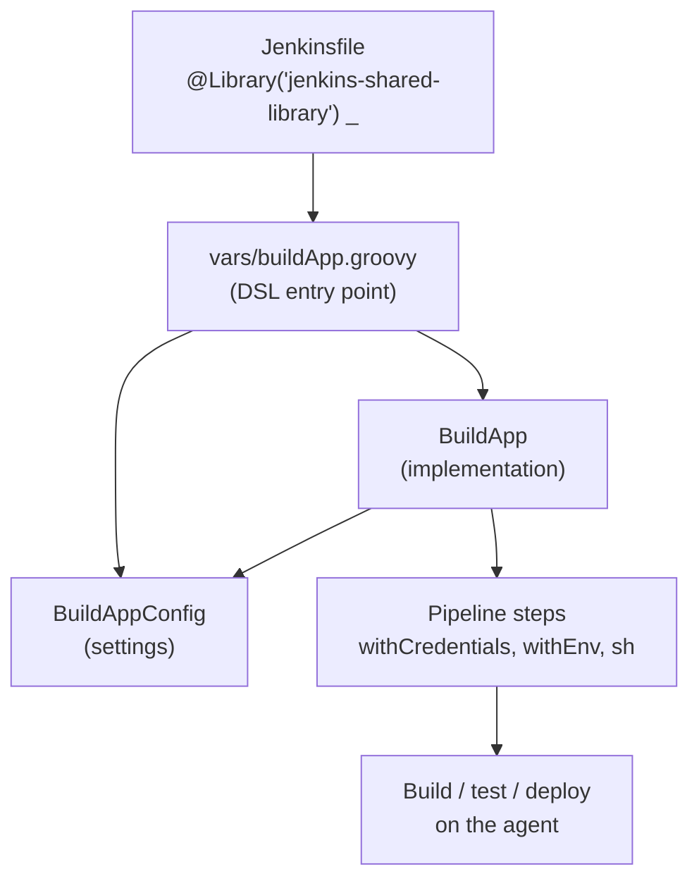
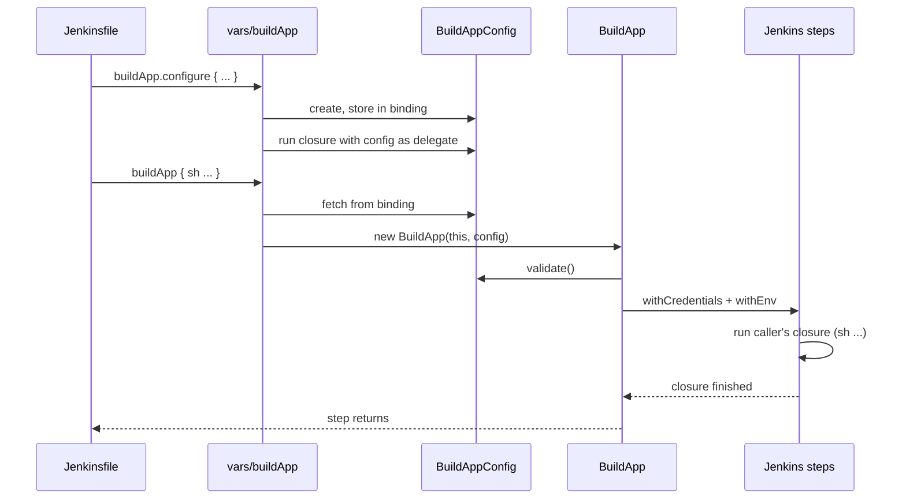

# Building and Using a Jenkins Shared Library

## Abbreviations

| Abbreviation | Full name | Meaning here |
|---|---|---|
| CI / CD | Continuous Integration / Continuous Delivery | The build-test-deploy automation a shared library standardises |
| DSL | Domain-Specific Language | The small, readable syntax a library exposes to Jenkinsfiles (`buildApp { ... }`) |
| CPS | Continuation-Passing Style | How Jenkins rewrites Pipeline Groovy so a build can pause, survive a restart and resume |
| SCM | Source Code Management | The Git repository Jenkins loads the library from |
| IDE | Integrated Development Environment | Editor support such as completion inside DSL closures |
| API | Application Programming Interface | The public steps a library promises not to break |
| JVM | Java Virtual Machine | The single process in which all builds on a controller share classes |

## 1. The short answer

A **Jenkins Shared Library** is a Git repository of Pipeline Groovy code that many Jenkinsfiles load and call. Instead of copy-pasting the same 80 lines of "log in to the registry, install, test, build, push" into every repository, each Jenkinsfile shrinks to a few readable calls, and the logic lives — versioned, reviewed and tested — in one place.

A well-structured library has three layers:

| Layer | Location | Job |
|---|---|---|
| **DSL entry point** | `vars/<step>.groovy` | Becomes a global step (`buildApp`). Thin: wire up config, delegate. |
| **Configuration object** | `src/.../<Step>Config.groovy` | Holds the user's settings, separate from behaviour. |
| **Implementation class** | `src/.../<Step>.groovy` | Does the work by calling real Jenkins steps (`sh`, `withCredentials`, ...). |

The rest of this article builds one such step, `buildApp`, end to end.

## 2. Repository layout

```text
jenkins-shared-library/
├── vars/                       # global steps: file name = step name
│   ├── buildApp.groovy
│   └── buildApp.txt            # help text shown in the Pipeline Syntax page
├── src/                        # ordinary Groovy classes on the classpath
│   └── com/example/jenkins/
│       └── build/
│           ├── BuildApp.groovy
│           └── BuildAppConfig.groovy
├── resources/                  # non-Groovy files, read with libraryResource
│   └── com/example/jenkins/build/settings.xml
├── test/                       # unit tests (JenkinsPipelineUnit)
└── README.md
```

- **`vars/`** — each `foo.groovy` becomes a global variable `foo` available in every Pipeline that loads the library. A `call` method makes `foo(...)` / `foo { ... }` work; other methods are reached as `foo.bar(...)`.
- **`src/`** — standard Java-style package directories, added to the classpath. Import them with `import com.example...`.
- **`resources/`** — loaded as text with `libraryResource 'com/example/jenkins/build/settings.xml'`, handy for config templates and scripts.

## 3. How the pieces fit



*This diagram answers: when a Jenkinsfile calls `buildApp`, which file does what?*

## 4. The configuration object

Settings live in a plain class, kept apart from the code that acts on them:

```groovy
// src/com/example/jenkins/build/BuildAppConfig.groovy
package com.example.jenkins.build

class BuildAppConfig implements Serializable {
    String credentialsId
    String registryUrl

    void validate(def script) {
        if (!credentialsId) script.error('buildApp: credentialsId is required')
        if (!registryUrl)   script.error('buildApp: registryUrl is required')
    }
}
```

**Why `Serializable`?** Pipeline Groovy runs under CPS (Continuation-Passing Style): at every step boundary Jenkins may serialise the whole program state to disk so the build can survive a controller restart. Any object still referenced at that point — including this config — must be serialisable, or the build fails with `NotSerializableException`.

## 5. The implementation class

The implementation receives the Pipeline *script* object so it can call Jenkins steps on it. Classes in `src/` do not see `sh` or `withCredentials` on their own — those are methods of the running Pipeline script.

```groovy
// src/com/example/jenkins/build/BuildApp.groovy
package com.example.jenkins.build

class BuildApp implements Serializable {
    private final def script
    private final BuildAppConfig config

    BuildApp(def script, BuildAppConfig config) {
        this.script = script
        this.config = config
    }

    void execute(Closure body) {
        config.validate(script)

        script.withCredentials([
            script.usernamePassword(
                credentialsId: config.credentialsId,
                usernameVariable: 'REGISTRY_USER',
                passwordVariable: 'REGISTRY_PASSWORD'
            )
        ]) {
            script.withEnv(["PACKAGE_REGISTRY=${config.registryUrl}"]) {
                body()
            }
        }
    }
}
```

The caller's closure runs *inside* the credentials and environment blocks, so its `sh` commands see `REGISTRY_USER`, `REGISTRY_PASSWORD` and `PACKAGE_REGISTRY`. `withCredentials` also masks the secret values in the build log.

## 6. The DSL entry point in `vars/`

The `vars/` file is the public face. Keep it thin: find the configuration, build the implementation, delegate.

```groovy
// vars/buildApp.groovy
import com.example.jenkins.build.BuildApp
import com.example.jenkins.build.BuildAppConfig

// buildApp.configure { credentialsId = '...'; registryUrl = '...' }
def configure(@DelegatesTo(BuildAppConfig) Closure closure) {
    closure.delegate = config()
    closure.resolveStrategy = Closure.DELEGATE_FIRST
    closure()
}

// buildApp { sh '...' }
def call(Closure body) {
    new BuildApp(this, config()).execute(body)
}

private BuildAppConfig config() {
    if (!binding.hasVariable('__buildAppConfig')) {
        binding.setVariable('__buildAppConfig', new BuildAppConfig())
    }
    binding.getVariable('__buildAppConfig')
}
```

Three details carry the design:

1. **`Closure.DELEGATE_FIRST`** — inside `configure { credentialsId = 'x' }`, the bare name `credentialsId` is resolved against the delegate (the config object) before anything else. That is what turns a closure into a configuration block.
2. **`@DelegatesTo(BuildAppConfig)`** — no runtime effect; it tells the IDE (Integrated Development Environment) what the delegate is, so completion and type checking work inside the block.
3. **Passing `this`** — in a `vars/` script, `this` is a Pipeline script object, so `BuildApp` can call `script.sh`, `script.withCredentials` and `script.error` through it.

### Why the configuration is kept in the binding

`configure` and `call` are two separate calls, so the settings must survive from one to the other. A `vars/` script is instantiated **once per build** (a per-build singleton), and its `binding` lives as long as that build. Storing the config there means:

- `buildApp.configure { ... }` followed later by `buildApp { ... }` in the same build shares the same settings;
- two builds running at the same time never see each other's settings.

**Do not use `static` fields for this.** Static state lives in the library's class loader, outside any single build, and concurrent builds would overwrite each other's credentials ID or registry URL.

### Help text

`vars/buildApp.txt` (plain text or HTML) appears under *Pipeline Syntax → Global Variables Reference* once the library has been loaded by a build. Treat it as the user documentation of the step.

## 7. Making the library available

Register the library once in **Manage Jenkins → System → Global Trusted Pipeline Libraries** (or on a folder, for a team-scoped library):

| Setting | Recommendation |
|---|---|
| Name | `jenkins-shared-library` — the name Jenkinsfiles refer to |
| Default version | A tag or a stable branch (`v1.4.0`, `main`) |
| Allow default version to be overridden | On, so a Jenkinsfile can pin or test a version |
| Load implicitly | Usually off — explicit `@Library` makes the dependency visible |
| Retrieval method | Modern SCM → Git, pointing at the library repository |

**Trust levels matter.** A *global* library runs outside the Groovy sandbox and can call any Jenkins API; a *folder-level* library runs inside the sandbox. Protect the global library's repository like production code: required reviews, protected branches, tagged releases.

## 8. Loading it from a Jenkinsfile

```groovy
@Library('jenkins-shared-library') _            // default version
@Library('jenkins-shared-library@v1.4.0') _     // pinned to a tag
@Library('jenkins-shared-library@feature/x') _  // try a branch before release
```

The trailing `_` is not a typo: a Groovy annotation must decorate *something*, and `_` is a throwaway target when you only need the global steps from `vars/`. If you also want to `import` classes from `src/`, put the annotation on the import instead:

```groovy
@Library('jenkins-shared-library') import com.example.jenkins.build.BuildAppConfig
```

The `library` step loads a library dynamically at run time, for example when the version comes from a parameter:

```groovy
library "jenkins-shared-library@${params.LIB_VERSION}"
```

## 9. A complete Jenkinsfile

```groovy
@Library('jenkins-shared-library@v1.4.0') _

pipeline {
    agent any

    stages {
        stage('Build') {
            steps {
                script {
                    buildApp.configure {
                        credentialsId = 'registry-credentials'
                        registryUrl   = 'https://packages.example.com/'
                    }
                }

                buildApp {
                    sh '''
                        set -eu
                        package-manager install
                        package-manager test
                        package-manager build
                    '''
                }
            }
        }
    }
}
```

**Why is `configure` in a `script {}` block?** Declarative Pipeline allows *steps* in `steps {}` — and a global variable's `call` method counts as a step, so `buildApp { ... }` is fine. But `buildApp.configure { ... }` is a method call on an object, which Declarative rejects outside `script {}`. A scripted Pipeline (`node { ... }`) has no such restriction.

## 10. What happens at run time



*This diagram answers: in what order do the two calls touch the config, the implementation and Jenkins?*

## 11. CPS pitfalls worth knowing

Most "it works in plain Groovy but not in Jenkins" bugs come from CPS:

| Symptom | Cause | Fix |
|---|---|---|
| `NotSerializableException` | A non-serialisable object (a `Matcher`, an iterator, a JSON parser result) is alive across a step boundary | Make your classes `Serializable`; keep such objects in local scope inside a `@NonCPS` method |
| A collection method silently processes only the first element | Some Groovy closures (`each`, `collect`, `sort` with a closure) behave oddly under CPS in older versions | Prefer a plain `for` loop, or move the pure-data logic into a `@NonCPS` method |
| `@NonCPS` method fails when calling `sh` | `@NonCPS` methods run as normal Groovy and **cannot call Pipeline steps** | Use `@NonCPS` only for pure computation; call steps from normal methods |
| `RejectedAccessException` | Code in a sandboxed (folder-level) library or Jenkinsfile calls an unapproved method | Move the code into a trusted global library, or get the signature approved |

## 12. Testing

Do not test a shared library only by pushing a branch and watching a real build. Unit-test it with **JenkinsPipelineUnit** (`com.lesfurets:jenkins-pipeline-unit`), which runs the scripts with mocked steps:

```groovy
// test/BuildAppTest.groovy
import com.lesfurets.jenkins.unit.BasePipelineTest
import org.junit.Before
import org.junit.Test

class BuildAppTest extends BasePipelineTest {
    @Before
    void setUp() {
        super.setUp()
        helper.registerAllowedMethod('usernamePassword', [Map]) { it }
        helper.registerAllowedMethod('withCredentials', [List, Closure]) { l, c -> c() }
        helper.registerAllowedMethod('withEnv', [List, Closure]) { l, c -> c() }
    }

    @Test
    void runsCallerClosureInsideCredentials() {
        def step = loadScript('vars/buildApp.groovy')
        step.configure {
            credentialsId = 'creds'
            registryUrl = 'https://packages.example.com/'
        }
        step.call { sh 'make build' }

        assert helper.callStack.find { it.methodName == 'sh' }
        assert helper.callStack.find { it.methodName == 'withCredentials' }
    }
}
```

Cover at least:

- configuration defaults, validation and the error message for missing settings;
- that the caller's closure runs *inside* `withCredentials` and `withEnv`;
- the environment variables passed to the closure;
- failure paths (`error` is called, nothing runs);
- that no secret value is passed to `echo` or written to a file.

Then add one integration check: a throwaway Jenkinsfile that loads the library at `@your-branch` on a real controller, run before tagging a release.

## 13. Design guidelines

- **Keep `vars/` thin; put logic in `src/`.** Classes are easier to test, reuse and refactor.
- **Separate settings from behaviour.** Config objects hold data; implementation classes act.
- **Validate early.** Fail with a clear `error('buildApp: registryUrl is required')`, not a cryptic `sh` failure ten minutes later.
- **Never hard-code secrets or environment-specific URLs.** Take credential *IDs* as parameters and resolve them with `withCredentials`.
- **No mutable static state.** Builds run concurrently in one JVM.
- **Treat public steps as an API.** Jenkinsfiles across the company depend on `buildApp`'s syntax. Do not break it in a minor release; use semantic version tags and a changelog.
- **Pin versions in important pipelines.** `@Library('lib@v1.4.0')` makes a library change an explicit, reviewable bump instead of a surprise.
- **Document every step** in its `vars/<step>.txt` and the README.

## 14. Conclusion

A Jenkins Shared Library turns copy-pasted Pipeline code into a versioned, tested internal product:

- the **`vars/` entry point** gives Jenkinsfiles a small, readable DSL;
- the **configuration object** holds settings for one build, safely in the binding;
- the **implementation class** does the work through real Pipeline steps, inside credential and environment scopes.

Add CPS awareness, unit tests with JenkinsPipelineUnit and disciplined versioning, and every repository gets the same reliable build behaviour from a few lines of Jenkinsfile — with one place to fix it when it needs to change.

## References

- Jenkins handbook, *Extending with Shared Libraries*: <https://www.jenkins.io/doc/book/pipeline/shared-libraries/>
- Pipeline CPS method mismatches and `@NonCPS`: <https://www.jenkins.io/doc/book/pipeline/cps-method-mismatches/>
- JenkinsPipelineUnit: <https://github.com/jenkinsci/JenkinsPipelineUnit>
- Related notes here: [Jenkins 2 Pipeline definition](./Jenkins-pipeline.md), [how make template pipeline](./template-pipeline.md)
