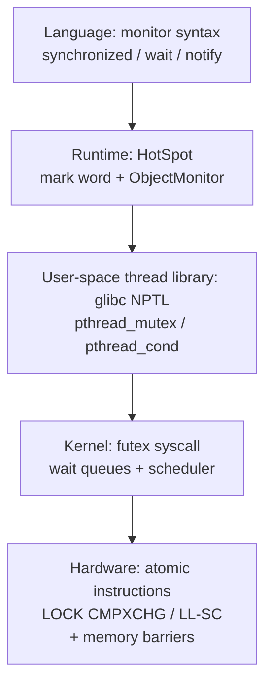
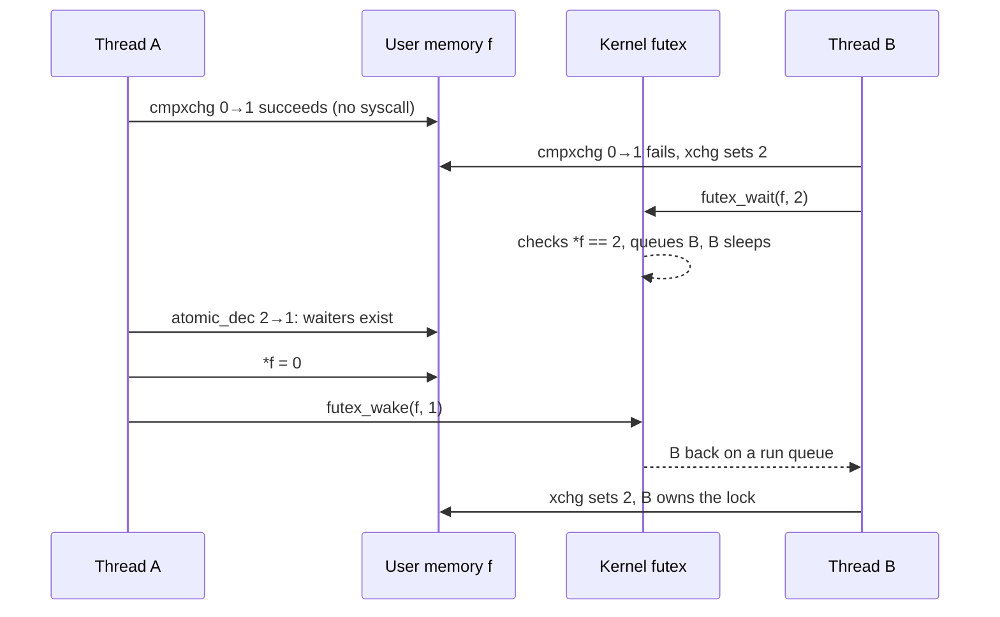
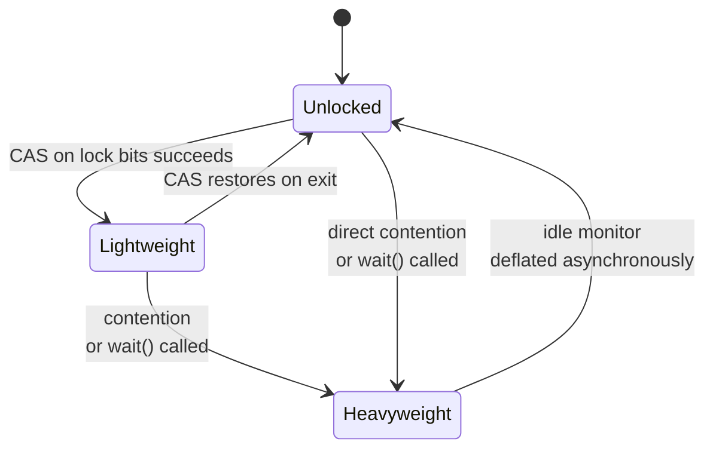
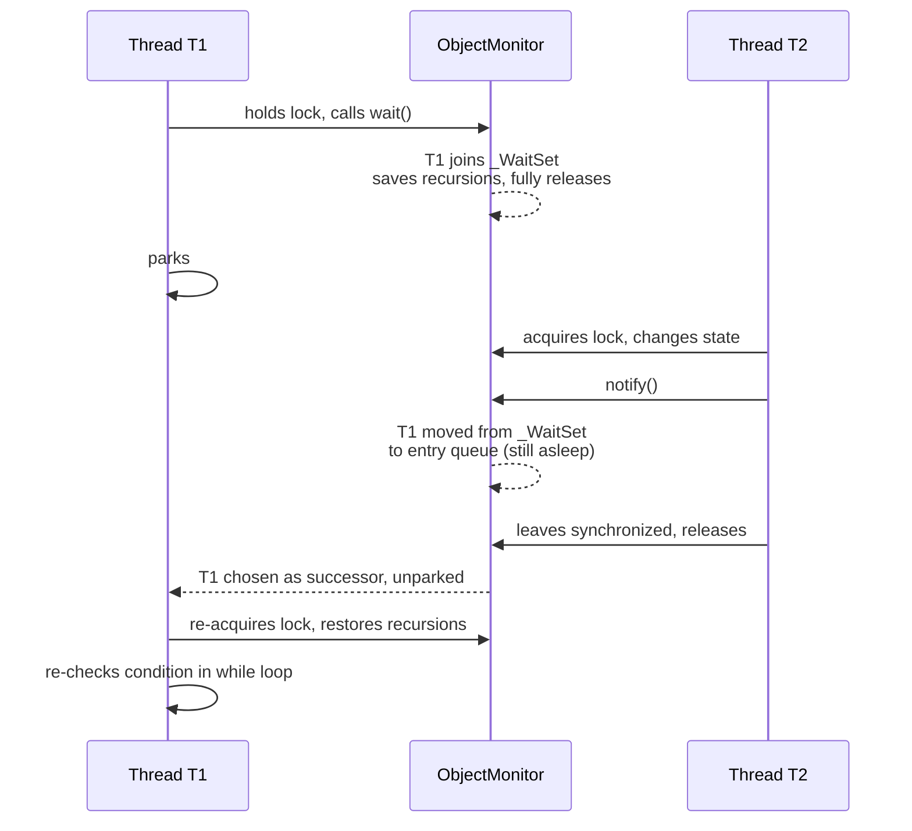

# How Monitors Are Implemented: From the OS Kernel to the HotSpot ObjectMonitor

*中文版：[管程是怎么实现的：从操作系统内核到 HotSpot 对象监视器](./monitor-implementation-os-and-hotspot.zh.md)*

The companion article, [From PV Operations and Monitors to Modern Java Concurrency](./semaphores-and-monitors-in-java.en.md), covers **what a monitor is**: private data, procedures, implicit mutual exclusion, condition variables, and the Hoare-versus-Mesa signalling question. This one asks the next question — **how is it built?** — and follows the answer from a single atomic CPU instruction, through Linux wait queues and futexes, up to the object header and `ObjectMonitor` that sit behind every `synchronized` block in HotSpot.

## Abbreviations

| Abbreviation | Full name |
|---|---|
| OS | Operating System |
| CPU | Central Processing Unit |
| CAS | Compare-And-Swap |
| TAS | Test-And-Set |
| LL/SC | Load-Linked / Store-Conditional |
| MCS | Mellor-Crummey and Scott (queue lock) |
| futex | Fast Userspace muTEX |
| NPTL | Native POSIX Thread Library (glibc's threading implementation) |
| POSIX | Portable Operating System Interface |
| JVM | Java Virtual Machine |
| JDK | Java Development Kit |
| JEP | JDK Enhancement Proposal |
| JUC | `java.util.concurrent` |
| AQS | `AbstractQueuedSynchronizer` |
| GC | Garbage Collection |
| IPI | Inter-Processor Interrupt |

## 0. Three problems every implementation must solve

Whatever layer you look at, a monitor implementation has to answer the same three mechanical questions:

1. **Mutual exclusion** — how do we guarantee at most one thread is inside?
2. **Condition waiting** — `wait(c)` must *release the lock and go to sleep*; `signal(c)` must *wake one sleeper*. If another thread slips in between those two halves, the signal is lost (the **lost wake-up** problem). How is that prevented?
3. **Blocking and waking** — when a thread cannot proceed, how does it actually stop consuming CPU, and how is it brought back?

Every design below is one particular answer to these three.



*This diagram answers: when a `synchronized` block blocks, which layers does the request pass through?*

## Part 1: Monitors at the operating-system level

First, a clarification that removes a lot of confusion: **a monitor is a language construct, not a kernel object.** There is no `monitor` system call in Linux. What Hoare and Brinch Hansen proposed was a compiler that sees a `monitor` block, inserts a lock at every procedure entry and an unlock at every exit, and compiles `wait`/`signal` into operations on condition variables. So "how does the OS implement monitors?" really means "what primitives does the OS provide so that a compiler or runtime can assemble one?" The answer is two things: **locks** and **wait queues**.

### 1.1 Mutual exclusion starts with one atomic instruction

**On a uniprocessor**, the only thing that can interrupt a critical section is an interrupt, so disabling interrupts on entry and re-enabling them on exit is enough. That stops working on multiple cores — you only silenced *your* core.

**On a multiprocessor**, you need hardware that performs read-modify-write indivisibly:

| Family | Example | Semantics |
|---|---|---|
| TAS / exchange | x86 `XCHG` | Atomically store a new value, return the old one |
| CAS | x86 `LOCK CMPXCHG` | Store only if the current value equals the expected one; report success |
| LL/SC | ARM `LDXR/STXR` (or ARMv8.1 `CAS`) | Store only if nobody wrote the location since the load |

The `LOCK` prefix makes the core take exclusive ownership of the cache line in the coherence protocol, so no other core can modify it mid-operation; these instructions also act as memory barriers, so loads and stores inside the critical section cannot be reordered outside it. With that, the simplest lock — a **spinlock** — is a few lines:

```c
void spin_lock(int *l)   { while (xchg(l, 1) == 1) cpu_relax(); }  // retry until we win
void spin_unlock(int *l) { store_release(l, 0); }
```

A spinlock solves mutual exclusion but not blocking: the loser burns CPU the whole time. For hold times of tens of nanoseconds that is actually the fastest option; for long hold times, or when the holder has been descheduled, it is pure waste. So we need the second ingredient.

### 1.2 Blocking and waking: kernel wait queues and the scheduler

The kernel "stops" a thread by **marking it as sleeping, removing it from the run queue and switching to someone else**. The canonical Linux pattern for waiting on a condition is:

```c
DEFINE_WAIT(wait);
for (;;) {
    prepare_to_wait(&wq, &wait, TASK_INTERRUPTIBLE); // (1) enqueue and mark ourselves asleep
    if (condition)                                   // (2) only then test the condition
        break;
    schedule();                                      // (3) give up the CPU
}
finish_wait(&wq, &wait);
```

And the waker:

```c
condition = true;
wake_up(&wq);   // mark queued tasks TASK_RUNNING and put them back on a run queue
```

**Why no lost wake-up?** Because of the order of (1) and (2). If the waker runs `wake_up` between (2) and (3), it flips our state back to `TASK_RUNNING`, so `schedule()` in (3) sees a runnable task and returns at once. Test the condition *before* enqueueing and that window would swallow the wake-up.

**What suspend and resume physically mean:**

- **Suspend:** `schedule()` takes the task off the run queue; `context_switch()` saves registers and switches kernel stacks (and page tables if the next task is in another process). The thread now consumes no CPU at all.
- **Resume:** `try_to_wake_up()` sets the task to `TASK_RUNNING` and puts it on some CPU's run queue; if that CPU is idle, an IPI (Inter-Processor Interrupt) kicks it.

A wake-up only makes the thread *runnable*; the scheduler decides when it actually runs. That is the physical origin of **Mesa semantics**: by the time the woken thread executes, someone else may have changed the condition again, so it must re-check in a `while` loop.

### 1.3 The kernel's own sleeping lock: spin, then queue

The kernel's `struct mutex` combines both ingredients into three paths:

| Path | When | What happens |
|---|---|---|
| Fast path | Lock is free | One `cmpxchg` sets owner from 0 to us — done |
| Mid path | Lock is held, but the owner is **currently running on a CPU** | Optimistic spinning (queued MCS-style) on the bet that it releases soon |
| Slow path | Owner is asleep, or spinning took too long | Join `wait_list`, `schedule()`; the unlocker wakes us |

Keep this "CAS first, spin briefly, then queue and sleep" shape in mind. It reappears in futexes, in glibc and in HotSpot.

### 1.4 Assembling a monitor: the classic Hoare monitor built from semaphores

Given locks and wait queues — which is all a semaphore is — a compiler can translate a monitor mechanically. This is the textbook translation, and it implements **Hoare semantics** (the signalled thread runs immediately):

```text
semaphore mutex = 1;       // monitor entry lock
semaphore next  = 0;       // signallers that stepped aside sleep here
int next_count  = 0;       // how many are sleeping on next

for each condition variable x:
semaphore x_sem   = 0;
int       x_count = 0;

procedure body:
    P(mutex);
    ...body...
    if (next_count > 0) V(next);   // hand the monitor back to a waiting signaller first
    else                V(mutex);

x.wait():
    x_count++;
    if (next_count > 0) V(next); else V(mutex);   // leave the monitor
    P(x_sem);                                     // sleep on x
    x_count--;

x.signal():
    if (x_count > 0) {
        next_count++;
        V(x_sem);      // wake one waiter on x and hand it the monitor
        P(next);       // step aside and sleep on next
        next_count--;
    }
```

Reading it makes Hoare's cost obvious: every signal costs **an extra context switch** — the signaller sleeps so the signalled thread can run. Mesa semantics shrink `x.signal()` to "`V(x_sem)` and keep going", saving that switch at the price of waiters re-checking their condition. That is the engineering reason both pthreads and Java chose Mesa.

### 1.5 The user-space shortcut: futex

The kernel machinery above has one drawback: even an uncontended lock would trap into the kernel on every acquire. A system call costs far more than an atomic instruction — typically hundreds of nanoseconds or more, and microseconds once a context switch is involved, versus nanoseconds for an uncontended CAS. The futex (Fast Userspace muTEX, merged in Linux 2.5 in 2002) fixes this by **keeping the lock word in user memory and entering the kernel only when someone must actually sleep or be woken.**

A futex has two core operations:

- `futex_wait(addr, expected)` — the kernel, **while holding the lock on the hash bucket for `addr`**, checks `*addr == expected`; only if it still matches does the caller go to sleep. Otherwise it returns `EAGAIN` immediately.
- `futex_wake(addr, n)` — wake up to `n` threads sleeping on `addr`.

"Check the value" and "go to sleep" are atomic inside the kernel. It is the same anti-lost-wake-up trick as in 1.2, with the condition replaced by a user-space integer.

Ulrich Drepper's *Futexes Are Tricky* gives the classic mutex built on it, using three states — `0` free, `1` locked with no waiters, `2` locked with possible waiters:

```c
void lock(int *f) {
    int c = cmpxchg(f, 0, 1);           // fast path: 0 -> 1, pure user space
    if (c != 0) {
        if (c != 2) c = xchg(f, 2);     // announce "someone is waiting"
        while (c != 0) {
            futex_wait(f, 2);           // slow path: sleep in the kernel
            c = xchg(f, 2);
        }
    }
}

void unlock(int *f) {
    if (atomic_dec(f) != 1) {           // was 2: there may be waiters
        *f = 0;
        futex_wake(f, 1);               // enter the kernel to wake one
    }                                   // was 1: nobody waiting, no syscall
}
```



*This diagram answers: at which moments does a futex lock actually enter the kernel?*

**Bottom line: an uncontended lock and unlock never leave user space; the user/kernel transition happens only when a thread must really sleep or really be woken.** That is the physical reason behind the folk wisdom "locks are cheap, contention is expensive."

### 1.6 Condition variables: the skeleton of pthread_cond

The hard part of a condition variable is that `wait` must atomically "release the mutex and sleep". A simplified futex version:

```c
void cond_wait(cond_t *cv, mutex_t *m) {
    int seq = cv->seq;          // (1) remember the current signal sequence
    mutex_unlock(m);            // (2) release the mutex
    futex_wait(&cv->seq, seq);  // (3) sleep only if no signal arrived since (1)
    mutex_lock(m);              // (4) compete for the mutex again (Mesa)
}

void cond_signal(cond_t *cv) {
    atomic_inc(&cv->seq);       // bump the sequence
    futex_wake(&cv->seq, 1);    // wake one sleeper
}
```

If a signal lands between (2) and (3), the sequence has already changed and `futex_wait` returns immediately — nothing is lost. Step (4) is Mesa semantics in code: the woken thread must re-acquire the mutex, so callers must write `while (!cond) pthread_cond_wait(...)`.

Real glibc (the algorithm introduced in 2.25) is considerably more involved: it splits waiters into two groups so a signal can never wake a thread that started waiting *after* the signal, and it handles sequence wrap-around and cancellation. The four steps above are still its skeleton.

## Part 2: Monitors in Java

At the language level every Java object is a monitor. **Physically, almost none of them carries one** — the memory cost would be prohibitive. HotSpot's trick is to **squeeze lock state into a few bits of the 64-bit object header, and allocate a real `ObjectMonitor` only when threads genuinely need to queue.**

### 2.1 The bytecode entry points: monitorenter / monitorexit

A `synchronized` block compiles to a `monitorenter` / `monitorexit` pair, and javac also emits an exception handler that runs `monitorexit` if the block throws — that is "the compiler releases the lock for you", implemented. A `synchronized` *method* gets no such bytecodes; instead its `ACC_SYNCHRONIZED` flag tells the JVM to lock on invocation and unlock on return. The monitor-theory promise that "locking is inserted by the compiler, so you cannot forget it" is delivered literally.

### 2.2 The mark word in the object header

On 64-bit HotSpot, the first word of every object header is the **mark word**. Its two lowest bits (plus, historically, one biased bit) decide what the remaining bits mean. The classic layout, without compact object headers:

| Lock state | High bits | Biased bit | Lock bits (lowest 2) |
|---|---|---|---|
| Unlocked | 25 unused · 31 identity hash · 1 unused · 4 GC age | 0 | `01` |
| Biased (removed) | 54 owning-thread pointer · 2 epoch · 1 unused · 4 GC age | 1 | `01` |
| Lightweight (legacy) | 62-bit pointer to an on-stack lock record | — | `00` |
| Heavyweight | 62-bit pointer to an `ObjectMonitor` | — | `10` |
| GC marked | used by the collector | — | `11` |

Two things to notice:

- Because one word is reused for everything, locking displaces the identity hash and GC age, which then have to be parked elsewhere — in the stack lock record's "displaced header" (legacy lightweight locking) or inside the `ObjectMonitor` (heavyweight).
- Compact object headers (experimental in JDK 24 via JEP 450, a product feature in JDK 25 via JEP 519) shrink the header to 64 bits and change this layout; they rely on the newer lightweight locking and the "object monitor table" described below. The table above is the classic version, best for understanding the idea.

### 2.3 Lock states and the upgrade path



*This diagram answers: how does an object's lock state move between unlocked, lightweight and heavyweight? (Biased locking is gone and is not shown.)*

**Biased locking (historical).** The observation behind it: most locks are only ever taken by one thread. The first acquire CASes the thread ID into the mark word; later re-entries by the same thread only compare IDs — **no CAS at all**. The bill arrives on revocation: when another thread shows up, the owner must be stopped at a safepoint and its stack inspected to see whether it still holds the lock. As uncontended CAS became cheap on modern CPUs, while revocation stayed expensive and the code stayed complex, biased locking was disabled by default and deprecated in JDK 15 (JEP 374), and its flags were obsoleted and the implementation removed in JDK 18. **The popular "biased → lightweight → heavyweight" upgrade story describes the default behaviour before JDK 15.**

**Lightweight locking, legacy ("stack locking").** The thread allocates a lock record in the current stack frame, copies the object's original mark word into it (the displaced header), then CASes the mark word to point at that record with lock bits `00`. A recursive acquire just pushes another lock record with an empty displaced header. Unlock CASes the displaced header back. **Only user-space CAS, never a system call.**

**Lightweight locking, new (lock-stack).** Introduced in JDK 21 and the default from JDK 23 (`LockingMode` defaults to lightweight). Each thread owns a small array, the lock-stack. Locking CASes only the mark word's lock bits from `01` to `00` and pushes the object reference onto the thread's lock-stack; the hash and age bits stay where they are, and there is no pointer into anyone's stack. "Do I own this?" becomes a scan of your own lock-stack. Part of the motivation is to make room for compact object headers and virtual threads, both of which are awkward when the header points into a specific thread's stack.

**Inflation to heavyweight.** Triggered when:

- the lightweight CAS fails (contention);
- the owner calls `wait()` — lightweight locks have no wait set, so a real `ObjectMonitor` is needed;
- the lock-stack is full, or another implementation limit is hit.

Inflation allocates (or reuses) an `ObjectMonitor` and points the mark word at it with lock bits `10`. From JDK 24, `-XX:+UseObjectMonitorTable` can instead keep the object-to-monitor mapping in a side hash table so the mark word is not overwritten — a capability compact object headers require.

**Do locks ever downgrade?** The common claim is "locks only upgrade, never downgrade." Within a single holding period that is roughly true, but an `ObjectMonitor` is not welded to its object: since JDK 15 a dedicated thread **deflates idle monitors asynchronously**, returning the object to the unlocked state and recycling the monitor. The precise statement is: **no downgrade while held; deflation once idle.**

### 2.4 ObjectMonitor: the monitor in full

`ObjectMonitor` is a C++ object — the textbook monitor made concrete inside HotSpot. Key fields in the classic version (roughly JDK 8 through 21):

| Field | Role | Monitor concept |
|---|---|---|
| `_owner` | Current owner | The one thread inside |
| `_recursions` | Re-entry count | Reentrancy |
| `_cxq` | Singly linked list of new contenders, pushed by CAS (LIFO) | Entry queue (lock-free part) |
| `_EntryList` | Doubly linked list from which the releasing thread picks a successor | Entry queue |
| `_WaitSet` | Circular doubly linked list of threads in `wait()` | Condition-variable queue |
| `_succ` | Thread already chosen as the presumed successor | Avoids redundant wake-ups |

Newer JDKs have refactored these structures — for example, JEP 491 changed how the owner is recorded (a thread ID rather than a platform-thread pointer) so virtual threads can own monitors, and the entry queues have been consolidated — so field names may differ. The shape — owner, recursion count, entry queue, wait set — has not changed.

**Acquire (`enter`) is the familiar three-stage pattern again:**

1. **CAS the owner** from empty to self; on success, return. If the owner is already self, `_recursions++`.
2. **Adaptive spinning**, sized by how often spinning on this monitor has paid off before — betting the owner releases soon.
3. **Queue and sleep**: wrap self in an `ObjectWaiter` node, CAS-push it onto `_cxq`, then loop "try once more, otherwise park".

**Release (`exit`):** if `_recursions` is non-zero, decrement and return. Otherwise release the owner (with a memory barrier). With no waiters, return — **no system call on this path either.** With waiters, pick a successor from `_EntryList` (draining `_cxq` into it first if it is empty) and **unpark just that one**, avoiding a thundering herd.

Notice that step 3 wakes up to *try the CAS again*, not to receive the lock. The releasing thread only wakes a successor; the lock itself is left free for anyone to grab, and a newly arriving thread may CAS it before the successor is even scheduled (**barging**). That buys `synchronized` throughput, but it means **`synchronized` is not fair** — if you need FIFO, use `new ReentrantLock(true)`.

### 2.5 What wait / notify do inside ObjectMonitor



*This diagram answers: which ObjectMonitor queues does a thread move through during wait/notify, and when is it actually woken?*

Facts you can read straight off the implementation:

- **`wait()` requires ownership.** Its first step checks that `_owner` is the caller and throws `IllegalMonitorStateException` otherwise.
- **`wait()` releases *all* re-entries.** It saves `_recursions`, zeroes it, exits completely, and restores the count after re-acquiring — which is why calling `wait()` three `synchronized` levels deep does not deadlock.
- **`notify()` wakes nobody immediately.** It only moves a waiter from `_WaitSet` to the entry queue. The notified thread is unparked later, once the notifier has left the critical section and the waiter has been chosen as successor. That is Mesa's signal-and-continue, visible in the source.
- **There is only one `_WaitSet`,** so threads waiting for different conditions share it — hence the default advice to use `notifyAll()`. For several conditions, use `ReentrantLock` with multiple `Condition`s; each has its own wait queue.

### 2.6 How the JVM reaches the OS primitives

HotSpot does not issue futex system calls directly; it goes through a platform layer:

| Java level | Inside HotSpot | On Linux it becomes |
|---|---|---|
| `synchronized` contention / `wait()` | `ObjectMonitor` → per-thread `ParkEvent` → `os::PlatformEvent::park()` | `pthread_mutex` + `pthread_cond_wait` |
| `LockSupport.park()` (AQS, `ReentrantLock`, `Condition`) | per-thread `Parker` | `pthread_mutex` + `pthread_cond_(timed)wait` |
| Both | glibc NPTL | `futex(FUTEX_WAIT / FUTEX_WAKE)` system calls |

`PlatformEvent` carries a small counter as its own fast path: if the unpark arrives before the park (the permit is already available), park returns without touching pthreads at all. Only a real sleep calls `pthread_cond_wait`, which glibc turns into `futex_wait`, which lands in the kernel wait queue and scheduler from Part 1. End to end:

```text
synchronized contention
  -> CAS fails -> spinning fails -> enqueue on ObjectMonitor
  -> ParkEvent::park -> pthread_cond_wait
  -> futex(FUTEX_WAIT) syscall             <- first entry into kernel mode
  -> kernel: join hash-bucket queue, schedule() away
...
owner exits -> unpark successor -> pthread_cond_signal
  -> futex(FUTEX_WAKE)                      <- the waker enters kernel mode
  -> try_to_wake_up() -> successor back on a run queue
```

On macOS, pthreads sit on Darwin's `psynch` system calls rather than futexes, but the structure is the same.

### 2.7 Virtual threads: moving "sleep" from the kernel into the JVM

A virtual thread (JEP 444, JDK 21) that blocks does **not** take the path to futex above. It saves its frames as a continuation on the heap and unmounts from its carrier platform thread, which goes off to run other virtual threads. To resume, the JVM's scheduler (a `ForkJoinPool`) mounts it again on some carrier.

In JDK 21–23, blocking inside `synchronized` pinned the carrier — partly because the old implementation tied lock ownership to a particular platform thread and its stack. JEP 491 (JDK 24) reworked how `ObjectMonitor` records its owner, so `synchronized` now unmounts in most cases. Pinning still happens when there is a native frame on the stack and during class initialisation.

## Part 3: The two layers side by side

| Mechanism | OS / thread library | HotSpot `synchronized` |
|---|---|---|
| Atomicity of mutual exclusion | Hardware atomics (`LOCK CMPXCHG`, LL/SC); interrupt masking on a uniprocessor | The same CAS, applied to the mark word or `_owner` |
| Uncontended fast path | futex lock: one user-space CAS, zero syscalls | Lightweight lock: one CAS (biased locking used to skip even that) |
| Brief contention | Kernel mutex optimistic spinning; glibc adaptive mutexes optional | `ObjectMonitor` adaptive spinning |
| Entry queue | Kernel `wait_list` / futex hash-bucket queue | `_cxq` + `_EntryList` |
| Condition variable | `pthread_cond`: sequence counter + futex | `_WaitSet` (only one per object) |
| Lost wake-up prevention | Enqueue or record a sequence first, test second, sleep last — checked atomically in the kernel | Join `_WaitSet` before releasing the lock; `ParkEvent` permit counter |
| Suspend | Off the run queue + context switch | `park` → `pthread_cond_wait` → futex |
| Resume | Back on a run queue, IPI if needed | `unpark` one successor → futex wake |
| Signalling semantics | Mesa (pthreads) | Mesa |
| Fairness | Generally not guaranteed | Not guaranteed; barging allowed |
| When kernel mode is entered | Only to really sleep or really wake | Only after inflation, on a real park / unpark |

## Part 4: What this adds to the companion article

| Topic | *From PV Operations and Monitors…* | This article |
|---|---|---|
| Monitor definition, Hoare vs. Mesa | Covered | Adds the implementation cost of each (1.4) |
| `synchronized` / `wait` / `notify` usage rules | Covered | Adds where each rule comes from inside `ObjectMonitor` (2.5) |
| AQS, `Condition`, `Semaphore` | Covered | Only the shared `park` path to the OS (2.6) |
| Atomic instructions, spinlocks, kernel wait queues, lost wake-up | Not covered | 1.1–1.3 |
| futex fast/slow paths, pthread_cond | Named only | 1.5–1.6 |
| Mark word, lock upgrades, inflation and deflation | One sentence | 2.2–2.3 |
| `ObjectMonitor` structure, barging and fairness | Not covered | 2.4 |
| Virtual threads | Covered (unmounting and pinning) | Adds why pinning happened (2.7) |

Two simplifications in the companion article have been corrected there:

1. "`LockSupport.park/unpark` → futex": HotSpot does not call futex directly. `Parker` / `PlatformEvent` sit on glibc's `pthread_mutex` / `pthread_cond`, which reach futex on Linux.
2. "Biased locking was deprecated and disabled by default in JDK 15 via JEP 374": true but incomplete — the implementation was removed in JDK 18. The three-stage "biased → lightweight → heavyweight" story therefore describes pre-JDK-15 defaults only.

## Conclusions

- **A monitor is not a kernel object; it is a language construct assembled from locks and wait queues.** The OS supplies atomic instructions, futexes, wait queues and a scheduler; the compiler and runtime turn them into implicit mutual exclusion plus condition variables.
- **Every layer uses the same three stages:** CAS first (pure user space), spin briefly (bet the owner releases soon), then queue and sleep (enter the kernel). The kernel mutex, futex locks, glibc and HotSpot's `ObjectMonitor` all follow it.
- **There is one core trick against lost wake-ups:** register your intent to wait (enqueue or record a sequence number) before testing the condition, then sleep — with the test-and-sleep done atomically in the kernel.
- **User/kernel transitions happen only under real contention.** An uncontended `synchronized` is one CAS; only an inflated monitor that must actually park or unpark reaches the futex syscall via `pthread_cond`.
- **Java's monitors materialise on demand.** Normally a monitor is a couple of bits in the mark word; it inflates into an `ObjectMonitor` only for queueing or `wait()`, and is deflated asynchronously once idle. Biased locking is history, and since JDK 23 lightweight locking itself uses the lock-stack design.
- **Mesa semantics have a physical cause:** a kernel wake-up only makes a thread runnable, and `notify()` only moves a thread back to the entry queue. By the time it runs, the condition may have changed — so the `while` loop stays.

## References

- C. A. R. Hoare, "Monitors: An Operating System Structuring Concept", *Communications of the ACM*, 1974 (including the semaphore-based construction).
- B. Lampson, D. Redell, "Experience with Processes and Monitors in Mesa", *Communications of the ACM*, 1980.
- A. Silberschatz et al., *Operating System Concepts*, sections "Monitors" and "Implementing a Monitor Using Semaphores".
- H. Franke, R. Russell, M. Kirkwood, "Fuss, Futexes and Furwocks: Fast Userlevel Locking in Linux", Ottawa Linux Symposium, 2002.
- U. Drepper, "Futexes Are Tricky", 2011.
- Linux kernel documentation: `Documentation/locking/mutex-design.rst`; `man 2 futex`.
- OpenJDK HotSpot sources: `src/hotspot/share/runtime/objectMonitor.{hpp,cpp}`, `synchronizer.cpp`, `lockStack.hpp`, `os/posix/os_posix.cpp` (`PlatformEvent`, `Parker`).
- JEP 374 (Deprecate and Disable Biased Locking), JEP 444 (Virtual Threads), JEP 450 / JEP 519 (Compact Object Headers), JEP 491 (Synchronize Virtual Threads without Pinning).
- D. Dice, "Biased Locking in HotSpot"; OpenJDK Wiki, "Synchronization".
- Companion article: [From PV Operations and Monitors to Modern Java Concurrency](./semaphores-and-monitors-in-java.en.md).
