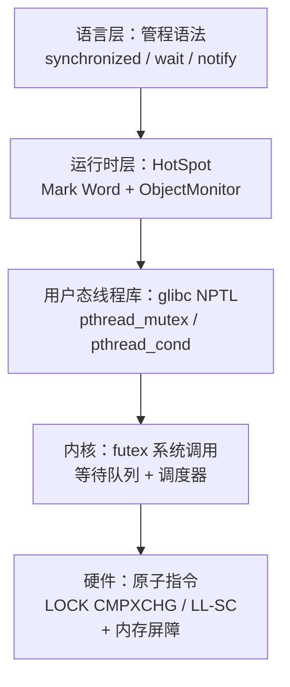
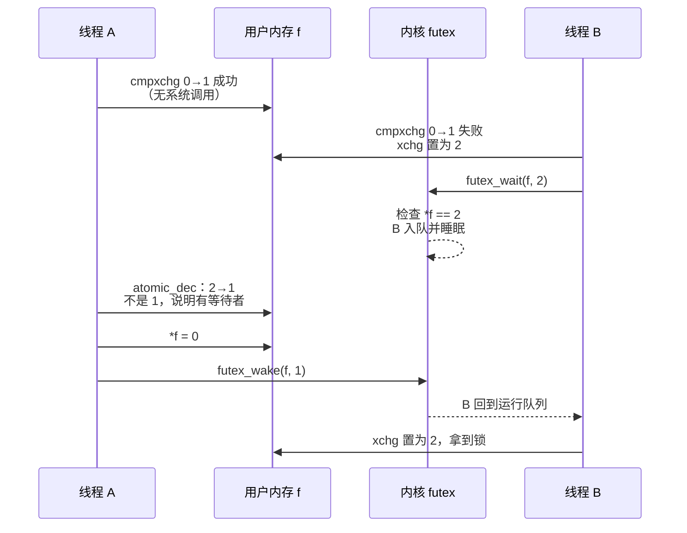
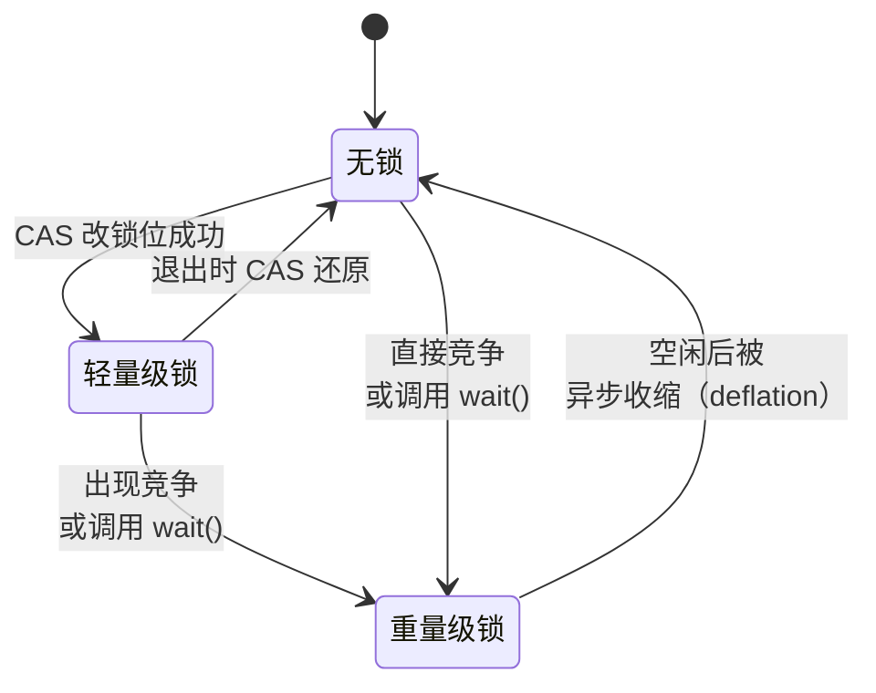
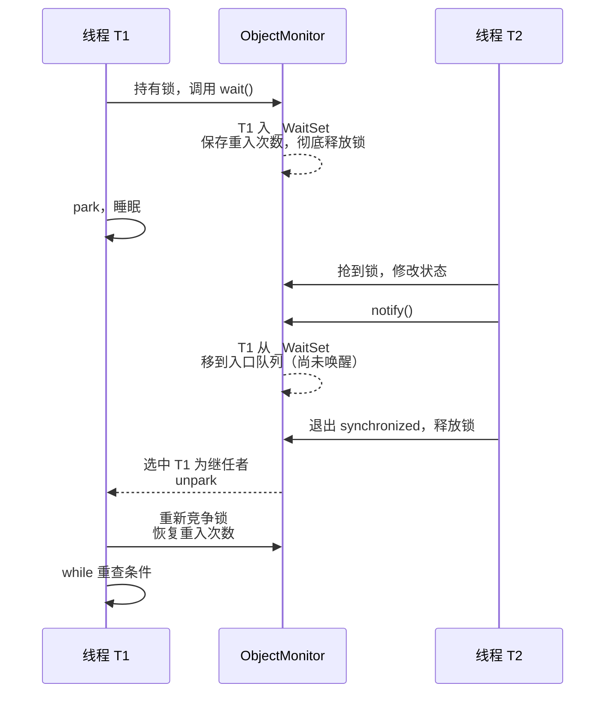

# 管程是怎么实现的：从操作系统内核到 HotSpot 对象监视器

*English version: [How Monitors Are Implemented: From the OS Kernel to the HotSpot ObjectMonitor](./monitor-implementation-os-and-hotspot.en.md)*

姊妹篇 [从 PV 操作、管程到现代 Java 并发](./semaphores-and-monitors-in-java.zh.md) 讲的是**管程是什么**：共享数据 + 过程 + 隐式互斥 + 条件变量，以及 Hoare / Mesa 两种唤醒语义。本文只回答下一个问题：**它是怎么做出来的**——从一条 CPU 原子指令开始，经过 Linux 内核的等待队列和 futex，一直到 HotSpot 里 `synchronized` 背后的对象头和 `ObjectMonitor`。

## 缩写对照表

| 缩写 | 英文全称 | 中文 |
|---|---|---|
| OS | Operating System | 操作系统 |
| CPU | Central Processing Unit | 中央处理器 |
| CAS | Compare-And-Swap | 比较并交换 |
| TAS | Test-And-Set | 测试并置位 |
| LL/SC | Load-Linked / Store-Conditional | 链接加载 / 条件存储 |
| MCS | Mellor-Crummey and Scott（queue lock） | MCS 队列锁 |
| futex | Fast Userspace muTEX | Linux 快速用户态互斥量 |
| NPTL | Native POSIX Thread Library | glibc 的原生 POSIX 线程库 |
| POSIX | Portable Operating System Interface | 可移植操作系统接口 |
| JVM | Java Virtual Machine | Java 虚拟机 |
| JDK | Java Development Kit | Java 开发工具包 |
| JEP | JDK Enhancement Proposal | JDK 增强提案 |
| JUC | `java.util.concurrent` | Java 并发工具包 |
| AQS | `AbstractQueuedSynchronizer` | 抽象队列同步器 |
| GC | Garbage Collection | 垃圾回收 |
| IPI | Inter-Processor Interrupt | 处理器间中断 |

## 0. 先拆问题：管程要解决的三件事

不管在哪一层实现，管程都要回答三个机制问题：

1. **互斥**：怎么保证同一时刻只有一个线程在管程里？
2. **条件等待**：`wait(c)` 要"释放锁 + 睡眠"，`signal(c)` 要"唤醒一个"——两步之间如果被插队，信号就丢了（**丢失唤醒**，lost wakeup）。怎么避免？
3. **阻塞与唤醒**：抢不到锁、条件不成立时，线程怎么真的"停下来"不占 CPU，又怎么被叫醒？

下面每一层的设计，都是对这三个问题的一种回答。



*这张图回答：一次 `synchronized` 阻塞，从语言一路落到哪些层？*

## 第一部分：操作系统里的管程是怎么实现的

先澄清一个容易混的点：**管程是语言结构，不是内核对象。** Linux 内核里没有一个叫 monitor 的系统调用。Hoare 和 Brinch Hansen 设想的是：编译器看到 `monitor` 关键字，自动在每个过程入口插入加锁、出口插入解锁，把 `wait/signal` 编译成对条件变量的操作。所以"OS 里的管程"，实际是问：**OS 提供了什么原语，让编译器 / 运行时能把管程拼出来？** 答案是两样：**锁**和**等待队列**。

### 1.1 互斥：一切从一条原子指令开始

**单核时代**：临界区只会被中断打断，于是进入时关中断、退出时开中断，就得到了互斥。这招在多核上失效——关掉的只是本核的中断，别的核照样跑。

**多核**：靠硬件提供"读—改—写不可分割"的指令：

| 指令族 | 代表 | 语义 |
|---|---|---|
| TAS / 交换 | x86 `XCHG` | 原子地写入新值并返回旧值 |
| CAS | x86 `LOCK CMPXCHG` | 当前值等于期望值才写入，返回是否成功 |
| LL/SC | ARM `LDXR/STXR`（或 ARMv8.1 的 `CAS`） | 读后若期间无人写过，才允许写回 |

`LOCK` 前缀让该核在缓存一致性协议里独占这条缓存行，其他核此刻无法修改它；同时这些指令自带内存屏障语义，保证临界区内的读写不会被重排到锁外。有了它，最朴素的锁——**自旋锁**——只需几行：

```c
void spin_lock(int *l)   { while (xchg(l, 1) == 1) cpu_relax(); }  // 抢不到就原地转
void spin_unlock(int *l) { store_release(l, 0); }
```

自旋锁解决了"互斥"，但没解决"阻塞"：抢不到的线程一直在烧 CPU。持锁时间短（几十纳秒）时这反而最快；持锁时间长或持锁者被调度走时，就是纯浪费。所以需要第二样东西。

### 1.2 阻塞与唤醒：内核的等待队列和调度器

内核让一个线程"停下来"的方式是：**把它的状态改成睡眠，从运行队列上摘下来，然后切换到别的线程**。Linux 内核里一个标准的"等条件"写法如下：

```c
DEFINE_WAIT(wait);
for (;;) {
    prepare_to_wait(&wq, &wait, TASK_INTERRUPTIBLE); // ① 先入队并把自己标成"睡眠"
    if (condition)                                   // ② 再检查条件
        break;
    schedule();                                      // ③ 让出 CPU，真正睡下
}
finish_wait(&wq, &wait);
```

唤醒方：

```c
condition = true;
wake_up(&wq);   // 把队列里的线程标回 TASK_RUNNING，放回运行队列
```

**丢失唤醒是怎么避免的？** 关键在 ① 和 ② 的顺序：先把自己挂进队列并标成睡眠，再检查条件。如果唤醒方恰好在 ② 和 ③ 之间执行了 `wake_up`，它会把本线程的状态改回 `TASK_RUNNING`——于是 ③ 的 `schedule()` 发现自己是可运行的，立刻返回，不会睡死。反过来，如果先检查条件再入队，中间那一瞬间的唤醒就落了空。

**挂起和唤醒的物理过程：**

- **挂起**：`schedule()` 把当前任务移出运行队列，`context_switch()` 保存寄存器、切换内核栈（跨进程时还要切换页表），CPU 转去执行别的任务。这个线程不再占用任何 CPU 时间。
- **唤醒**：`try_to_wake_up()` 把任务状态改为 `TASK_RUNNING`，放回某个 CPU 的运行队列；如果目标 CPU 在空闲，就发一个 IPI（Inter-Processor Interrupt，处理器间中断）把它叫醒。

注意：唤醒只是让线程**变得可运行**，什么时候真正上 CPU 由调度器决定。这正是 **Mesa 语义**的物理来源——被唤醒者恢复运行时，条件可能已经被别人改掉了，所以必须 `while` 重查。

### 1.3 内核自己的睡眠锁：自旋 + 排队的混合体

内核里的 `struct mutex` 把上面两样组合起来，分三段路径：

| 路径 | 条件 | 做法 |
|---|---|---|
| 快速路径 | 锁空闲 | 一次 `cmpxchg` 把 owner 从 0 改成自己，完事 |
| 中间路径 | 锁被占，但持有者**正在某个 CPU 上运行** | 乐观自旋（排在 MCS 风格的队列里转），赌它马上释放 |
| 慢速路径 | 持有者睡着了，或自旋太久 | 挂进 `wait_list`，`schedule()` 睡下；解锁者负责唤醒 |

这个"先 CAS、再自旋、最后排队睡眠"的三段式，后面在 futex、glibc、HotSpot 里会一再出现。

### 1.4 把管程拼出来：经典的"用信号量实现 Hoare 管程"

有了锁和等待队列（信号量就是二者的封装），编译器就能把管程翻译出来。下面是教材里的标准译法，实现的是 **Hoare 语义**（signal 后让被唤醒者立即运行）：

```text
semaphore mutex = 1;       // 管程入口锁
semaphore next  = 0;       // signal 者让出后，睡在这里
int next_count  = 0;       // 睡在 next 上的 signal 者数量

每个条件变量 x：
semaphore x_sem   = 0;
int       x_count = 0;

过程体：
    P(mutex);
    …过程代码…
    if (next_count > 0) V(next);   // 优先把管程交还给让出的 signal 者
    else                V(mutex);

x.wait():
    x_count++;
    if (next_count > 0) V(next); else V(mutex);   // 释放管程
    P(x_sem);                                     // 睡在 x 上
    x_count--;

x.signal():
    if (x_count > 0) {
        next_count++;
        V(x_sem);      // 唤醒一个 x 上的等待者，管程直接交给它
        P(next);       // 自己让出，睡到 next 上
        next_count--;
    }
```

读这段代码能看清 Hoare 语义的代价：每次 signal 都要**额外一次线程切换**（signal 者睡下、被唤醒者上场）。Mesa 语义把 `x.signal()` 简化成"`V(x_sem)` 然后继续跑"，省掉那次切换，代价是等待者醒来后要重新检查条件——这就是 pthreads 和 Java 都选 Mesa 的工程原因。

### 1.5 用户态的捷径：futex

上面的内核机制有个问题：哪怕锁完全没人抢，每次加锁也得陷入内核。一次系统调用的成本远高于一条原子指令（前者通常在百纳秒级以上，再加上下文切换就是微秒级；后者无竞争时在纳秒级）。futex（Fast Userspace muTEX，2002 年进入 Linux 2.5）的思路是：**锁的状态放在用户内存里，只有真要睡觉或真要叫醒人时才进内核。**

futex 只有两个核心操作：

- `futex_wait(addr, expected)`：内核**在持有该地址对应哈希桶锁的情况下**检查 `*addr == expected`，相等才让调用者睡下；不等就立即返回 `EAGAIN`。
- `futex_wake(addr, n)`：唤醒最多 `n` 个睡在 `addr` 上的线程。

"检查值"和"入队睡眠"在内核里是原子的——这与 1.2 中"先入队再查条件"是同一个防丢失唤醒的技巧，只不过把"条件"换成了一个用户态整数。

Ulrich Drepper 在 *Futexes Are Tricky* 里给出的经典互斥锁，用三个状态：`0` 空闲、`1` 已锁无等待者、`2` 已锁且可能有等待者：

```c
void lock(int *f) {
    int c = cmpxchg(f, 0, 1);           // 快速路径：0 → 1，纯用户态
    if (c != 0) {
        if (c != 2) c = xchg(f, 2);     // 标记"有人在等"
        while (c != 0) {
            futex_wait(f, 2);           // 慢速路径：进内核睡
            c = xchg(f, 2);
        }
    }
}

void unlock(int *f) {
    if (atomic_dec(f) != 1) {           // 原来是 2：可能有人在等
        *f = 0;
        futex_wake(f, 1);               // 进内核叫醒一个
    }                                   // 原来是 1：无人等待，纯用户态返回
}
```



*这张图回答：futex 锁在什么时候才进内核？*

**结论：无竞争时加锁和解锁都不进内核；只有"真要睡"和"真要叫醒人"才有用户态/内核态切换。** 这就是"锁本身不贵，竞争才贵"的物理原因。

### 1.6 条件变量：pthread_cond 的骨架

条件变量的难点是 `wait` 必须原子地"释放互斥锁 + 睡下"。用 futex 可以这样做（简化版）：

```c
void cond_wait(cond_t *cv, mutex_t *m) {
    int seq = cv->seq;          // ① 记下当前"信号序号"
    mutex_unlock(m);            // ② 释放互斥锁
    futex_wait(&cv->seq, seq);  // ③ 序号没变才睡
    mutex_lock(m);              // ④ 醒来后重新抢锁（Mesa）
}

void cond_signal(cond_t *cv) {
    atomic_inc(&cv->seq);       // 改序号
    futex_wake(&cv->seq, 1);    // 叫醒一个
}
```

如果 signal 恰好发生在 ② 和 ③ 之间，序号已经变了，③ 的 `futex_wait` 会立即返回，信号不会丢。④ 体现了 Mesa 语义：醒来的线程要重新竞争互斥锁，所以调用方必须 `while (!cond) pthread_cond_wait(...)`。

真实的 glibc 实现（2.25 起的新算法）比这复杂得多：它把等待者分成两组来保证 signal 不会唤醒"比它更晚开始等待"的线程，还要处理序号回绕和取消。但骨架就是上面这四步。

## 第二部分：Java 的管程是怎么实现的

Java 语言层面"每个对象都是管程"，但**物理上并不是每个对象都带着一个管程**——那样内存开销无法承受。HotSpot 的做法是：**锁状态先挤在对象头的 64 位里，只有真正需要排队时，才分配一个 `ObjectMonitor` 结构。**

### 2.1 字节码入口：monitorenter / monitorexit

`synchronized` 代码块编译成一对字节码 `monitorenter` / `monitorexit`，编译器还会额外生成一个异常处理器，保证抛异常时也执行 `monitorexit`——这就是"编译器替你释放锁"的实现。`synchronized` 方法不生成这两条字节码，而是在方法标志上置 `ACC_SYNCHRONIZED`，由 JVM 在调用和返回时加解锁。管程理论里"加锁由编译器插入，程序员忘不了"，在这里一字不差地落地了。

### 2.2 对象头的 Mark Word

64 位 HotSpot 中，每个对象头的第一个字是 **Mark Word**。它的最低 2 位（加上曾经的 1 位偏向标志）决定其余位的含义。下表是未开启紧凑对象头时的经典布局：

| 锁状态 | 高位内容 | 偏向位 | 锁标志（最低 2 位） |
|---|---|---|---|
| 无锁 | 25 位未用 · 31 位 identity hash · 1 位未用 · 4 位 GC 年龄 | 0 | `01` |
| 偏向锁（已移除） | 54 位持有线程指针 · 2 位 epoch · 1 位未用 · 4 位 GC 年龄 | 1 | `01` |
| 轻量级锁（旧实现） | 62 位：指向栈上锁记录的指针 | — | `00` |
| 重量级锁 | 62 位：指向 `ObjectMonitor` 的指针 | — | `10` |
| GC 标记 | GC 使用 | — | `11` |

两点要注意：

- 一个字被反复复用，意味着 identity hash、GC 年龄这些信息在加锁时会被"挤走"，必须另找地方暂存（旧轻量级锁存到栈上的"displaced header"，重量级锁存到 `ObjectMonitor` 里）。
- 紧凑对象头（JEP 450 在 JDK 24 实验性引入，JEP 519 在 JDK 25 转正）把对象头压缩到 64 位，布局随之改变；它要求配合下面提到的新轻量级锁和"ObjectMonitor 表"。上表是理解原理用的经典版本。

### 2.3 锁的几种状态与升级路径



*这张图回答：一个对象的锁状态如何在无锁、轻量级、重量级之间迁移？（偏向锁已移除，未画出）*

**偏向锁（历史）。** 观察依据是：大多数锁从头到尾只被一个线程用。第一次加锁时用一次 CAS 把线程 ID 写进 Mark Word，以后同一线程再进入，只需比较线程 ID，**连 CAS 都不用**。代价在撤销：另一个线程来抢时，必须在安全点（safepoint）暂停持有者，检查它的栈来判断是否还持有锁。随着现代 CPU 上无竞争 CAS 越来越便宜，而撤销又贵、代码又复杂，偏向锁在 JDK 15 被默认关闭并废弃（JEP 374），JDK 18 中相关参数被淘汰、实现被移除。**今天讲"偏向 → 轻量 → 重量"三段升级，是在讲 JDK 15 之前的默认行为。**

**轻量级锁（旧实现，"栈锁"）。** 线程在当前栈帧里分配一个锁记录（lock record），把对象原来的 Mark Word 复制进去（displaced header），然后 CAS 把 Mark Word 改成指向这个锁记录的指针、锁位 `00`。重入时再压一个 displaced header 为空的锁记录即可。解锁时 CAS 把 displaced header 换回去。全程**只有用户态 CAS，没有系统调用**。

**轻量级锁（新实现，lock-stack）。** JDK 21 引入、JDK 23 起成为默认（`LockingMode` 默认值改为 lightweight）。每个线程有一个小数组"锁栈"（lock-stack），加锁时 CAS 只把 Mark Word 的锁位从 `01` 改成 `00`，并把对象引用压进自己的锁栈；Mark Word 的其余位（hash、年龄）原样保留，不再有指向栈的指针。判断"是不是我持有"只需查自己的锁栈。这样做的动机之一，是给紧凑对象头和虚拟线程让路——指向某个线程栈的指针在这两种场景下都很碍事。

**膨胀为重量级锁。** 以下情况会触发 inflate：

- 轻量级加锁的 CAS 失败（有竞争）；
- 持锁线程调用了 `wait()`——轻量级锁没有 wait set，必须有 `ObjectMonitor`；
- 锁栈满了，或其他实现上的限制。

膨胀时分配（或从缓存取出）一个 `ObjectMonitor`，把 Mark Word 改为指向它、锁位 `10`。JDK 24 起还可以用 `-XX:+UseObjectMonitorTable` 把"对象 → 监视器"的映射放进一张旁路哈希表，不再改写 Mark Word（紧凑对象头需要这个能力）。

**锁会降级吗？** 常见说法是"锁只能升级不能降级"。对单次持有过程来说大体如此，但 `ObjectMonitor` 并不永久绑定在对象上：JDK 15 起有专门的线程**异步收缩（deflate）**空闲的监视器，把对象恢复为无锁状态，监视器回收复用。所以更准确的说法是：**在持有期间不降级，空闲后会被收缩。**

### 2.4 ObjectMonitor：管程的完整形态

`ObjectMonitor` 是 C++ 对象，就是教科书管程在 HotSpot 里的实体。经典版本（JDK 8–21 一带）的关键字段：

| 字段 | 作用 | 对应管程概念 |
|---|---|---|
| `_owner` | 当前持有者 | 管程内的那个线程 |
| `_recursions` | 重入次数 | 可重入 |
| `_cxq` | 新来竞争者的单链表，CAS 头插（LIFO） | 入口队列（无锁入队部分） |
| `_EntryList` | 解锁者从中挑选继任者的双向链表 | 入口队列 |
| `_WaitSet` | 调用了 `wait()` 的线程的环形双向链表 | 条件变量的等待队列 |
| `_succ` | 已被选为"假定继任者"的线程 | 避免重复唤醒 |

较新的 JDK 对这些结构做过重构（例如为 JEP 491 让 owner 改为记录线程 ID 以支持虚拟线程，入口队列也有合并），字段名可能不同，但"owner + 重入计数 + 入口队列 + 等待集合"这个结构没有变。

**加锁（`enter`）的路径，又是熟悉的三段式：**

1. **CAS 抢 owner**：`_owner` 从空改成自己，成功即返回；如果 owner 已经是自己，`_recursions++`。
2. **自适应自旋**：根据这把锁过去自旋成功的历史决定转多久，赌持有者马上释放。
3. **排队睡眠**：把自己包装成 `ObjectWaiter` 节点，CAS 头插进 `_cxq`，然后循环"再试一次 → 不行就 park"。

**解锁（`exit`）：** `_recursions` 不为 0 就减一返回；否则释放 owner（带内存屏障）。如果没有等待者，直接返回——**这条路径上也没有系统调用**。如果有等待者，从 `_EntryList` 挑一个继任者（`_EntryList` 空就先把 `_cxq` 整体搬过来），**只 unpark 这一个**，避免惊群。

注意第 3 步醒来后是"再试一次 CAS"，而不是直接拿到锁：解锁者只是把继任者叫醒，锁本身是空出来让大家抢的。新来的线程可能在继任者醒来之前就 CAS 成功（**插队**，barging）。这让 `synchronized` 吞吐更高，但它**不是公平锁**——想要 FIFO，只能用 `new ReentrantLock(true)`。

### 2.5 wait / notify 在 ObjectMonitor 里怎么走



*这张图回答：一次 wait/notify，线程在 ObjectMonitor 的哪些队列之间移动，何时真正被唤醒？*

几个从实现里直接读出来的事实：

- **`wait()` 必须先持锁**：实现第一步就检查 `_owner` 是不是自己，不是就抛 `IllegalMonitorStateException`。
- **`wait()` 释放的是"全部"重入**：先把 `_recursions` 存起来、清零、彻底退出，醒来重新拿到锁后再恢复——所以在三层嵌套的 `synchronized` 里调用 `wait()` 也不会死锁。
- **`notify()` 不立即唤醒任何人**：它只是把等待者从 `_WaitSet` 挪到入口队列。被通知的线程要等通知者退出临界区、并被选为继任者，才会被 unpark。这就是 Mesa 语义（signal-and-continue）在源码层面的样子。
- **因为只有一个 `_WaitSet`**，等不同条件的线程挤在一起，所以默认要 `notifyAll()`；需要多条件就用 `ReentrantLock` + `Condition`，后者每个 `Condition` 有自己的等待队列。

### 2.6 JVM 怎么衔接到 OS 原语

HotSpot 不直接调用 futex 系统调用，而是通过平台层封装：

| Java 层 | HotSpot 内部 | Linux 上落到 |
|---|---|---|
| `synchronized` 竞争 / `wait()` | `ObjectMonitor` → 每线程的 `ParkEvent` → `os::PlatformEvent::park()` | `pthread_mutex` + `pthread_cond_wait` |
| `LockSupport.park()`（AQS、`ReentrantLock`、`Condition`） | 每线程的 `Parker` | `pthread_mutex` + `pthread_cond_(timed)wait` |
| 两者共同 | glibc NPTL | `futex(FUTEX_WAIT / FUTEX_WAKE)` 系统调用 |

`PlatformEvent` 自己也带一个小计数器作快速路径：如果 unpark 先于 park 到达（"许可"已经给了），park 直接返回，根本不碰 pthread。只有真要睡时才进入 `pthread_cond_wait`，再由 glibc 走到 `futex_wait`，最后进入第一部分讲的内核等待队列和调度器。所以完整链条是：

```text
synchronized 竞争
  → CAS 失败 → 自旋失败 → ObjectMonitor 入队
  → ParkEvent::park → pthread_cond_wait
  → futex(FUTEX_WAIT) 系统调用          ← 第一次进入内核态
  → 内核：入哈希桶等待队列，schedule() 切走
…
持有者 exit → unpark 继任者 → pthread_cond_signal
  → futex(FUTEX_WAKE)                  ← 唤醒方进入内核态
  → try_to_wake_up() → 继任者回到运行队列
```

在 macOS 上，pthread 底层不是 futex，而是 Darwin 内核的 `psynch` 系列系统调用，但结构相同。

### 2.7 虚拟线程：把"睡眠"从内核挪到 JVM

虚拟线程（JEP 444，JDK 21）在阻塞时**不**走上面那条通往 futex 的路：它把自己的栈帧作为 continuation 保存到堆上，从承载它的平台线程上卸载（unmount），平台线程继续去跑别的虚拟线程。唤醒时由 JVM 的调度器（一个 `ForkJoinPool`）把它重新挂载到某个平台线程上。

JDK 21–23 中，`synchronized` 里阻塞会把承载线程钉住（pinning），原因之一正是旧实现把锁和"某个平台线程 / 某个线程栈"绑在一起；JEP 491（JDK 24）重写了 `ObjectMonitor` 的 owner 记录方式，大部分情况下 `synchronized` 也能卸载了。仍然会钉住的情况包括：栈上有本地方法帧，以及类初始化期间。

## 第三部分：两层实现并排对照

| 机制问题 | 操作系统 / 线程库 | HotSpot `synchronized` |
|---|---|---|
| 互斥的原子性 | 硬件原子指令（`LOCK CMPXCHG`、LL/SC）；单核可关中断 | 同样的 CAS，作用在 Mark Word 或 `_owner` 上 |
| 无竞争快速路径 | futex 锁：一次用户态 CAS，零系统调用 | 轻量级锁：一次 CAS（偏向锁时代连 CAS 都省了） |
| 短暂竞争 | 内核 mutex 乐观自旋；glibc 自适应自旋锁可选 | `ObjectMonitor` 自适应自旋 |
| 入口队列 | 内核 `wait_list` / futex 哈希桶队列 | `_cxq` + `_EntryList` |
| 条件变量 | `pthread_cond`：序号 + futex | `_WaitSet`（每对象仅一个） |
| 防丢失唤醒 | "先入队/记序号，再查条件，再睡"，内核内原子检查 | 入 `_WaitSet` 后才释放锁；`ParkEvent` 许可计数 |
| 挂起 | 移出运行队列 + 上下文切换 | `park` → `pthread_cond_wait` → futex |
| 唤醒 | 放回运行队列，必要时发 IPI | 选一个继任者 `unpark` → futex wake |
| 唤醒语义 | Mesa（pthreads） | Mesa |
| 公平性 | 一般不保证 | 不保证，允许插队 |
| 内核态切换何时发生 | 只在真要睡 / 真要唤醒时 | 只在膨胀后真要 park / unpark 时 |

## 第四部分：与姊妹篇的对照

| 主题 | 《从 PV 操作、管程到现代 Java 并发》 | 本文 |
|---|---|---|
| 管程定义、Hoare vs. Mesa | 已覆盖 | 补充：两种语义的实现代价（1.4） |
| `synchronized` / `wait` / `notify` 的用法与规矩 | 已覆盖 | 补充：每条规矩在 `ObjectMonitor` 源码层面的出处（2.5） |
| AQS、`Condition`、`Semaphore` | 已覆盖 | 只讲它们共享的 `park` 落地路径（2.6） |
| 原子指令、自旋锁、内核等待队列、丢失唤醒 | 未覆盖 | 1.1–1.3 |
| futex 快慢路径、pthread_cond | 只提到名字 | 1.5–1.6 |
| Mark Word、锁升级、膨胀与收缩 | 一句话带过 | 2.2–2.3 |
| `ObjectMonitor` 结构、插队与公平性 | 未覆盖 | 2.4 |
| 虚拟线程 | 已覆盖（卸载与钉住） | 补充：钉住的实现原因（2.7） |

姊妹篇里有两处说法偏简化，本次已在原文修正：

1. "`LockSupport.park/unpark` → futex"：HotSpot 并不直接调用 futex，中间隔着 `Parker` / `PlatformEvent` 和 glibc 的 `pthread_mutex` / `pthread_cond`，后者在 Linux 上才落到 futex。
2. "偏向锁已由 JEP 374 在 JDK 15 中废弃并默认关闭"：没错，但不完整——JDK 18 已淘汰相关参数、移除实现。所以网上常见的"偏向 → 轻量 → 重量"三段升级，只适用于 JDK 15 之前的默认配置。

## 结论

- **管程不是内核对象，而是用锁 + 等待队列拼出来的语言结构。** OS 提供的是原子指令、futex、等待队列和调度器；编译器和运行时负责把它们组装成"隐式互斥 + 条件变量"。
- **所有层都在用同一个三段式**：先 CAS（纯用户态）→ 再自旋（赌持有者马上释放）→ 最后排队睡眠（进内核）。内核 mutex、futex 锁、glibc、HotSpot `ObjectMonitor` 莫不如此。
- **防丢失唤醒只有一个核心技巧**：先登记自己要等（入队或记下序号），再检查条件，最后睡；检查和入睡在内核里原子完成。
- **用户态 / 内核态切换只发生在真竞争时。** 无竞争的 `synchronized` 是一次 CAS；只有膨胀为重量级锁、并且真的要 park / unpark 时，才通过 `pthread_cond` 走到 futex 系统调用。
- **Java 的管程是"按需实体化"的**：平时只是 Mark Word 里的几个位，需要排队或 `wait()` 时才膨胀出 `ObjectMonitor`，空闲后又被异步收缩。偏向锁已成历史，JDK 23 起轻量级锁也换成了 lock-stack 实现。
- **Mesa 语义有物理根源**：内核唤醒只是让线程变成可运行，`notify()` 只是把线程挪回入口队列——醒来时条件早已可能变了，所以永远写 `while`。

## 参考资料

- C. A. R. Hoare, "Monitors: An Operating System Structuring Concept", *Communications of the ACM*, 1974（含用信号量实现管程的构造）。
- B. Lampson, D. Redell, "Experience with Processes and Monitors in Mesa", *Communications of the ACM*, 1980。
- A. Silberschatz 等，*Operating System Concepts*，"Monitors" 与 "Implementing a Monitor Using Semaphores" 小节。
- H. Franke, R. Russell, M. Kirkwood, "Fuss, Futexes and Furwocks: Fast Userlevel Locking in Linux", Ottawa Linux Symposium, 2002。
- U. Drepper, "Futexes Are Tricky", 2011。
- Linux 内核文档：`Documentation/locking/mutex-design.rst`；`man 2 futex`。
- OpenJDK HotSpot 源码：`src/hotspot/share/runtime/objectMonitor.{hpp,cpp}`、`synchronizer.cpp`、`lockStack.hpp`、`os/posix/os_posix.cpp`（`PlatformEvent`、`Parker`）。
- JEP 374（废弃并禁用偏向锁）、JEP 444（虚拟线程）、JEP 450 / JEP 519（紧凑对象头）、JEP 491（虚拟线程同步不再钉住）。
- D. Dice, "Biased Locking in HotSpot"；OpenJDK Wiki "Synchronization"。
- 姊妹篇：[从 PV 操作、管程到现代 Java 并发](./semaphores-and-monitors-in-java.zh.md)。
