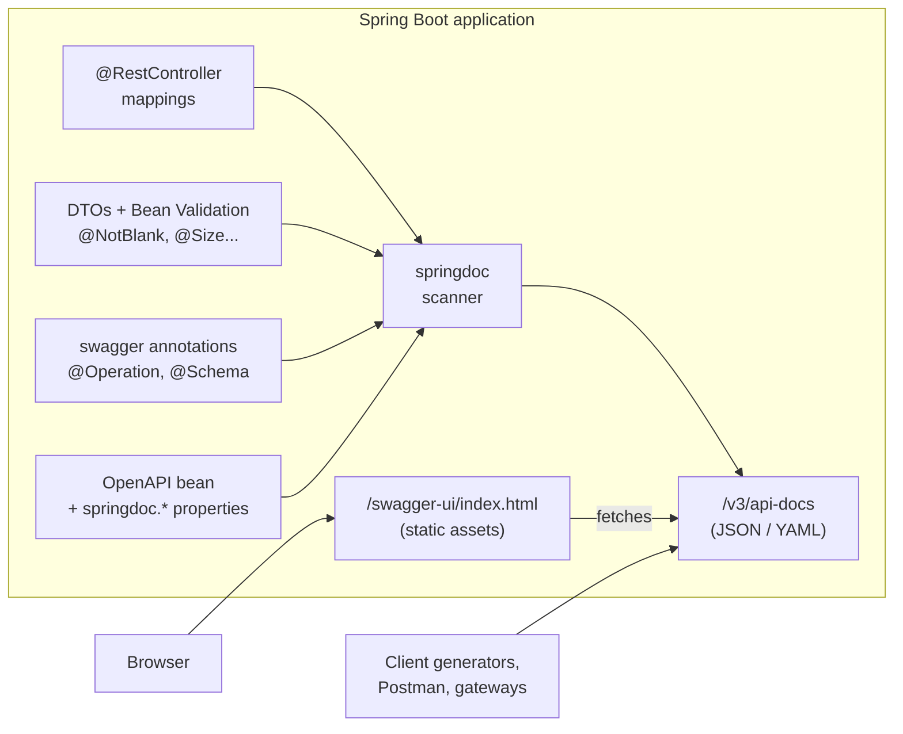
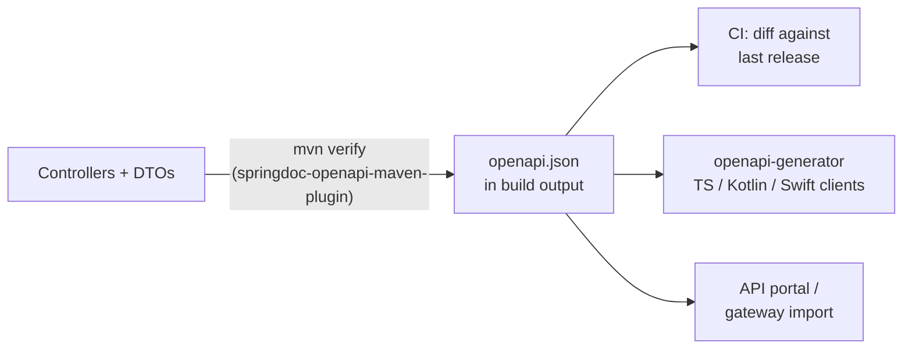

# Spring Boot: Integrating Swagger / OpenAPI With springdoc-openapi

## Abbreviations

| Abbreviation | Full name | Meaning here |
|---|---|---|
| API | Application Programming Interface | The HTTP endpoints your controllers expose |
| OAS | OpenAPI Specification | The vendor-neutral standard for describing HTTP APIs |
| REST | Representational State Transfer | The resource-oriented HTTP style most Spring controllers follow |
| HTTP | Hypertext Transfer Protocol | The protocol the API and the documentation are served over |
| JSON / YAML | JavaScript Object Notation / YAML Ain't Markup Language | The two formats an OpenAPI document is written in |
| UI | User Interface | Swagger UI, the browser page that renders the document |
| MVC | Model–View–Controller | Spring Web MVC, the servlet-based web stack |
| DTO | Data Transfer Object | Request/response classes such as `CreateBookRequest` |
| JWT | JSON Web Token | The bearer token format declared in the security scheme |
| CI | Continuous Integration | The build pipeline that can export and diff the spec |
| ISBN | International Standard Book Number | Field used in the sample model |

## 1. The short answer

Add **one dependency** — `springdoc-openapi-starter-webmvc-ui` — and a Spring Boot application gets:

- `/v3/api-docs` — an **OpenAPI 3.1** JSON document generated *from your code* (controllers, DTOs, validation annotations) at runtime;
- `/v3/api-docs.yaml` — the same document as YAML;
- `/swagger-ui.html` — **Swagger UI**, an interactive page that renders the document and lets you send real requests.

Everything after that — titles, descriptions, examples, error responses, security schemes, groups — is optional polish added with annotations, one `OpenAPI` bean, and `springdoc.*` properties.

Everything in this article was built and run against **Spring Boot 4.1.1 + springdoc-openapi 3.1.1 on Java 17**; the JSON excerpts are real output.

## 2. Swagger, OpenAPI, springfox, springdoc — sorting out the names

| Name | What it is |
|---|---|
| **Swagger** | The original API-description format (Swagger 2.0) and today a family of SmartBear tools: Swagger UI, Swagger Editor, Swagger Codegen. |
| **OpenAPI** | Swagger 2.0 donated to the Linux Foundation and renamed in 2016. OAS 3.0 (2017) and 3.1 (2021) are the current versions. *The format is OpenAPI; the tools are still called Swagger.* |
| **Swagger UI** | The HTML/JavaScript page that turns an OpenAPI document into browsable, clickable documentation. |
| **springfox** | The old Spring integration (`@EnableSwagger2`, `Docket`). Last release 3.0.0 in 2020; it does not work with Spring Boot 3+ (Jakarta EE namespace). **Do not use it for new code.** |
| **springdoc-openapi** | The maintained Spring integration. Reads Spring's own metadata, emits OpenAPI 3, bundles Swagger UI. This is what this article uses. |

## 3. How springdoc works



*This diagram answers: where does the OpenAPI document come from, and who consumes it?*

springdoc asks Spring MVC for its `RequestMappingHandlerMapping` — the same table Spring uses to route requests — so paths, HTTP methods, parameters and return types come straight from your real mappings. It then inspects DTOs with the swagger-core model resolver (Jackson-aware) and folds in validation and documentation annotations. The document is built lazily on the first request and cached.

## 4. Step 1 — add the dependency

Choose the artifact that matches your web stack and Spring Boot line:

| Spring Boot | springdoc line | Web MVC artifact | WebFlux artifact |
|---|---|---|---|
| 4.1.x | **3.1.x** | `springdoc-openapi-starter-webmvc-ui` | `springdoc-openapi-starter-webflux-ui` |
| 4.0.x | 3.0.x | same | same |
| 3.x | 2.8.x | same | same |
| 2.x (legacy) | 1.8.0 (final) | `springdoc-openapi-ui` | `springdoc-openapi-webflux-ui` |

*Versions checked on Maven Central on 2026-10-22. Each springdoc line is built against one Spring Boot generation — mixing them (for example springdoc 2.x on Boot 4) fails at startup.*

The `-ui` starters include Swagger UI; the `-api` variants (`springdoc-openapi-starter-webmvc-api`) produce only `/v3/api-docs`, for services where the UI is hosted elsewhere.

```xml
<parent>
  <groupId>org.springframework.boot</groupId>
  <artifactId>spring-boot-starter-parent</artifactId>
  <version>4.1.1</version>
</parent>

<dependencies>
  <dependency>
    <groupId>org.springframework.boot</groupId>
    <artifactId>spring-boot-starter-webmvc</artifactId>
  </dependency>
  <dependency>
    <groupId>org.springframework.boot</groupId>
    <artifactId>spring-boot-starter-validation</artifactId>
  </dependency>
  <dependency>
    <groupId>org.springdoc</groupId>
    <artifactId>springdoc-openapi-starter-webmvc-ui</artifactId>
    <version>3.1.1</version>
  </dependency>
</dependencies>
```

(Spring Boot 4 renamed `spring-boot-starter-web` to `spring-boot-starter-webmvc`; the old name still works as a deprecated alias. On Boot 3, keep `spring-boot-starter-web`.)

Gradle:

```kotlin
implementation("org.springdoc:springdoc-openapi-starter-webmvc-ui:3.1.1")
```

Start the application. With zero further configuration, these work:

| URL | Returns |
|---|---|
| `/v3/api-docs` | OpenAPI document (JSON) |
| `/v3/api-docs.yaml` | OpenAPI document (YAML) |
| `/v3/api-docs/{group}` | One group's document (see §8) |
| `/swagger-ui.html` | `302` redirect to `/swagger-ui/index.html` |
| `/v3/api-docs/swagger-config` | Settings that Swagger UI loads on start-up |

## 5. Step 2 — describe the API as a whole

One `OpenAPI` bean sets document-level metadata: title, version, description, license, and security schemes.

```java
@Configuration
public class OpenApiConfig {

    @Bean
    OpenAPI booksOpenApi() {
        return new OpenAPI()
                .info(new Info()
                        .title("Books API")
                        .version("v1")
                        .description("Catalogue service for the book store")
                        .license(new License().name("Apache 2.0")))
                .components(new Components().addSecuritySchemes("bearerAuth",
                        new SecurityScheme()
                                .type(SecurityScheme.Type.HTTP)
                                .scheme("bearer")
                                .bearerFormat("JWT")))
                .addSecurityItem(new SecurityRequirement().addList("bearerAuth"));
    }
}
```

The security scheme puts an **Authorize** button in Swagger UI; a token pasted there is sent as `Authorization: Bearer …` on every "Try it out" request. `addSecurityItem` applies it to all operations; to apply it to selected endpoints only, drop that line and annotate those methods with `@SecurityRequirement(name = "bearerAuth")`.

The same metadata can also be declared with `@OpenAPIDefinition` and `@SecurityScheme` annotations on any `@Configuration` class; the bean form is easier when values come from configuration.

## 6. Step 3 — document controllers and models

springdoc already knows the paths and types. Annotations add the *human* parts: summaries, descriptions, examples and non-200 responses.

```java
@RestController
@RequestMapping("/api/books")
@Tag(name = "Books", description = "Manage the book catalogue")
public class BookController {

    @GetMapping("/{id}")
    @Operation(summary = "Get a book by id")
    @ApiResponses({
            @ApiResponse(responseCode = "200", description = "Book found"),
            @ApiResponse(responseCode = "404", description = "No book with that id",
                    content = @Content(schema = @Schema(implementation = ProblemDetail.class)))
    })
    public ResponseEntity<Book> get(@Parameter(description = "Book id", example = "42")
                                    @PathVariable Long id) { ... }

    @PostMapping
    @ResponseStatus(HttpStatus.CREATED)
    @Operation(summary = "Create a book")
    @ApiResponse(responseCode = "201", description = "Book created")
    @ApiResponse(responseCode = "400", description = "Validation failed",
            content = @Content(schema = @Schema(implementation = ProblemDetail.class)))
    public Book create(@Valid @RequestBody CreateBookRequest request) { ... }
}
```

```java
@Schema(description = "A book in the catalogue")
public record Book(
        @Schema(description = "Server-assigned id", example = "42",
                accessMode = Schema.AccessMode.READ_ONLY)
        Long id,
        @Schema(description = "Book title", example = "Effective Java")
        String title,
        @Schema(description = "13-digit ISBN", example = "9780134685991")
        String isbn) {
}

@Schema(description = "Payload for creating a book")
public record CreateBookRequest(
        @NotBlank @Size(max = 200) @Schema(example = "Effective Java")
        String title,
        @NotBlank @Pattern(regexp = "\\d{13}") @Schema(example = "9780134685991")
        String isbn) {
}
```

The annotations come from `io.swagger.v3.oas.annotations.*` (swagger-core), pulled in by the starter.

| Annotation | Placed on | Adds |
|---|---|---|
| `@Tag` | Controller | Groups operations under a heading in Swagger UI |
| `@Operation` | Handler method | `summary`, `description`, `operationId`, `hidden`, `deprecated` |
| `@Parameter` | Method parameter | Description, example, `required` for path/query/header parameters |
| `@ApiResponse(s)` | Handler method | Additional status codes and their body schemas |
| `@Schema` | DTO class or field | Description, example, `accessMode`, `allowableValues`, `implementation` |
| `@Hidden` | Controller or method | Leaves it out of the document |

### Bean Validation flows into the schema

This is the real generated schema for `CreateBookRequest`:

```json
"CreateBookRequest": {
  "type": "object",
  "description": "Payload for creating a book",
  "properties": {
    "title": { "type": "string", "example": "Effective Java", "maxLength": 200, "minLength": 0 },
    "isbn":  { "type": "string", "example": "9780134685991", "minLength": 1, "pattern": "\\d{13}" }
  },
  "required": ["isbn", "title"]
}
```

- `@NotBlank` / `@NotNull` → the field is listed in `required`;
- `@Size(max = 200)` → `maxLength: 200`; `@Pattern` → `pattern`; `@Min`/`@Max` → `minimum`/`maximum`.

**Watch the `title` field:** `@NotBlank` alone produces `minLength: 1` (as on `isbn`), but `@Size(max = 200)` contributes its default `min = 0`, which wins. If the minimum matters to clients, write `@Size(min = 1, max = 200)`.

Likewise, `accessMode = READ_ONLY` becomes `"readOnly": true` on `Book.id`, telling client generators not to send it on create.

## 7. Step 4 — document errors honestly

A spec that only shows the happy path misleads its clients. Spring Framework's `ProblemDetail` (RFC 9457 "Problem Details for HTTP APIs") gives every error the same shape, and the `@ApiResponse(... implementation = ProblemDetail.class)` lines above advertise it.

Make sure the runtime matches the documentation — turn on Spring Boot's built-in problem-details handling:

```yaml
spring:
  mvc:
    problemdetails:
      enabled: true
```

With it, a failed validation returns (verified):

```json
{"detail":"Invalid request content.","instance":"/api/books","status":400,"title":"Bad Request"}
```

Without it, Boot's default error body (`timestamp`, `status`, `error`, `path`) is returned, which does **not** match a `ProblemDetail` schema. A `@RestControllerAdvice` that extends `ResponseEntityExceptionHandler` achieves the same and lets you add field-level errors.

## 8. Step 5 — group large APIs

One service often exposes public endpoints, admin endpoints and internal callbacks. `GroupedOpenApi` splits them into separate documents, chosen from a drop-down in Swagger UI:

```java
@Bean
GroupedOpenApi publicApi() {
    return GroupedOpenApi.builder()
            .group("public")
            .pathsToMatch("/api/**")
            .build();
}

@Bean
GroupedOpenApi adminApi() {
    return GroupedOpenApi.builder()
            .group("admin")
            .pathsToMatch("/admin/**")
            .build();
}
```

Each group is served at `/v3/api-docs/{group}`. Groups can also filter by `packagesToScan`, `pathsToExclude`, or a custom `OpenApiCustomizer`. Once any group bean exists, Swagger UI offers only the groups in its drop-down; `/v3/api-docs` itself still serves the full, ungrouped document.

## 9. Useful `springdoc.*` properties

```yaml
springdoc:
  api-docs:
    path: /v3/api-docs          # where the JSON is served
  swagger-ui:
    path: /swagger-ui.html      # entry URL of the UI
    operations-sorter: method   # sort operations by HTTP method
    tags-sorter: alpha          # sort tags alphabetically
    try-it-out-enabled: true    # open the "Try it out" panels by default
  packages-to-scan: com.example.books
  default-produces-media-type: application/json
```

| Property | Effect |
|---|---|
| `springdoc.api-docs.enabled` | `false` removes `/v3/api-docs` (returns 404) |
| `springdoc.swagger-ui.enabled` | `false` removes Swagger UI |
| `springdoc.packages-to-scan` / `paths-to-match` | Limit what the default document includes |
| `springdoc.show-actuator` | Include Actuator endpoints in the document |
| `springdoc.api-docs.version` | `openapi_3_1` (default in springdoc 2.8+/3.x) or `openapi_3_0` for tools that cannot read 3.1 yet |

## 10. Spring Security

If Spring Security is on the classpath, the documentation endpoints are locked like everything else. Open them explicitly (in non-production profiles):

```java
@Bean
SecurityFilterChain api(HttpSecurity http) throws Exception {
    http.authorizeHttpRequests(auth -> auth
            .requestMatchers("/v3/api-docs/**", "/swagger-ui/**", "/swagger-ui.html").permitAll()
            .anyRequest().authenticated());
    // ... JWT resource server, etc.
    return http.build();
}
```

All three patterns are needed: the HTML entry point, the static assets under `/swagger-ui/`, and the JSON the page fetches (including `/v3/api-docs/swagger-config`).

## 11. Production concerns

- **Decide whether the docs should exist in production.** For an internal service, a full catalogue of endpoints and models is free reconnaissance for an attacker. Common choice: enable in `dev`/`test`, disable in `prod`:

  ```yaml
  # application-prod.yml
  springdoc:
    api-docs:
      enabled: false
    swagger-ui:
      enabled: false
  ```

  For a public API, keep the spec but publish it deliberately (developer portal, gateway), not by accident.
- **Behind a reverse proxy or load balancer**, the generated `servers` entry (`"url": "http://localhost:18082", "description": "Generated server url"` in the test run) is derived from the incoming request, so it may show the internal host or `http`. Set `server.forward-headers-strategy=framework` so `X-Forwarded-*` headers are honoured, or declare `servers` explicitly in the `OpenAPI` bean.
- **Start-up cost** is small — the document is built on first request — but very large APIs can take noticeable time on that first call; groups help.

## 12. Code-first, design-first, and the spec as a build artefact

springdoc is **code-first**: the code is the source of truth and the spec is derived. The alternative is **design-first**: write `openapi.yaml` by hand, review it, and *generate* Spring interfaces from it with `openapi-generator` (`spring` generator). Either way, treat the spec as a versioned artefact:



*This diagram answers: once springdoc produces a spec, how does it feed the rest of the delivery pipeline?*

`springdoc-openapi-maven-plugin` (1.5) starts the app during `integration-test`, downloads `/v3/api-docs`, and writes it to `target/openapi.json`; it needs `spring-boot-maven-plugin`'s `start`/`stop` goals around it. A CI (Continuous Integration) job that diffs this file against the previous release (for example with `openapi-diff`) catches breaking changes — a renamed field, a newly required parameter — before clients do. *(The plugin set-up is shown for orientation; it was not run for this article.)*

## 13. Migrating from springfox

| springfox | springdoc / swagger-core |
|---|---|
| `@EnableSwagger2`, `Docket` bean | Nothing to enable; `GroupedOpenApi` bean for groups |
| `@Api` | `@Tag` |
| `@ApiOperation(value = "...", notes = "...")` | `@Operation(summary = "...", description = "...")` |
| `@ApiParam` | `@Parameter` |
| `@ApiModel` / `@ApiModelProperty` | `@Schema` |
| `@ApiResponse(code = 404, message = "...")` | `@ApiResponse(responseCode = "404", description = "...")` |
| `@ApiIgnore` | `@Hidden` (or `@Parameter(hidden = true)`) |
| `/v2/api-docs`, `/swagger-ui/` | `/v3/api-docs`, `/swagger-ui.html` |

Remove every `io.springfox` dependency first — having both on the classpath causes confusing start-up failures.

## 14. Common mistakes

| Symptom | Cause | Fix |
|---|---|---|
| App fails at start with `NoSuchMethodError` / `ClassNotFoundException` | springdoc line does not match the Spring Boot generation | Use the version table in §4 |
| `/swagger-ui.html` returns 401/403 | Spring Security blocks the UI or its JSON | Permit all three patterns in §10 |
| UI loads but shows "Failed to load API definition" | JSON path blocked, or a proxy rewrites paths | Check `/v3/api-docs/swagger-config` and `/v3/api-docs` directly |
| Schema shows `minLength: 0` on a `@NotBlank` field | `@Size` without `min` | `@Size(min = 1, max = …)` |
| Documented 400 body doesn't match reality | Default Boot error JSON, not `ProblemDetail` | `spring.mvc.problemdetails.enabled=true` or a `ResponseEntityExceptionHandler` |
| Request DTO shows server-set fields like `id` | One record used for both request and response | Separate request/response DTOs, or `accessMode = READ_ONLY` |
| Code generator rejects the spec | Tool only supports OAS 3.0 | `springdoc.api-docs.version=openapi_3_0` |

## 15. Conclusion

- **OpenAPI is the format; Swagger UI is the viewer; springdoc-openapi is the Spring integration.** springfox is obsolete.
- **One starter dependency** gives a live OpenAPI 3.1 document at `/v3/api-docs` and Swagger UI at `/swagger-ui.html`, derived from your actual mappings, types and validation rules.
- **Add value deliberately:** an `OpenAPI` bean for metadata and security, `@Operation`/`@ApiResponse` for intent and error cases, `@Schema` for examples, `GroupedOpenApi` for large services — and make the runtime error format match what you document.
- **Treat the spec as a product:** lock it down or disable it in production, export it in CI, diff it between releases, and generate clients from it.

## References

- springdoc-openapi documentation: <https://springdoc.org/>
- springdoc-openapi on GitHub: <https://github.com/springdoc/springdoc-openapi>
- OpenAPI Specification 3.1: <https://spec.openapis.org/oas/v3.1.0>
- swagger-core annotations: <https://github.com/swagger-api/swagger-core/wiki/Swagger-2.X---Annotations>
- RFC 9457, Problem Details for HTTP APIs: <https://www.rfc-editor.org/rfc/rfc9457>
- Related: [Spring Boot Startup Lifecycle](./springboot-startup-lifecycle.en.md)
