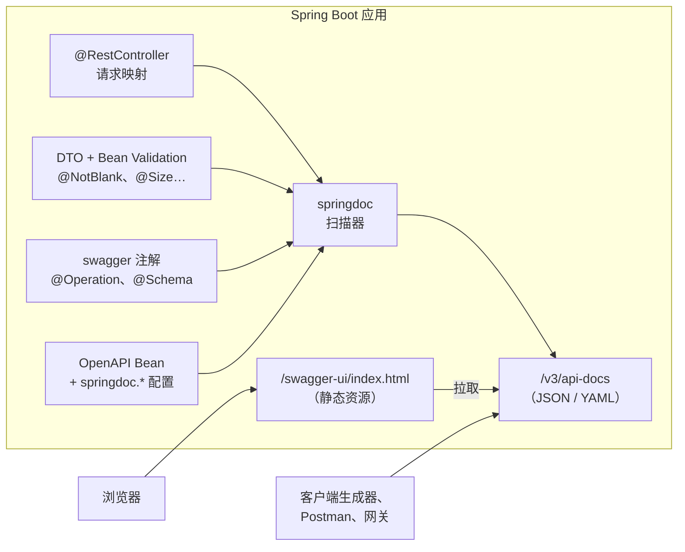
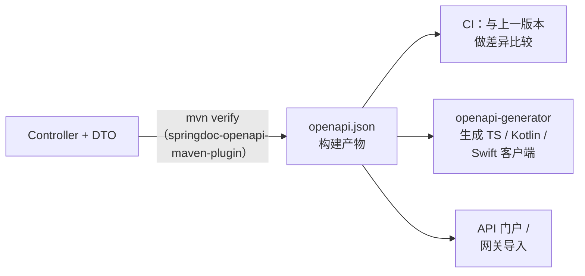

# Spring Boot 集成 Swagger / OpenAPI：用 springdoc-openapi 生成接口文档

## 缩写对照表

| 缩写 | 英文全称 | 中文 |
|---|---|---|
| API | Application Programming Interface | 应用程序编程接口；此处指 Controller 暴露的 HTTP 接口 |
| OAS | OpenAPI Specification | OpenAPI 规范，描述 HTTP API 的厂商中立标准 |
| REST | Representational State Transfer | 表述性状态转移，面向资源的 HTTP 接口风格 |
| HTTP | Hypertext Transfer Protocol | 超文本传输协议 |
| JSON / YAML | JavaScript Object Notation / YAML Ain't Markup Language | OpenAPI 文档的两种书写格式 |
| UI | User Interface | 用户界面；此处指 Swagger UI 页面 |
| MVC | Model–View–Controller | 模型-视图-控制器；此处指基于 Servlet 的 Spring Web MVC |
| DTO | Data Transfer Object | 数据传输对象，如 `CreateBookRequest` |
| JWT | JSON Web Token | JSON 网络令牌，安全方案里声明的 Bearer 令牌格式 |
| CI | Continuous Integration | 持续集成 |
| ISBN | International Standard Book Number | 国际标准书号，示例模型中的字段 |
| RFC | Request for Comments | 互联网标准文档，如 RFC 9457 |

## 一、一句话回答

只要加**一个依赖**——`springdoc-openapi-starter-webmvc-ui`——Spring Boot 应用就自动拥有：

- `/v3/api-docs`：运行时*从代码*（Controller、DTO、校验注解）生成的 **OpenAPI 3.1** JSON 文档；
- `/v3/api-docs.yaml`：同一份文档的 YAML 版本；
- `/swagger-ui.html`：**Swagger UI**，把文档渲染成可交互页面，还能直接发真实请求。

之后的标题、描述、示例值、错误响应、安全方案、分组，都是锦上添花：几个注解、一个 `OpenAPI` Bean、若干 `springdoc.*` 配置。

本文所有内容都在 **Spring Boot 4.1.1 + springdoc-openapi 3.1.1 + Java 17** 上实际构建运行过，文中的 JSON 片段是真实输出。

## 二、理清名字：Swagger、OpenAPI、springfox、springdoc

| 名称 | 是什么 |
|---|---|
| **Swagger** | 最初的 API 描述格式（Swagger 2.0），如今是 SmartBear 旗下一组工具的品牌：Swagger UI、Swagger Editor、Swagger Codegen。 |
| **OpenAPI** | 2016 年 Swagger 2.0 捐给 Linux 基金会后改名而来。当前版本是 OAS 3.0（2017）和 3.1（2021）。*格式叫 OpenAPI，工具仍叫 Swagger。* |
| **Swagger UI** | 把 OpenAPI 文档渲染成可浏览、可点击的文档页面的 HTML/JavaScript 程序。 |
| **springfox** | 老一代 Spring 集成方案（`@EnableSwagger2`、`Docket`）。最后一个版本是 2020 年的 3.0.0，不支持 Spring Boot 3+（Jakarta EE 命名空间）。**新项目不要再用。** |
| **springdoc-openapi** | 仍在维护的 Spring 集成方案。读取 Spring 自身的元数据，输出 OpenAPI 3，并内置 Swagger UI。本文用的就是它。 |

## 三、springdoc 的工作原理



*这张图回答：OpenAPI 文档从哪里来，又被谁使用？*

springdoc 向 Spring MVC 要来 `RequestMappingHandlerMapping`——也就是 Spring 自己用来路由请求的那张映射表——所以路径、HTTP 方法、参数和返回类型都直接来自你真实的映射。然后它用 swagger-core 的模型解析器（能识别 Jackson 配置）分析 DTO，再叠加校验注解和文档注解。文档在第一次被请求时生成并缓存。

## 四、第 1 步：添加依赖

按 Web 技术栈和 Spring Boot 版本选择构件：

| Spring Boot | springdoc 版本线 | Web MVC 构件 | WebFlux 构件 |
|---|---|---|---|
| 4.1.x | **3.1.x** | `springdoc-openapi-starter-webmvc-ui` | `springdoc-openapi-starter-webflux-ui` |
| 4.0.x | 3.0.x | 同上 | 同上 |
| 3.x | 2.8.x | 同上 | 同上 |
| 2.x（旧项目） | 1.8.0（最终版） | `springdoc-openapi-ui` | `springdoc-openapi-webflux-ui` |

*版本于 2026-10-22 在 Maven Central 核对。每条 springdoc 版本线只针对一代 Spring Boot 构建，混用（比如在 Boot 4 上用 springdoc 2.x）会在启动时失败。*

带 `-ui` 的 starter 内置 Swagger UI；`-api` 变体（如 `springdoc-openapi-starter-webmvc-api`）只生成 `/v3/api-docs`，适合 UI 托管在别处的服务。

```xml
<parent>
  <groupId>org.springframework.boot</groupId>
  <artifactId>spring-boot-starter-parent</artifactId>
  <version>4.1.1</version>
</parent>

<dependencies>
  <dependency>
    <groupId>org.springframework.boot</groupId>
    <artifactId>spring-boot-starter-webmvc</artifactId>
  </dependency>
  <dependency>
    <groupId>org.springframework.boot</groupId>
    <artifactId>spring-boot-starter-validation</artifactId>
  </dependency>
  <dependency>
    <groupId>org.springdoc</groupId>
    <artifactId>springdoc-openapi-starter-webmvc-ui</artifactId>
    <version>3.1.1</version>
  </dependency>
</dependencies>
```

（Spring Boot 4 把 `spring-boot-starter-web` 改名为 `spring-boot-starter-webmvc`，旧名字作为已废弃的别名仍可用；Boot 3 项目继续用 `spring-boot-starter-web`。）

Gradle：

```kotlin
implementation("org.springdoc:springdoc-openapi-starter-webmvc-ui:3.1.1")
```

启动应用，不做任何其他配置，以下地址就已可用：

| 地址 | 返回 |
|---|---|
| `/v3/api-docs` | OpenAPI 文档（JSON） |
| `/v3/api-docs.yaml` | OpenAPI 文档（YAML） |
| `/v3/api-docs/{group}` | 某个分组的文档（见第八节） |
| `/swagger-ui.html` | `302` 重定向到 `/swagger-ui/index.html` |
| `/v3/api-docs/swagger-config` | Swagger UI 启动时加载的配置 |

## 五、第 2 步：描述整个 API

一个 `OpenAPI` Bean 负责文档级元数据：标题、版本、描述、许可证和安全方案。

```java
@Configuration
public class OpenApiConfig {

    @Bean
    OpenAPI booksOpenApi() {
        return new OpenAPI()
                .info(new Info()
                        .title("Books API")
                        .version("v1")
                        .description("Catalogue service for the book store")
                        .license(new License().name("Apache 2.0")))
                .components(new Components().addSecuritySchemes("bearerAuth",
                        new SecurityScheme()
                                .type(SecurityScheme.Type.HTTP)
                                .scheme("bearer")
                                .bearerFormat("JWT")))
                .addSecurityItem(new SecurityRequirement().addList("bearerAuth"));
    }
}
```

声明安全方案后，Swagger UI 会出现 **Authorize** 按钮；在那里粘贴的令牌会以 `Authorization: Bearer …` 头随每次 "Try it out" 请求发送。`addSecurityItem` 把它应用到所有接口；如果只想用于部分接口，去掉这一行，改在对应方法上加 `@SecurityRequirement(name = "bearerAuth")`。

同样的元数据也可以用 `@OpenAPIDefinition`、`@SecurityScheme` 注解写在任意 `@Configuration` 类上；当取值来自配置文件时，Bean 的写法更方便。

## 六、第 3 步：给 Controller 和模型加文档

路径和类型 springdoc 已经知道了。注解补充的是*给人看*的部分：摘要、描述、示例值，以及 200 之外的响应。

```java
@RestController
@RequestMapping("/api/books")
@Tag(name = "Books", description = "Manage the book catalogue")
public class BookController {

    @GetMapping("/{id}")
    @Operation(summary = "Get a book by id")
    @ApiResponses({
            @ApiResponse(responseCode = "200", description = "Book found"),
            @ApiResponse(responseCode = "404", description = "No book with that id",
                    content = @Content(schema = @Schema(implementation = ProblemDetail.class)))
    })
    public ResponseEntity<Book> get(@Parameter(description = "Book id", example = "42")
                                    @PathVariable Long id) { ... }

    @PostMapping
    @ResponseStatus(HttpStatus.CREATED)
    @Operation(summary = "Create a book")
    @ApiResponse(responseCode = "201", description = "Book created")
    @ApiResponse(responseCode = "400", description = "Validation failed",
            content = @Content(schema = @Schema(implementation = ProblemDetail.class)))
    public Book create(@Valid @RequestBody CreateBookRequest request) { ... }
}
```

```java
@Schema(description = "A book in the catalogue")
public record Book(
        @Schema(description = "Server-assigned id", example = "42",
                accessMode = Schema.AccessMode.READ_ONLY)
        Long id,
        @Schema(description = "Book title", example = "Effective Java")
        String title,
        @Schema(description = "13-digit ISBN", example = "9780134685991")
        String isbn) {
}

@Schema(description = "Payload for creating a book")
public record CreateBookRequest(
        @NotBlank @Size(max = 200) @Schema(example = "Effective Java")
        String title,
        @NotBlank @Pattern(regexp = "\\d{13}") @Schema(example = "9780134685991")
        String isbn) {
}
```

这些注解来自 `io.swagger.v3.oas.annotations.*`（swagger-core），由 starter 自动引入。

| 注解 | 用在 | 作用 |
|---|---|---|
| `@Tag` | Controller | 在 Swagger UI 中把接口归到一个标题下 |
| `@Operation` | 处理方法 | `summary`、`description`、`operationId`、`hidden`、`deprecated` |
| `@Parameter` | 方法参数 | 路径/查询/请求头参数的描述、示例、是否必填 |
| `@ApiResponse(s)` | 处理方法 | 补充其他状态码及其响应体结构 |
| `@Schema` | DTO 类或字段 | 描述、示例、`accessMode`、`allowableValues`、`implementation` |
| `@Hidden` | Controller 或方法 | 从文档中隐藏 |

### Bean Validation 会自动进入 Schema

下面是 `CreateBookRequest` 实际生成的 Schema：

```json
"CreateBookRequest": {
  "type": "object",
  "description": "Payload for creating a book",
  "properties": {
    "title": { "type": "string", "example": "Effective Java", "maxLength": 200, "minLength": 0 },
    "isbn":  { "type": "string", "example": "9780134685991", "minLength": 1, "pattern": "\\d{13}" }
  },
  "required": ["isbn", "title"]
}
```

- `@NotBlank` / `@NotNull` → 字段进入 `required` 列表；
- `@Size(max = 200)` → `maxLength: 200`；`@Pattern` → `pattern`；`@Min`/`@Max` → `minimum`/`maximum`。

**注意 `title` 字段：** 单独的 `@NotBlank` 会生成 `minLength: 1`（如 `isbn`），但 `@Size(max = 200)` 带来了默认的 `min = 0`，并且覆盖了前者。如果最小长度对调用方有意义，请写成 `@Size(min = 1, max = 200)`。

同理，`accessMode = READ_ONLY` 在 `Book.id` 上生成 `"readOnly": true`，告诉客户端代码生成器创建时不要发送这个字段。

## 七、第 4 步：如实描述错误响应

只展示成功路径的文档会误导调用方。Spring Framework 的 `ProblemDetail`（RFC 9457《HTTP API 问题详情》）让所有错误使用同一种结构，上面的 `@ApiResponse(... implementation = ProblemDetail.class)` 正是在声明这一点。

要确保运行时行为与文档一致，打开 Spring Boot 内置的 problem-details 处理：

```yaml
spring:
  mvc:
    problemdetails:
      enabled: true
```

打开后，校验失败的返回（实测）：

```json
{"detail":"Invalid request content.","instance":"/api/books","status":400,"title":"Bad Request"}
```

不打开的话，返回的是 Boot 默认错误体（`timestamp`、`status`、`error`、`path`），与 `ProblemDetail` 的 Schema **对不上**。也可以写一个继承 `ResponseEntityExceptionHandler` 的 `@RestControllerAdvice`，效果相同，还能补充字段级错误信息。

## 八、第 5 步：给大型 API 分组

一个服务常常同时有公开接口、管理接口和内部回调。`GroupedOpenApi` 把它们拆成多份文档，在 Swagger UI 的下拉框里切换：

```java
@Bean
GroupedOpenApi publicApi() {
    return GroupedOpenApi.builder()
            .group("public")
            .pathsToMatch("/api/**")
            .build();
}

@Bean
GroupedOpenApi adminApi() {
    return GroupedOpenApi.builder()
            .group("admin")
            .pathsToMatch("/admin/**")
            .build();
}
```

每个分组的地址是 `/v3/api-docs/{group}`。分组还可以按 `packagesToScan`、`pathsToExclude` 或自定义 `OpenApiCustomizer` 过滤。一旦定义了分组 Bean，Swagger UI 的下拉框里就只列出各个分组；而 `/v3/api-docs` 本身仍然返回完整的、未分组的文档。

## 九、常用 `springdoc.*` 配置

```yaml
springdoc:
  api-docs:
    path: /v3/api-docs          # JSON 文档地址
  swagger-ui:
    path: /swagger-ui.html      # UI 入口地址
    operations-sorter: method   # 按 HTTP 方法排序接口
    tags-sorter: alpha          # 标签按字母排序
    try-it-out-enabled: true    # 默认展开 "Try it out"
  packages-to-scan: com.example.books
  default-produces-media-type: application/json
```

| 配置项 | 效果 |
|---|---|
| `springdoc.api-docs.enabled` | `false` 时去掉 `/v3/api-docs`（返回 404） |
| `springdoc.swagger-ui.enabled` | `false` 时去掉 Swagger UI |
| `springdoc.packages-to-scan` / `paths-to-match` | 限定默认文档包含的范围 |
| `springdoc.show-actuator` | 把 Actuator 端点也写进文档 |
| `springdoc.api-docs.version` | `openapi_3_1`（springdoc 2.8+/3.x 默认）或 `openapi_3_0`，供尚不支持 3.1 的工具使用 |

## 十、配合 Spring Security

如果引入了 Spring Security，文档端点会和其他接口一样被拦截。需要显式放行（在非生产环境）：

```java
@Bean
SecurityFilterChain api(HttpSecurity http) throws Exception {
    http.authorizeHttpRequests(auth -> auth
            .requestMatchers("/v3/api-docs/**", "/swagger-ui/**", "/swagger-ui.html").permitAll()
            .anyRequest().authenticated());
    // ... JWT 资源服务器等配置
    return http.build();
}
```

三个模式缺一不可：HTML 入口、`/swagger-ui/` 下的静态资源，以及页面拉取的 JSON（包括 `/v3/api-docs/swagger-config`）。

## 十一、生产环境要考虑的事

- **先决定生产环境要不要暴露文档。** 对内部服务来说，一份完整的接口和模型清单等于免费送给攻击者的侦察资料。常见做法：`dev`/`test` 开启，`prod` 关闭：

  ```yaml
  # application-prod.yml
  springdoc:
    api-docs:
      enabled: false
    swagger-ui:
      enabled: false
  ```

  对公开 API，可以保留文档，但要*有意识地*发布（开发者门户、网关），而不是无意中暴露。
- **位于反向代理或负载均衡器之后时**，生成的 `servers` 条目（测试运行中是 `"url": "http://localhost:18082", "description": "Generated server url"`）取自进入应用的请求，可能显示内部主机名或 `http`。设置 `server.forward-headers-strategy=framework` 让应用识别 `X-Forwarded-*` 头，或者在 `OpenAPI` Bean 中显式声明 `servers`。
- **启动开销**很小——文档在第一次请求时才生成——但特别大的 API 首次请求可能明显变慢，分组可以缓解。

## 十二、代码优先、设计优先，以及把规范当作构建产物

springdoc 属于**代码优先**：代码是事实来源，规范由代码推导。另一种是**设计优先**：手写 `openapi.yaml`、评审，再用 `openapi-generator`（`spring` 生成器）*生成* Spring 接口。无论哪种，都应把规范当作有版本的产物：



*这张图回答：springdoc 产出规范之后，它如何接入交付流水线的其他环节？*

`springdoc-openapi-maven-plugin`（1.5）在 `integration-test` 阶段启动应用，下载 `/v3/api-docs` 并写入 `target/openapi.json`；它需要 `spring-boot-maven-plugin` 的 `start`/`stop` 目标包在前后。CI（Continuous Integration，持续集成）任务把这个文件与上一个发布版本做差异比较（例如用 `openapi-diff`），就能在调用方踩坑之前发现破坏性变更——字段改名、参数新变为必填等。*（插件配置仅作方向性介绍，本文未实际运行。）*

## 十三、从 springfox 迁移

| springfox | springdoc / swagger-core |
|---|---|
| `@EnableSwagger2`、`Docket` Bean | 无需启用；分组用 `GroupedOpenApi` Bean |
| `@Api` | `@Tag` |
| `@ApiOperation(value = "...", notes = "...")` | `@Operation(summary = "...", description = "...")` |
| `@ApiParam` | `@Parameter` |
| `@ApiModel` / `@ApiModelProperty` | `@Schema` |
| `@ApiResponse(code = 404, message = "...")` | `@ApiResponse(responseCode = "404", description = "...")` |
| `@ApiIgnore` | `@Hidden`（或 `@Parameter(hidden = true)`） |
| `/v2/api-docs`、`/swagger-ui/` | `/v3/api-docs`、`/swagger-ui.html` |

先删掉所有 `io.springfox` 依赖——两者同时在类路径上会导致难以排查的启动失败。

## 十四、常见错误

| 现象 | 原因 | 解决 |
|---|---|---|
| 启动报 `NoSuchMethodError` / `ClassNotFoundException` | springdoc 版本线与 Spring Boot 代际不匹配 | 对照第四节的版本表 |
| `/swagger-ui.html` 返回 401/403 | Spring Security 拦截了 UI 或其 JSON | 放行第十节中的三个模式 |
| UI 能打开但提示 "Failed to load API definition" | JSON 地址被拦截，或代理改写了路径 | 直接访问 `/v3/api-docs/swagger-config` 和 `/v3/api-docs` 排查 |
| `@NotBlank` 字段的 Schema 显示 `minLength: 0` | `@Size` 没写 `min` | 改为 `@Size(min = 1, max = …)` |
| 文档中的 400 响应体与实际不符 | 返回的是 Boot 默认错误 JSON，而非 `ProblemDetail` | `spring.mvc.problemdetails.enabled=true` 或 `ResponseEntityExceptionHandler` |
| 请求 DTO 里出现 `id` 这类服务端字段 | 请求和响应共用一个 record | 拆分请求/响应 DTO，或使用 `accessMode = READ_ONLY` |
| 代码生成器拒绝解析规范 | 工具只支持 OAS 3.0 | `springdoc.api-docs.version=openapi_3_0` |

## 十五、结论

- **OpenAPI 是格式，Swagger UI 是查看器，springdoc-openapi 是 Spring 集成方案。** springfox 已经过时。
- **一个 starter 依赖**就能得到 `/v3/api-docs` 上实时的 OpenAPI 3.1 文档和 `/swagger-ui.html` 上的 Swagger UI，内容直接来自真实的请求映射、类型和校验规则。
- **有意识地补充价值：** 用 `OpenAPI` Bean 写元数据和安全方案，用 `@Operation`/`@ApiResponse` 说明意图和错误场景，用 `@Schema` 给示例，大型服务用 `GroupedOpenApi` 分组——并让运行时的错误格式与文档一致。
- **把规范当作产品：** 生产环境锁定或关闭，在 CI 中导出，版本之间做差异比较，并据此生成客户端。

## 参考资料

- springdoc-openapi 文档：<https://springdoc.org/>
- springdoc-openapi GitHub：<https://github.com/springdoc/springdoc-openapi>
- OpenAPI 规范 3.1：<https://spec.openapis.org/oas/v3.1.0>
- swagger-core 注解：<https://github.com/swagger-api/swagger-core/wiki/Swagger-2.X---Annotations>
- RFC 9457《HTTP API 问题详情》：<https://www.rfc-editor.org/rfc/rfc9457>
- 相关文章：[Spring Boot 启动生命周期](./springboot-startup-lifecycle.zh.md)
