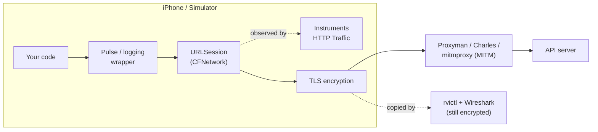
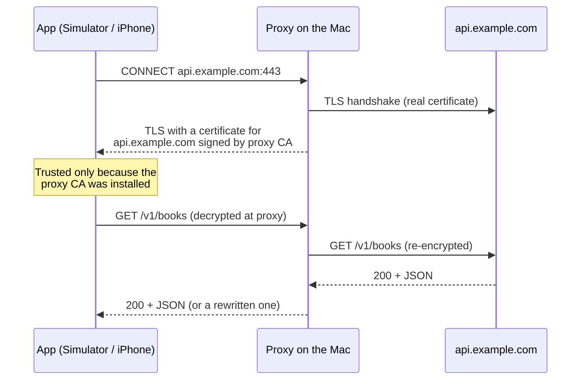

# Inspecting an iOS App's Network Traffic: Instruments, Proxyman, mitmproxy, Pulse and More

## Abbreviations

| Abbreviation | Full name | Meaning here |
|---|---|---|
| HTTP / HTTPS | Hypertext Transfer Protocol (Secure) | The request/response traffic you want to see |
| TLS | Transport Layer Security | The encryption that makes HTTPS unreadable on the wire |
| CA | Certificate Authority | The root certificate a proxy uses to sign fake server certificates |
| MITM | Man-in-the-Middle | Decrypting traffic by sitting between app and server — what debugging proxies do |
| DNS | Domain Name System | Name resolution; visible at packet level |
| QA | Quality Assurance | Testers who need to see traffic without Xcode |
| UDID | Unique Device Identifier | The ID `rvictl` needs to attach to a physical device |
| CLI | Command-Line Interface | `xcrun`, `xctrace`, `rvictl`, `mitmproxy` |
| SPKI | Subject Public Key Info | The public-key part of a certificate that pinning usually hashes |

## 1. The short answer

| You want to... | Use |
|---|---|
| Debug API calls every day on the Simulator | **Proxyman** (or Charles / mitmproxy) |
| See decrypted traffic with zero setup, even with certificate pinning on | **Instruments → HTTP Traffic** |
| Let testers or non-developers see traffic on real devices and TestFlight builds | **Pulse** (in-app logger) |
| A quick look right now, no tools | **`CFNETWORK_DIAGNOSTICS=3`** or a logging wrapper |
| Diagnose TLS handshakes, DNS or connectivity — not payloads | **`rvictl` + Wireshark** |

The rest of this article explains how each option works, how to set it up, and where each one stops working.

## 2. Where each tool looks

The tools differ mainly in **where they sit** relative to encryption:



*This diagram answers: at which layer does each tool capture traffic, and is the data still readable there?*

- **Inside the app, before encryption** (Pulse, logging wrappers, `CFNETWORK_DIAGNOSTICS`): sees plaintext, needs code or scheme changes, unaffected by pinning.
- **At the URLSession layer** (Instruments HTTP Traffic): sees plaintext without code changes, unaffected by pinning, but only for URLSession.
- **On the network, as a proxy** (Proxyman, Charles, mitmproxy): sees plaintext only because the device trusts the proxy's CA. Most powerful — can modify and replay — but certificate pinning blocks it.
- **On the wire** (`rvictl` + Wireshark): sees packets, but HTTPS payloads stay encrypted.

## 3. Instruments → HTTP Traffic (built in, no proxy)

Since Xcode 13, Instruments has an **HTTP Traffic** instrument that shows your app's URLSession traffic **already decrypted**.

**Steps**

1. In Xcode: **Product → Profile** (⌘I).
2. Choose the **Network** template — it contains the HTTP Traffic and Network Connections instruments.
3. Record, use the app, stop.
4. Drill down: process → session → domain → individual tasks. Each transaction shows URL, method, request and response headers, status, timing, and bodies.

It also works from the command line, which is handy for capturing a run on CI or on a remote Mac:

```bash
xcrun xctrace list templates          # "Network" should be listed
xcrun xctrace record --template Network --device "<device name or UDID>" \
    --attach "<YourApp>" --time-limit 60s --output trace.trace
open trace.trace
```

**Pros**

- No certificates, no proxy settings, nothing to undo afterwards.
- **Certificate pinning does not matter** — it reads URLSession from the inside, not the network.
- Shows URLSession's own view: task timing, redirects, which tasks shared a connection.

**Cons**

- Clunky for repeated debugging: record, stop, drill down, repeat.
- Read-only — you cannot modify, block or replay requests.
- Only sees **URLSession** (and things built on it, such as Alamofire). Raw sockets, `Network.framework` connections, and stacks that bring their own HTTP client (for example Flutter's Dart `HttpClient`, some gRPC and video SDKs) are invisible.
- Captures your own debuggable app; it is not a tool for inspecting other people's apps.

## 4. A proxy app: Proxyman, Charles or mitmproxy (best day to day)

A debugging proxy is a deliberate man-in-the-middle. The app connects to the proxy; the proxy connects to the real server; to decrypt HTTPS it presents a certificate signed by **its own CA**, which you have told the device to trust.



*This diagram answers: how can a proxy read HTTPS, and why must the device trust its CA?*

### Choosing a proxy

| Tool | Cost | Strengths |
|---|---|---|
| **Proxyman** | Free tier; paid for advanced features | Native macOS app, most iOS-friendly: one-click Simulator certificate install, the **Atlantis** framework for capturing from a device without Wi-Fi proxy settings, good UI |
| **Charles** | Paid (trial) | Long-established, cross-platform, rich rewrite/map/throttle features |
| **mitmproxy** | Free, open source | Scriptable in Python, works in a terminal (`mitmproxy`), web UI (`mitmweb`) or headless (`mitmdump`); ideal for automation |

### Simulator setup

The Simulator uses the **Mac's** network stack and proxy settings, so two things are needed: the Mac's system proxy points at the tool, and the Simulator trusts the tool's CA.

- **Proxyman:** *Certificate → Install Certificate on iOS → Simulators*. Proxyman sets the macOS system proxy itself while recording.
- **Charles:** *Help → SSL Proxying → Install Charles Root Certificate in iOS Simulators*, then enable SSL proxying for the hosts you care about (*Proxy → SSL Proxying Settings*).
- **mitmproxy:** run it once so it generates its CA in `~/.mitmproxy/`, then trust it in the booted Simulator and point the Mac's proxy at it:

  ```bash
  xcrun simctl keychain booted add-root-cert ~/.mitmproxy/mitmproxy-ca-cert.pem

  networksetup -setwebproxy "Wi-Fi" 127.0.0.1 8080
  networksetup -setsecurewebproxy "Wi-Fi" 127.0.0.1 8080
  mitmweb                        # UI at http://127.0.0.1:8081

  # when finished
  networksetup -setwebproxystate "Wi-Fi" off
  networksetup -setsecurewebproxystate "Wi-Fi" off
  ```

  (Replace `Wi-Fi` with your active network service — `networksetup -listallnetworkservices` lists them.)

### Physical device setup

1. Put the iPhone on the same network as the Mac.
2. **Settings → Wi-Fi → (i) → Configure Proxy → Manual**: server = the Mac's IP, port = the proxy's port (8888 for Charles, 9090 for Proxyman, 8080 for mitmproxy by default).
3. In Safari on the phone, open the proxy's certificate page (`http://mitm.it` for mitmproxy, `chls.pro/ssl` for Charles; Proxyman shows its own instructions) and download the profile.
4. **Settings → General → VPN & Device Management** → install the downloaded profile.
5. **Settings → General → About → Certificate Trust Settings** → turn on full trust for that root. Without this step the profile is installed but HTTPS still fails.

**Proxyman Atlantis** skips steps 2–5: add the Atlantis Swift package to a Debug build, call `Atlantis.start()`, and the app streams its URLSession traffic to Proxyman over the local network (Bonjour). No proxy, no CA — but it is code in your app, so keep it out of Release builds.

### What you can do once traffic flows through a proxy

- **Breakpoints** — pause a request or response and edit it before it continues.
- **Rewrite** — change headers, status codes or bodies by rule (e.g. force a `500` to test error UI).
- **Map Local / Map Remote** — serve a response from a local file, or redirect a host to staging.
- **Replay / repeat** — resend a captured request, optionally edited.
- **Throttle** — simulate slow or lossy networks (Apple's *Network Link Conditioner* is the system-wide alternative).

### The big gotcha: certificate pinning

If the app pins its server's certificate or public key, it rejects the proxy's certificate and requests simply fail (`NSURLErrorCancelled` / `-999` or `-1200` series errors). Do not "fix" this by weakening pinning everywhere — **disable it only in Debug builds**:

```swift
import Foundation
import CryptoKit

final class PinningDelegate: NSObject, URLSessionDelegate {
    private let pinnedKeyHashes: Set<String>   // base64 SHA-256 of the server's public key

    init(pinnedKeyHashes: Set<String>) {
        self.pinnedKeyHashes = pinnedKeyHashes
    }

    func urlSession(_ session: URLSession,
                    didReceive challenge: URLAuthenticationChallenge,
                    completionHandler: @escaping (URLSession.AuthChallengeDisposition, URLCredential?) -> Void) {
        #if DEBUG
        // Debug builds: normal system trust, so a proxy CA you installed on purpose is accepted.
        completionHandler(.performDefaultHandling, nil)
        #else
        guard challenge.protectionSpace.authenticationMethod == NSURLAuthenticationMethodServerTrust,
              let trust = challenge.protectionSpace.serverTrust,
              SecTrustEvaluateWithError(trust, nil),
              let chain = SecTrustCopyCertificateChain(trust) as? [SecCertificate],
              let leafKey = chain.first.flatMap(SecCertificateCopyKey),
              let keyData = SecKeyCopyExternalRepresentation(leafKey, nil) as Data?,
              pinnedKeyHashes.contains(Data(SHA256.hash(data: keyData)).base64EncodedString())
        else {
            completionHandler(.cancelAuthenticationChallenge, nil)
            return
        }
        completionHandler(.useCredential, URLCredential(trust: trust))
        #endif
    }
}
```

*(Type-checked with `swiftc` for both Debug and Release. It hashes the key's raw external representation, not the SPKI (Subject Public Key Info) structure — generate your pin hashes the same way.)*

If pinning comes from a third-party SDK you cannot configure, use **Instruments HTTP Traffic** or **Pulse** instead — both see the traffic before TLS, so pinning is irrelevant.

## 5. In-app logging with Pulse (great for teams and QA)

[Pulse](https://github.com/kean/Pulse) records every URLSession request **inside the app** and ships a SwiftUI viewer.

- Add the `Pulse` and `PulseUI` packages.
- Route traffic through it — the simplest form replaces your `URLSession` with Pulse's drop-in proxy (`URLSessionProxy` in Pulse 4+; check the README for the API of the version you install).
- Present `ConsoleView()` from a debug menu or a shake gesture.

Why teams like it:

- **No proxy, no certificates, no Mac** — a tester opens the console on the phone.
- Logs can be **shared** as a file and opened on a Mac (Pulse Pro / Pulse for Mac).
- Keeps working in **TestFlight** builds if you include it there.
- Pinning-proof, because it observes requests before encryption.

Caveat: anything in the log can include tokens and personal data. Restrict it to internal builds, redact `Authorization` headers, and never ship the console in an App Store build.

## 6. Quick and dirty: console logging

### `CFNETWORK_DIAGNOSTICS`

In Xcode: **Product → Scheme → Edit Scheme → Run → Arguments → Environment Variables**, add:

| Name | Value |
|---|---|
| `CFNETWORK_DIAGNOSTICS` | `3` |

CFNetwork then writes verbose request and response details for every task to the Xcode console (levels 1–3; 3 is the most detailed). It is very noisy, but it takes ten seconds and needs no tools. Remove it when you are done — the output can contain headers and cookies.

### A logging wrapper around your network layer

If your app has a single network client, a few lines of logging there is often the most useful permanent tool:

```swift
struct LoggingClient {
    let session: URLSession

    func data(for request: URLRequest) async throws -> (Data, URLResponse) {
        let start = Date()
        #if DEBUG
        print("➡️ \(request.httpMethod ?? "GET") \(request.url?.absoluteString ?? "")")
        #endif
        let (data, response) = try await session.data(for: request)
        #if DEBUG
        let status = (response as? HTTPURLResponse)?.statusCode ?? -1
        let ms = Int(Date().timeIntervalSince(start) * 1000)
        print("⬅️ \(status) \(request.url?.absoluteString ?? "") \(data.count) bytes \(ms) ms")
        #endif
        return (data, response)
    }
}
```

A custom `URLProtocol` subclass registered in `URLSessionConfiguration.protocolClasses` can do the same for every request in a session without touching call sites, at the cost of more code.

## 7. Packet level: `rvictl` + Wireshark (rarely needed)

`rvictl` (installed with Xcode at `/Library/Apple/usr/bin/rvictl`) creates a **remote virtual interface** that mirrors a USB-connected iPhone's network traffic onto the Mac:

```bash
xcrun xctrace list devices          # find the device UDID
rvictl -s <UDID>                    # creates rvi0
sudo tcpdump -i rvi0 -w phone.pcap  # or capture rvi0 in Wireshark
rvictl -x <UDID>                    # remove the interface
```

HTTPS stays **encrypted** — you see IP addresses, ports, DNS queries, TLS handshakes (including the server name in the ClientHello), retransmissions and resets, but not URLs or bodies. Use it for "the request never arrives", TLS version/cipher problems, DNS issues, or to see traffic that bypasses both URLSession and the system proxy.

## 8. Side-by-side

| | Instruments HTTP Traffic | Proxy (Proxyman/Charles/mitmproxy) | Pulse | `CFNETWORK_DIAGNOSTICS` / wrapper | `rvictl` + Wireshark |
|---|---|---|---|---|---|
| Setup | None | CA + proxy settings | Add a package | Scheme variable / code | USB + CLI |
| Decrypted bodies | Yes | Yes | Yes | Yes | **No** |
| Works with pinning | **Yes** | **No** (disable in Debug) | **Yes** | **Yes** | n/a |
| Modify / replay | No | **Yes** | No | No | No |
| Non-URLSession traffic | No | If it honours the proxy | No | No | **Yes** (encrypted) |
| Physical device | Yes | Yes | Yes | Yes | Yes |
| Usable by QA without Xcode | No | With a Mac | **Yes** | No | No |

## 9. Safety checklist

- **Remove trust when you are done.** A trusted proxy CA on a phone lets anyone holding that CA's key read its HTTPS traffic. Delete the profile (*Settings → General → VPN & Device Management*) on devices you no longer debug, and keep the CA private key off shared machines.
- **Turn the Mac proxy off** after mitmproxy sessions, or other apps will fail when it is not running.
- **Keep debug hooks out of Release builds** — pinning bypasses, Atlantis, Pulse console, verbose logging — with `#if DEBUG` or a separate build configuration.
- **Only inspect apps you own or are authorised to test.**

## 10. Conclusion

- **Daily API work:** Proxyman with the Simulator — full visibility plus breakpoints, rewrite, map-local and replay.
- **When pinning or proxy setup gets in the way:** Instruments' **HTTP Traffic** — decrypted URLSession traffic with no setup at all.
- **When non-developers need to see traffic on real devices:** **Pulse**, built into internal and TestFlight builds.
- **For a ten-second look:** `CFNETWORK_DIAGNOSTICS=3`.
- **For network-level failures, not payloads:** `rvictl` + Wireshark.

## References

- WWDC21, *Analyze HTTP traffic in Instruments*: <https://developer.apple.com/videos/play/wwdc2021/10212/>
- Proxyman documentation: <https://docs.proxyman.com/>
- Atlantis: <https://github.com/ProxymanApp/atlantis>
- mitmproxy, certificate installation: <https://docs.mitmproxy.org/stable/concepts-certificates/>
- Charles Proxy: <https://www.charlesproxy.com/documentation/>
- Pulse: <https://github.com/kean/Pulse>
- Apple, *Recording a packet trace*: <https://developer.apple.com/documentation/network/recording-a-packet-trace>
