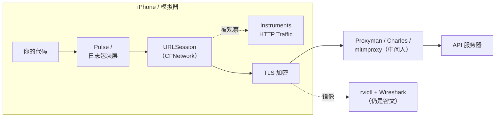
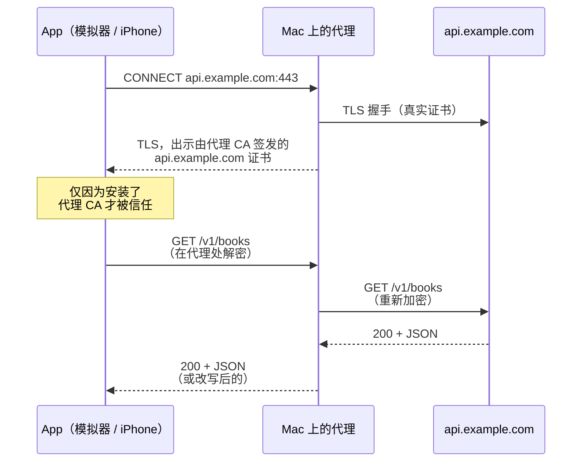

# iOS App 网络抓包全指南：Instruments、Proxyman、mitmproxy、Pulse 怎么选

## 缩写对照表

| 缩写 | 英文全称 | 中文 |
|---|---|---|
| HTTP / HTTPS | Hypertext Transfer Protocol (Secure) | 超文本传输协议（安全版），即要查看的请求/响应流量 |
| TLS | Transport Layer Security | 传输层安全协议，让 HTTPS 在线路上不可读的加密层 |
| CA | Certificate Authority | 证书颁发机构；此处指代理用来签发伪造服务器证书的根证书 |
| MITM | Man-in-the-Middle | 中间人；抓包代理就是"有意为之的中间人" |
| DNS | Domain Name System | 域名系统 |
| QA | Quality Assurance | 质量保证，即测试人员 |
| UDID | Unique Device Identifier | 设备唯一标识，`rvictl` 连接真机时需要 |
| CLI | Command-Line Interface | 命令行界面，如 `xcrun`、`xctrace`、`rvictl`、`mitmproxy` |
| SPKI | Subject Public Key Info | 证书中的公钥信息结构，证书锁定通常对它做哈希 |
| SDK | Software Development Kit | 软件开发工具包 |

## 一、一句话回答

| 你想要…… | 用这个 |
|---|---|
| 在模拟器上日常调试接口 | **Proxyman**（或 Charles / mitmproxy） |
| 零配置看到解密后的流量，即使开着证书锁定 | **Instruments → HTTP Traffic** |
| 让测试或非开发人员在真机、TestFlight 包上查看流量 | **Pulse**（App 内日志） |
| 现在就想瞄一眼，不装任何工具 | **`CFNETWORK_DIAGNOSTICS=3`** 或日志包装层 |
| 排查 TLS 握手、DNS、连通性——而不是看报文内容 | **`rvictl` + Wireshark** |

下文逐一说明每种方式的原理、配置方法，以及它在哪里失效。

## 二、每种工具"看"在哪一层

这些工具最大的区别在于：它们相对于加密层**所处的位置**。



*这张图回答：每个工具在哪一层抓流量？在那一层数据还是明文吗？*

- **App 内部、加密之前**（Pulse、日志包装层、`CFNETWORK_DIAGNOSTICS`）：看到明文；需要改代码或改 Scheme；不受证书锁定影响。
- **URLSession 层**（Instruments HTTP Traffic）：不改代码就能看到明文；不受证书锁定影响；但只覆盖 URLSession。
- **网络上的代理**（Proxyman、Charles、mitmproxy）：能看到明文，*只是因为*设备信任了代理的 CA。功能最强——能改包、重放——但会被证书锁定挡住。
- **线路上**（`rvictl` + Wireshark）：能看到数据包，但 HTTPS 内容仍是密文。

## 三、Instruments → HTTP Traffic（系统自带，无需代理）

从 Xcode 13 起，Instruments 提供 **HTTP Traffic** 工具，能显示你自己 App 的 URLSession 流量，并且**已经解密**。

**步骤**

1. Xcode 中 **Product → Profile**（⌘I）。
2. 选择 **Network** 模板——它包含 HTTP Traffic 和 Network Connections 两个工具。
3. 开始录制，操作 App，停止。
4. 逐层展开：进程 → 会话 → 域名 → 单个任务。每个事务都能看到 URL、方法、请求/响应头、状态码、耗时和请求/响应体。

它也可以在命令行使用，方便在 CI 或远程 Mac 上采集：

```bash
xcrun xctrace list templates          # 列表里应有 "Network"
xcrun xctrace record --template Network --device "<设备名或 UDID>" \
    --attach "<YourApp>" --time-limit 60s --output trace.trace
open trace.trace
```

**优点**

- 不装证书、不设代理，用完也无需还原。
- **证书锁定无影响**——它从 URLSession 内部读取，而不是从网络上截获。
- 呈现的是 URLSession 自己的视角：任务耗时、重定向、哪些任务复用了同一连接。

**缺点**

- 反复调试时操作繁琐：录制、停止、展开，再来一遍。
- 只读——不能修改、拦截或重放请求。
- 只能看到 **URLSession**（以及基于它的库，如 Alamofire）。原始 socket、`Network.framework` 连接、自带 HTTP 客户端的技术栈（例如 Flutter 的 Dart `HttpClient`、部分 gRPC 和视频 SDK）都看不到。
- 采集的是你自己可调试的 App，不是用来分析别人 App 的工具。

## 四、代理工具：Proxyman、Charles、mitmproxy（日常首选）

抓包代理就是一个*有意为之*的中间人。App 连到代理，代理再连到真正的服务器；为了解密 HTTPS，代理出示一张由**它自己的 CA** 签发的证书，而你事先让设备信任了这个 CA。



*这张图回答：代理为什么能读 HTTPS？设备为什么必须信任它的 CA？*

### 选哪个代理

| 工具 | 费用 | 特点 |
|---|---|---|
| **Proxyman** | 有免费版，高级功能付费 | 原生 macOS 应用，对 iOS 最友好：一键给模拟器装证书；**Atlantis** 框架可在不设 Wi-Fi 代理的情况下抓真机流量；界面好用 |
| **Charles** | 付费（可试用） | 老牌、跨平台，改写/映射/限速功能丰富 |
| **mitmproxy** | 免费开源 | 可用 Python 编写脚本；支持终端界面（`mitmproxy`）、网页界面（`mitmweb`）和无界面模式（`mitmdump`），适合自动化 |

### 模拟器配置

模拟器使用的是 **Mac 的**网络栈和代理设置，因此需要两件事：Mac 的系统代理指向抓包工具；模拟器信任该工具的 CA。

- **Proxyman：** *Certificate → Install Certificate on iOS → Simulators*。录制时 Proxyman 会自动设置 macOS 系统代理。
- **Charles：** *Help → SSL Proxying → Install Charles Root Certificate in iOS Simulators*，然后为关心的域名开启 SSL 代理（*Proxy → SSL Proxying Settings*）。
- **mitmproxy：** 先运行一次，让它在 `~/.mitmproxy/` 生成 CA；再让已启动的模拟器信任它，并把 Mac 的代理指向它：

  ```bash
  xcrun simctl keychain booted add-root-cert ~/.mitmproxy/mitmproxy-ca-cert.pem

  networksetup -setwebproxy "Wi-Fi" 127.0.0.1 8080
  networksetup -setsecurewebproxy "Wi-Fi" 127.0.0.1 8080
  mitmweb                        # 界面在 http://127.0.0.1:8081

  # 用完后关闭
  networksetup -setwebproxystate "Wi-Fi" off
  networksetup -setsecurewebproxystate "Wi-Fi" off
  ```

  （把 `Wi-Fi` 换成你当前使用的网络服务名，`networksetup -listallnetworkservices` 可列出。）

### 真机配置

1. iPhone 与 Mac 连同一网络。
2. **设置 → 无线局域网 → (i) → 配置代理 → 手动**：服务器填 Mac 的 IP，端口填代理端口（默认 Charles 8888、Proxyman 9090、mitmproxy 8080）。
3. 在手机 Safari 打开代理的证书页面（mitmproxy 是 `http://mitm.it`，Charles 是 `chls.pro/ssl`，Proxyman 会给出自己的指引），下载描述文件。
4. **设置 → 通用 → VPN 与设备管理** → 安装刚下载的描述文件。
5. **设置 → 通用 → 关于本机 → 证书信任设置** → 为该根证书开启完全信任。漏掉这一步，描述文件虽已安装，HTTPS 仍会失败。

**Proxyman Atlantis** 可以跳过第 2–5 步：在 Debug 构建中加入 Atlantis Swift 包并调用 `Atlantis.start()`，App 就会通过局域网（Bonjour）把 URLSession 流量发给 Proxyman。无需代理、无需 CA——但它是 App 里的代码，务必不要带进 Release 构建。

### 流量经过代理后能做什么

- **断点**：暂停请求或响应，修改后再放行。
- **改写（Rewrite）**：按规则改请求头、状态码或响应体（例如强制返回 `500` 来测试错误界面）。
- **Map Local / Map Remote**：用本地文件作为响应，或把某个域名重定向到预发环境。
- **重放**：重新发送抓到的请求，可先修改。
- **限速**：模拟慢速或丢包网络（系统级的替代方案是 Apple 的 *Network Link Conditioner*）。

### 最大的坑：证书锁定

如果 App 锁定了服务器证书或公钥，它会拒绝代理的证书，请求直接失败（`NSURLErrorCancelled` / `-999`，或 `-1200` 系列错误）。不要为此全面削弱证书锁定——**只在 Debug 构建中关闭它**：

```swift
import Foundation
import CryptoKit

final class PinningDelegate: NSObject, URLSessionDelegate {
    private let pinnedKeyHashes: Set<String>   // 服务器公钥的 SHA-256（base64）

    init(pinnedKeyHashes: Set<String>) {
        self.pinnedKeyHashes = pinnedKeyHashes
    }

    func urlSession(_ session: URLSession,
                    didReceive challenge: URLAuthenticationChallenge,
                    completionHandler: @escaping (URLSession.AuthChallengeDisposition, URLCredential?) -> Void) {
        #if DEBUG
        // Debug 构建：走系统默认信任评估，这样你主动安装的代理 CA 会被接受。
        completionHandler(.performDefaultHandling, nil)
        #else
        guard challenge.protectionSpace.authenticationMethod == NSURLAuthenticationMethodServerTrust,
              let trust = challenge.protectionSpace.serverTrust,
              SecTrustEvaluateWithError(trust, nil),
              let chain = SecTrustCopyCertificateChain(trust) as? [SecCertificate],
              let leafKey = chain.first.flatMap(SecCertificateCopyKey),
              let keyData = SecKeyCopyExternalRepresentation(leafKey, nil) as Data?,
              pinnedKeyHashes.contains(Data(SHA256.hash(data: keyData)).base64EncodedString())
        else {
            completionHandler(.cancelAuthenticationChallenge, nil)
            return
        }
        completionHandler(.useCredential, URLCredential(trust: trust))
        #endif
    }
}
```

*（已用 `swiftc` 分别在 Debug 和 Release 条件下做过类型检查。这里哈希的是公钥的原始外部表示，而不是 SPKI（Subject Public Key Info，公钥信息）结构——生成锁定哈希时要用同样的方式。）*

如果证书锁定来自无法配置的第三方 SDK，就改用 **Instruments HTTP Traffic** 或 **Pulse**——它们都在 TLS 之前看到流量，证书锁定与它们无关。

## 五、App 内日志：Pulse（适合团队和测试）

[Pulse](https://github.com/kean/Pulse) 在 **App 内部**记录每个 URLSession 请求，并自带 SwiftUI 查看界面。

- 添加 `Pulse` 和 `PulseUI` 两个包。
- 让流量经过它——最简单的方式是用 Pulse 提供的可直接替换的代理对象替换你的 `URLSession`（Pulse 4+ 中为 `URLSessionProxy`；具体 API 以所装版本的 README 为准）。
- 在调试菜单或摇一摇手势中展示 `ConsoleView()`。

团队喜欢它的原因：

- **无需代理、无需证书、无需 Mac**——测试人员在手机上直接打开控制台。
- 日志可以导出为文件**分享**，在 Mac 上打开（Pulse Pro / Pulse for Mac）。
- 如果把它打进 **TestFlight** 构建，在那里同样可用。
- 不受证书锁定影响，因为它在加密之前观察请求。

注意：日志里可能包含令牌和个人数据。只在内部构建中启用，对 `Authorization` 头做脱敏，绝不要把控制台带进 App Store 版本。

## 六、最快的办法：控制台日志

### `CFNETWORK_DIAGNOSTICS`

Xcode 中 **Product → Scheme → Edit Scheme → Run → Arguments → Environment Variables**，添加：

| 名称 | 值 |
|---|---|
| `CFNETWORK_DIAGNOSTICS` | `3` |

CFNetwork 会把每个任务的请求和响应细节输出到 Xcode 控制台（级别 1–3，3 最详细）。输出非常嘈杂，但十秒钟就能用上，不需要任何工具。用完记得删掉——输出里可能有请求头和 Cookie。

### 给网络层加一个日志包装

如果 App 只有一个统一的网络客户端，在那里加几行日志往往是最实用的长期工具：

```swift
struct LoggingClient {
    let session: URLSession

    func data(for request: URLRequest) async throws -> (Data, URLResponse) {
        let start = Date()
        #if DEBUG
        print("➡️ \(request.httpMethod ?? "GET") \(request.url?.absoluteString ?? "")")
        #endif
        let (data, response) = try await session.data(for: request)
        #if DEBUG
        let status = (response as? HTTPURLResponse)?.statusCode ?? -1
        let ms = Int(Date().timeIntervalSince(start) * 1000)
        print("⬅️ \(status) \(request.url?.absoluteString ?? "") \(data.count) bytes \(ms) ms")
        #endif
        return (data, response)
    }
}
```

也可以写一个自定义 `URLProtocol` 子类并注册到 `URLSessionConfiguration.protocolClasses`，在不改调用点的情况下记录该会话的所有请求，代价是代码更多。

## 七、数据包层：`rvictl` + Wireshark（很少需要）

`rvictl`（随 Xcode 安装，位于 `/Library/Apple/usr/bin/rvictl`）会创建一个**远程虚拟网卡**，把 USB 连接的 iPhone 的网络流量镜像到 Mac 上：

```bash
xcrun xctrace list devices          # 查设备 UDID
rvictl -s <UDID>                    # 创建 rvi0
sudo tcpdump -i rvi0 -w phone.pcap  # 或在 Wireshark 中抓 rvi0
rvictl -x <UDID>                    # 移除虚拟网卡
```

HTTPS 内容仍是**密文**——你能看到 IP、端口、DNS 查询、TLS 握手（包括 ClientHello 里的服务器名）、重传和连接重置，但看不到 URL 和报文体。适合排查"请求根本没到服务器"、TLS 版本/加密套件问题、DNS 问题，或者既绕过 URLSession 又绕过系统代理的流量。

## 八、横向对比

| | Instruments HTTP Traffic | 代理（Proxyman/Charles/mitmproxy） | Pulse | `CFNETWORK_DIAGNOSTICS` / 包装层 | `rvictl` + Wireshark |
|---|---|---|---|---|---|
| 配置成本 | 无 | CA + 代理设置 | 加一个包 | Scheme 变量 / 代码 | USB + 命令行 |
| 能看到解密后的报文体 | 能 | 能 | 能 | 能 | **不能** |
| 开启证书锁定时可用 | **可用** | **不可用**（Debug 中关闭锁定） | **可用** | **可用** | 不适用 |
| 改包 / 重放 | 否 | **是** | 否 | 否 | 否 |
| 非 URLSession 流量 | 否 | 取决于是否走系统代理 | 否 | 否 | **是**（密文） |
| 真机 | 支持 | 支持 | 支持 | 支持 | 支持 |
| 测试人员无需 Xcode 即可使用 | 否 | 需要 Mac | **是** | 否 | 否 |

## 九、安全检查清单

- **用完撤销信任。** 手机上受信任的代理 CA，意味着任何持有该 CA 私钥的人都能读取这台手机的 HTTPS 流量。不再调试的设备上要删除描述文件（*设置 → 通用 → VPN 与设备管理*），CA 私钥也不要放在共享机器上。
- **mitmproxy 用完后关闭 Mac 系统代理**，否则代理没运行时其他应用会连不上网。
- **调试手段不进 Release 构建**——锁定绕过、Atlantis、Pulse 控制台、详细日志——用 `#if DEBUG` 或单独的构建配置隔离。
- **只分析你自己拥有或已获授权测试的 App。**

## 十、结论

- **日常接口调试：** Proxyman + 模拟器——完整可见，还有断点、改写、Map Local 和重放。
- **证书锁定或代理配置碍事时：** Instruments 的 **HTTP Traffic**——零配置看到解密后的 URLSession 流量。
- **需要让非开发人员在真机上看流量时：** **Pulse**，打进内部包和 TestFlight 包。
- **只想瞄一眼：** `CFNETWORK_DIAGNOSTICS=3`。
- **排查网络层故障而非报文内容：** `rvictl` + Wireshark。

## 参考资料

- WWDC21《Analyze HTTP traffic in Instruments》：<https://developer.apple.com/videos/play/wwdc2021/10212/>
- Proxyman 文档：<https://docs.proxyman.com/>
- Atlantis：<https://github.com/ProxymanApp/atlantis>
- mitmproxy 证书安装：<https://docs.mitmproxy.org/stable/concepts-certificates/>
- Charles Proxy：<https://www.charlesproxy.com/documentation/>
- Pulse：<https://github.com/kean/Pulse>
- Apple《Recording a packet trace》：<https://developer.apple.com/documentation/network/recording-a-packet-trace>
