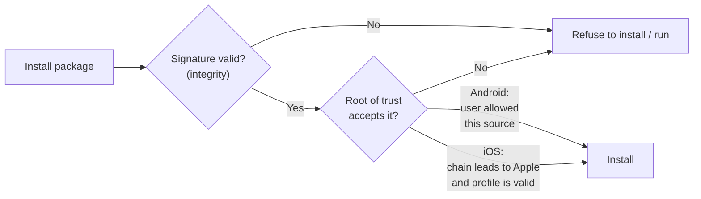
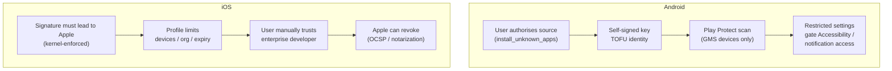
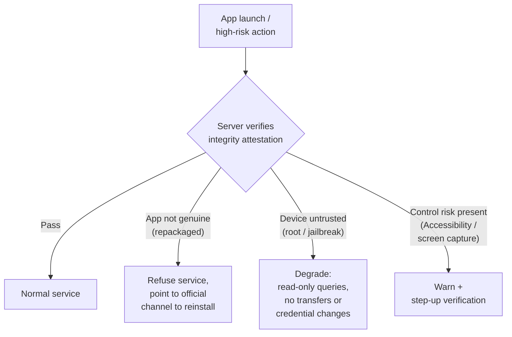

# Mobile App Sideloading Attacks: Trust Chains, Weak Points and Defences on Android and iOS

*中文版：[移动 App 侧载攻击：Android 与 iOS 的信任链、突破口与防护](./sideloading-attack-android-ios.zh.md)*

Sideloading is not a vulnerability. It is a **deliberate exception in the trust model**. This article starts from the first-principles question — on what basis does a mobile OS decide whether a piece of code may be installed and run? — then takes apart the install-time trust chain on Android and on iOS, shows how attackers exploit the exception, and ends with defensive design for a banking app.

It explains mechanisms and defences only; it does not provide step-by-step exploitation instructions.

## Abbreviations

| Abbreviation | Full name |
|---|---|
| OS | Operating System |
| APK | Android Package Kit |
| IPA | iOS App Store Package |
| DEX | Dalvik Executable |
| SDK | Software Development Kit |
| CA | Certificate Authority |
| TOFU | Trust On First Use |
| AMFI | Apple Mobile File Integrity (kernel extension) |
| UDID | Unique Device Identifier |
| MDM | Mobile Device Management |
| OCSP | Online Certificate Status Protocol |
| DMA | Digital Markets Act (EU) |
| SEP | Secure Enclave Processor |
| SSV | Signed System Volume |
| GMS | Google Mobile Services |
| OTP | One-Time Password |
| RASP | Runtime Application Self-Protection |
| CVE | Common Vulnerabilities and Exposures |

## 1. The first-principles question: what lets code run?

Faced with an install package, a mobile OS has to answer three questions:

1. **Who wrote it?** (identity)
2. **Has it been altered?** (integrity)
3. **Should I trust that author?** (authorisation — the root of trust)

Both platforms answer the first two with **code signing**: the author signs a digest of the package with a private key, and the OS verifies it with the public key. Change one byte and the signature breaks. They part ways on the third question:

- **Android** accepts **self-signed** certificates. The OS does not ask whether the author is trustworthy; it only guarantees that *later updates to the same package name come from the same key*. The root of trust is **the user's decision to install** plus **whatever review the distribution channel did** (Google Play and others).
- **iOS** requires every signing certificate to be **issued by Apple**, and the kernel checks on every execution that the chain leads back to Apple. The root of trust is **Apple itself**.

An **official store** answers all three questions as a bundle: it reviewed the author and the code, and it guarantees the delivery path. **Sideloading** skips the store and hands the package straight to the OS. Signatures still answer the first two questions — but the answer to the third degrades from "the store reviewed it" to "the user (or some certificate holder) said so".

**Why leave the door open at all?** Because sealing it would break legitimate needs: development and debugging, in-house enterprise distribution, beta testing, open-source and alternative stores, and — in the EU and elsewhere — legal obligations. So both platforms are designed as "closed by default, openable with friction". The attacker's job is to get the victim, or a borrowed certificate, to push through that friction on their behalf.

*This diagram answers: at install time, whom does each platform hand the trust decision to?*

## 2. Sideloading on Android

### 2.1 Signing: identity is the key, not the name on the certificate

Android does not check whether a signing certificate was issued by a CA. An app's identity is simply **package name + signing certificate**:

- **Updates** must be signed with the same certificate as the installed version (or carry a valid key-rotation proof); otherwise installation fails.
- **Signature-level permissions** (`protectionLevel="signature"`) and the old `sharedUserId` are shared only among apps from the same signer.
- The model is **TOFU (Trust On First Use)**: whichever key you trusted on first install is the only key you will accept afterwards.

The implication is blunt: **if the first version a user installs is the attacker's, the signing system will faithfully protect the attacker.**

The evolution of signature schemes is essentially a story about *which bytes the signature covers*:

| Scheme | Introduced | Covers | Key point |
|---|---|---|---|
| v1 (JAR signing) | Android 1.0 | Each ZIP entry individually | ZIP metadata and bytes outside entries are **unprotected**; verification requires decompression, which is slow |
| v2 | Android 7.0 | The whole file (APK Signing Block inserted before the central directory) | Any byte change invalidates it; verified without unpacking |
| v3 | Android 9 | Same as v2 | Adds **key rotation** (proof-of-rotation): change the signing key, keep the identity |
| v3.1 | Android 13 | Same as v3 | Rotation can target specific SDK versions |
| v4 | Android 11 | fs-verity Merkle tree in a separate file | Enables incremental install (ADB incremental); requires a v2/v3 signature alongside |

**Janus (CVE-2017-13156)** is the textbook lesson in uncovered bytes. A single file can be a valid DEX (parsed from the start) and a valid APK/ZIP (parsed from the central directory at the end) at the same time. For an APK signed **only with v1**, prepending DEX content does not break the v1 signature, yet the runtime — on certain paths in Android 5.0–8.0 — would execute it as DEX. An attacker could therefore swap the code **without changing the signing identity**, even delivering it as a "legitimate update" over an installed app. The December 2017 security patch fixed it, and v2/v3 signatures are immune by construction because they cover the whole file. **Developer takeaway: always sign with v2 or later, and set `minSdk` high enough that no v1-only verification path matters.**

### 2.2 The install flow: PackageManager and the "unknown sources" gate

Every APK is ultimately installed by the system PackageManager / PackageInstaller. What differs is **who initiates it**:

- **Google Play and other preinstalled stores** hold system install privileges and can install and update silently.
- **Ordinary apps** (browsers, file managers, messengers) can only invoke PackageInstaller, which shows a system confirmation screen; the user must tap Install.

The gate for "let this source install apps" changed in important ways:

| Period | Mechanism | Consequence |
|---|---|---|
| Android 7.1 and earlier | A global **Unknown sources** toggle | Once on, **any** app could launch an install |
| Android 8.0+ | Per-source authorisation: the initiator declares `REQUEST_INSTALL_PACKAGES`, and the user grants "Install unknown apps" (`install_unknown_apps`) **app by app** | Granting your browser does not grant your messenger |
| Android 12+ | An installer can use `setRequireUserAction` to update apps **it installed** without a prompt | Third-party stores get store-like update UX, but only for their own apps |
| Android 13+ | **Restricted settings**: apps installed by non-session-based installers (typically a browser-downloaded APK) cannot be granted Accessibility or Notification Listener access until the user explicitly lifts the restriction | Aimed squarely at "sideloaded trojan + Accessibility abuse" |
| Android 14+ | Installation of apps with `targetSdkVersion` < 23 is blocked | Closes the "old targetSdk skips runtime permissions" route |
| Android 15+ | Restricted settings cover more install paths and permissions | Further tightening |

Restricted settings deserve emphasis. They do not stop installation; they **split "getting installed" from "getting dangerous capabilities" into two separate gates**. A sideloaded banking trojan earns its money from the Accessibility service (reading the screen, clicking on the user's behalf) and from notification/SMS access (stealing OTPs) — exactly the two things now locked separately.

### 2.3 Where the boundary actually gets crossed

Sideloading only gets code *installed*. Whether an attack works depends on what the installed app can reach, and on whether the target app leaves doors open:

| Weak point | Mechanism | Status |
|---|---|---|
| **Low `targetSdkVersion`** | Before Android 6.0, apps got every dangerous permission at install time; the system keeps compatibility behaviour for old targetSdk values | Android 14 blocks targetSdk < 23; compatibility behaviour still differs across higher versions |
| **`requestLegacyExternalStorage`** | On Android 10, an app could opt out of scoped storage and keep broad external-storage access | Ignored once targetSdk ≥ 30 |
| **Signature-scheme downgrade** | v1-only APKs on old systems are exposed to Janus-style issues | Patched; modern tooling signs v2/v3 by default |
| **`sharedUserId`** | Apps with the same signer could share one Linux UID and each other's data; one leaked key compromises the whole family | Deprecated since API 29 |
| **Exported components** | `exported="true"` Activities / Services / Receivers / Providers can be invoked by any app — including a sideloaded malicious one; without permission protection they become stepping stones | Since Android 12, components with intent filters must declare `exported` **explicitly** |
| **Manifest misconfiguration** | `debuggable="true"`, `allowBackup="true"`, over-broad `FileProvider` paths, cleartext traffic allowed, and so on | Developer review and lint |

The last two rows make the key point: **a sideloaded malicious app is simply another attacker process on the same device.** It does not have to break the OS — only to find a door the target app left open.

### 2.4 The threat model in practice

| Attack | Mechanism | Why it works |
|---|---|---|
| **Repackaging** | Decompile the genuine APK → inject malicious code or swap payment details → re-sign with **the attacker's own key** → distribute via phishing links, look-alike sites, third-party markets | TOFU: the user never had the genuine app, or uninstalled it first; a signature only proves the code was not changed *again* |
| **Janus-style coverage gaps** | Modify code in bytes the signature does not cover, **keeping the original signing identity** | Old v1-only apps on unpatched old systems |
| **Trojanised "hardened" / "cracked" / "ad-free" builds** | APKs advertised as an "official protected build" or "premium unlocked" are repackaged artefacts themselves | The user actively seeks out the sideload |
| **Banking trojans (SMS / social-engineering delivery)** | A text or chat message lures the user into downloading an APK → coaxes them into enabling Accessibility → overlay phishing, OTP theft, remote-controlled transactions | Social engineering walks the user through both the "unknown sources" and the Accessibility gates |
| **Droppers** | A first-stage app looks harmless (sometimes even gets into a store), then downloads the real payload and asks to install it | Defers the dangerous behaviour until after review and scanning |

### 2.5 Play Protect and Verify Apps: what they do and where they stop

Google Play Protect (formerly Verify Apps) is part of GMS (Google Mobile Services) and runs on **certified devices**:

- **Before install:** scans sideloaded APKs locally and in the cloud, warning about or blocking known malware.
- **After install:** periodic scans; can disable or remove malicious apps.
- **Real-time code-level scanning:** for never-before-seen sideloaded apps, extracts signals and sends them for cloud analysis (rolling out from Android 14 onward).
- **Enhanced fraud protection** (piloted in selected countries since 2024): blocks installs from "internet sideloading" sources — browsers, messengers, file managers — when the app requests sensitive permissions such as SMS, notification listener or Accessibility.
- **Developer verification:** Google announced in 2025 that apps on certified devices, sideloaded ones included, would progressively be required to come from identity-verified developers, starting in selected countries from 2026 and expanding globally afterwards. Exact scope and exemptions (for example, an install flow for advanced users) follow Google's current announcements.

**The limits — i.e. the attacker's bypass surface:**

- **Signatures and sample databases are "known-bad" oriented.** New repackaged variants, heavy obfuscation, and payloads that activate by region or after a delay can all slip past the first scan.
- **Users can switch it off or ignore the warning.** "Turn off Play Protect" is a common step in social-engineering scripts.
- **It exists only on certified devices with GMS.** Devices without GMS — much of the Chinese market, AOSP-based custom ROMs — do not have this layer at all; vendor security centres take its place with uneven capability.
- **Droppers** push malicious behaviour past the moment of scanning.

Bottom line: Play Protect **raises attacker cost**. It is not a security boundary an app can rely on.

## 3. Sideloading on iOS

### 3.1 The official rule: kernel-enforced code signing

The iOS rule fits in one sentence: **every executable code page must have a signature chain leading to Apple, or the kernel will not execute it.** Several layers make that hold:

1. **Secure boot chain:** Boot ROM → iBoot → kernel, each stage verifying the next. This guarantees the kernel is Apple's, which is what makes all later enforcement trustworthy.
2. **Signed System Volume (SSV):** the system partition is cryptographically sealed; tampering prevents boot.
3. **AMFI plus kernel code-signing enforcement:** every Mach-O carries a CodeDirectory (per-page hashes) and a signature; when a page is faulted into memory, the kernel checks its hash. **Unsigned or mismatched pages cannot execute** — which also blocks "download new code and run it" (JIT is available only to the few processes granted a specific entitlement).
4. **dyld and library validation:** dynamically loaded libraries must be signed too, and by default by the same Team ID as the main binary (or by Apple), which stops arbitrary third-party dylibs being loaded into a process.
5. **Provisioning profiles and entitlements:** code not signed by the App Store must ship an Apple-issued provisioning profile stating the Team ID, allowed devices (or enterprise scope), allowed capabilities and expiry.

**App Store channel:** the developer uploads → App Review → **Apple re-signs the app with its own certificate** and applies FairPlay DRM encryption → the device trusts only Apple's signature.

A note on the **Secure Enclave (SEP)**: it protects keys — Touch ID / Face ID, data-protection keys, App Attest keys. **It plays no part in verifying app code signatures.** The root of trust for code signing is the Apple root public key burned into the Boot ROM and the kernel it boots. Where the SEP really matters for sideloading is **App Attest** (section 5): it lets a server verify that a request comes from the Apple-signed app belonging to *your* App ID.

### 3.2 The legitimate exceptions

| Exception | Certificate / profile | Devices | Bar to entry |
|---|---|---|---|
| **Development** | Development certificate + profile listing UDIDs | Registered devices | Paid account — **a free Apple ID also works, but apps expire after 7 days and the number is limited** |
| **Ad Hoc** | Distribution certificate + profile listing UDIDs | A limited number of registered devices per account per year | Paid developer account |
| **In-House / Enterprise** | Enterprise certificate + profile with no device list | **Any device** | Apple Developer Enterprise Program, **for distribution to the organisation's own employees only**; the user must manually trust the developer under Settings → General → VPN & Device Management |
| **TestFlight** | Signed by Apple | Invited testers | External testing requires Beta App Review; builds expire |
| **EU alternative distribution (DMA)** | Signed by Apple + **Notarization** | EU accounts and devices | See 3.4 |

Every one of these shares the same premise: **the final signature still leads to Apple, and Apple can revoke it at any time.**

### 3.3 Attack paths and real-world patterns

**① Abusing enterprise certificates.** The enterprise certificate is the only exception with no device limit and no review, so it is the most abused: gambling, adult, piracy and fake financial apps have all been distributed on borrowed, bought or stolen enterprise certificates. The user is coaxed into "trusting" an unfamiliar enterprise developer — social engineering walking through the trust gate. Apple's countermeasure is **revocation**: when a device launches the app while online, it checks the certificate via OCSP, and a revoked certificate stops the app from launching. How fast that bites depends on connectivity and locally cached status, so revocation lands with a lag rather than everywhere at once.

**② "Super signing" (abusing Ad Hoc / development certificates).** The distributor uses individual developer accounts — often registered in bulk or bought — collects each user's device UDID via an installed configuration profile, adds the device to an account's device list, and signs an Ad Hoc build for **that one device**. Because it is not an enterprise certificate, it does not die in a single enterprise revocation; the cost is the per-account device quota, which makes it a grey, pay-per-device business. It also violates Apple's developer agreement, and accounts get banned.

**③ Free-account self-signing and third-party "stores" (AltStore / SideStore and similar).** These use a free Apple ID's development-signing ability to re-sign IPAs for the user, locally or via a companion tool, refreshing them before the 7-day expiry. Mechanically legitimate, but it puts *what gets signed* entirely in the user's hands: **nobody reviews whether the IPA was modified.** (In the EU, AltStore PAL exists as a notarized alternative marketplace — a separate, compliant path.)

**④ Re-signed clone apps (repackaging on iOS).** Obtain a **decrypted** IPA (App Store builds are FairPlay-encrypted, so this first requires dumping on a jailbroken device) → modify the binary or **inject a dylib** (by editing the Mach-O load commands) → re-sign the whole bundle with the attacker's own certificate (enterprise, Ad Hoc or free account). The injected dylib is re-signed together with the main binary, so same-Team-ID library validation passes. **The result is "your app" with a perfectly valid signature — under a Team ID that is no longer yours.** This is what a "non-jailbreak tweak" really is, and it is why section 5 checks the Team ID on the server.

**⑤ Exploiting the signature check itself.** TrollStore is the example: it exploited CoreTrust signature-verification bugs (CVE-2022-26766, CVE-2023-41991) so that arbitrary apps install **permanently** with forged signatures, never expire, and may carry arbitrary entitlements. Once patched, such bugs work only on older iOS versions, but the lesson stands: **signature enforcement is only as strong as the code that verifies signatures.**

**⑥ Region and eligibility bypass (DMA context).** Eligibility for EU alternative distribution depends on the account region and the device's location, with a grace period after leaving the EU. The regional signals involved can be spoofed or "borrowed", carrying a channel meant only for the EU elsewhere.

### 3.4 EU DMA sideloading: the door opens, Apple's gate stays

Since iOS 17.4 (March 2024), EU users can install apps from **alternative app marketplaces**, and since iOS 17.5 directly from developers' websites. The key constraints:

- **Notarization:** every iOS app distributed this way in the EU is still submitted to Apple for automated plus human baseline review — malware, fraud, basic functionality — and, if it passes, is **signed by Apple**. Content policy is not reviewed; "is it malicious, is it impersonating someone" is.
- **Marketplace developer authorisation:** whoever runs a marketplace must be authorised by Apple and meet financial and compliance requirements.
- **System install sheets:** the OS, not the marketplace, displays the app name, developer, screenshots and age rating at install time, so a marketplace cannot forge them.
- **Revocation:** if a notarized app turns out to be malware, Apple can still revoke it, and installed copies will no longer launch.

So the DMA does not change iOS's root of trust — **signatures still lead to Apple**; it narrows full App Review down to a security-baseline notarization. (Apple has also published its approach to similar opening required by Japan's Mobile Software Competition Act; details follow Apple's current announcements.)

### 3.5 Jailbreaking: tearing out code-signing enforcement

At heart, a jailbreak **exploits a kernel (or lower-level) vulnerability to gain the ability to change kernel behaviour**, then switches off or sidesteps each layer from 3.1:

- **Patch AMFI / the code-signing checks**, or inject hashes of self-signed binaries into the kernel trust cache so the kernel treats them as "Apple-approved".
- **Enable dynamic injection:** frameworks such as Substrate / ElleKit load tweak dylibs into arbitrary processes — your banking app included — and hook any function at runtime.
- **Open the filesystem and package managers:** Cydia, Sileo and the like install software from arbitrary sources.
- **Rootless jailbreaks:** since iOS 15, because of the SSV, jailbreaks no longer modify the system volume and keep their files in a separate directory instead — but kernel-level signing enforcement is bypassed all the same.

Once jailbroken, sideloading is no longer the question: **any code can run, and any app's memory can be read, written and hooked.** That is why jailbreak detection is standard in financial apps — and why it is forever cat-and-mouse: the detection code itself runs on a compromised kernel.

## 4. The two platforms' threat models side by side

*This diagram answers: which gates must a sideloaded app pass on each platform?*

| Dimension | Android | iOS |
|---|---|---|
| **Typical attacker** | Banking-trojan crews, scam operations, repackagers chasing installs | Enterprise-certificate and super-signing distributors, clone-app makers, jailbreak tweak authors |
| **Entry point** | Phishing SMS / chat links to an APK; third-party markets; "cracked" builds | Coaxing the user to trust an enterprise developer; super-signing sites; jailbreak repos; self-signing tools |
| **OS defence boundary** | App sandbox + permission model + per-source authorisation + restricted settings | Kernel code-signing enforcement + sandbox + library validation + provisioning profiles |
| **Root of trust for signatures** | **The developer** (self-signed, TOFU) | **Apple** (every signature must chain to Apple's root) |
| **Central revocation** | Weak: Play Protect can remotely disable known malware but cannot "revoke a signature" | Strong: revoking a certificate or notarization stops installed apps from launching |
| **Default difficulty of sideloading** | Low: a few taps | High: needs a developer account, an enterprise certificate or a jailbreak |
| **Biggest single point of failure** | The user being talked into granting Accessibility | An enterprise certificate leaking or being abused; jailbreaks |
| **Can users protect themselves?** | Yes, but it depends on vigilance: keep unknown sources off, never grant Accessibility to strangers, keep Play Protect on | More easily: don't trust unknown enterprise developers, don't jailbreak, don't install profiles from unknown sources |

In one line: **on Android the developer vouches for their own identity, and safety rests on "user decision plus scanning as a backstop"; on iOS Apple vouches for every identity, and safety rests on "Apple can withdraw that vouching at any time."** The former is broken at the user; the latter at certificate management or a kernel bug.

## 5. Defences for banking-app developers

There is one design principle: **every client-side check runs in an environment the attacker may fully control, so it is only a speed bump. The real verdict belongs on the server, based on platform-issued attestations the client cannot forge.**

### 5.1 Server-verifiable integrity attestation (the main line of defence)

| Platform | Mechanism | What it proves |
|---|---|---|
| Android | **Play Integrity API** — the server decrypts and verifies a Google-signed verdict | `appIntegrity`: whether this is the genuine, Play-recognised binary signed by you (a repackaged build shows as unrecognised); `deviceIntegrity`: whether the device passes integrity checks (rooted, modified or uncertified systems usually fail); `accountDetails`: licensing status; `appAccessRiskVerdict`: whether apps capable of capturing the screen or controlling the UI are running |
| Android | **Key Attestation** — a key generated in Android Keystore hardware, with a hardware-issued certificate chain | The key really lives in trusted hardware; the certificate extensions carry the calling app's package name and signing digest and the device's boot state |
| iOS | **App Attest** (DeviceCheck framework) — a key generated in the SEP, attested by Apple | The request comes from the genuine app under **your Team ID + Bundle ID**, on real Apple hardware; a re-signed clone has a different Team ID and cannot obtain a valid attestation |
| iOS | **DeviceCheck** | A few persistent per-device bits, useful for flagging abusive devices |

In practice: require a **fresh** attestation (bound to a one-time server nonce to prevent replay) on high-risk endpoints — login, card binding, transfers — and downgrade or refuse when the server-side check fails.

### 5.2 Client-side checks (defence in depth, never sufficient alone)

- **Signature self-check:** on Android, read your own signing-certificate digest at runtime and compare it with the expected value; on iOS, inspect the provisioning profile and Team ID. Easily hooked away, but it stops cheap repackaging.
- **Install-source check (Android):** use `PackageManager.getInstallSourceInfo()` to see whether the installer is an expected store. Treat a sideload source as a risk-score bump rather than an automatic refusal — enterprise MDM distribution is a legitimate source.
- **Root / jailbreak / emulator detection:** file and path artefacts, suspicious processes and ports, `su` binaries, jailbreak leftovers, system properties. **Report the result to the server for risk scoring** instead of only showing a local dialog.
- **Hook and debugger detection:** look for signatures of injection frameworks such as Frida and Substrate, and for an attached debugger.
- **Accessibility and overlay risk (Android):** inspect enabled Accessibility services; set `FLAG_SECURE` on sensitive screens against screenshots; use `setFilterTouchesWhenObscured` against overlay tapjacking.
- **Obfuscation and hardening:** raise the cost of reverse engineering and repackaging (R8/ProGuard, string encryption, critical logic in native code). Commercial RASP products bundle many of these; see the [RASP outline](./RASP-for-mobile.md).
- **Certificate pinning:** prevents traffic from being rewritten by a man-in-the-middle in a repackaged or jailbroken environment; see [Certificate pinning](./cert-pinning.md) and [Mobile App Certificate Pinning](./Cert-Pinning-Swift.md).

### 5.3 Build and release

- On Android, sign with **v2 + v3**, and set `minSdk` as high as your user base allows. Keep the signing key in an HSM or use Play App Signing — **a leaked key means a counterfeit identity**.
- Review the manifest: explicit and minimal `exported` flags, signature-level permissions on sensitive components, `debuggable` off, `allowBackup` set deliberately.
- On iOS, ship only through the App Store (or controlled MDM enterprise distribution). **Never distribute to the public on an enterprise certificate** — it breaks the rules and exposes both your certificate and your users to revocation.
- State the one official download channel clearly on your website and in the app, and monitor for impersonating apps and fake download sites.

### 5.4 Risk response and compliance

*This diagram answers: once the server has an integrity verdict, how should it respond, tier by tier?*

- **Tiered, not all-or-nothing:** refuse repackaged apps outright; usually degrade rooted or jailbroken devices (for example, allow queries but block transfers); warn and step up verification when suspicious Accessibility services are present.
- **Compliance:** financial regulators in many jurisdictions expect mobile banking apps to detect rooted/jailbroken devices and tampered apps and to warn or restrict transactions accordingly. Map the specific clauses of your own regulator during security design review.
- **Observability:** feed integrity verdicts, install source and root/jailbreak signals into risk analytics, so that batches of repackaged builds or impersonating distribution channels become visible.

## 6. Conclusions

- **Sideloading is a trust exception, not a vulnerability.** Signatures establish who wrote the code and that it is unaltered; sideloading changes *why it is trusted*.
- **On Android, identity is self-signed and trusted on first install.** The main battlefield is social engineering — getting the user to allow a source and grant Accessibility. Per-source authorisation (Android 8), restricted settings (Android 13), Play Protect's enhanced fraud protection and developer verification all add locks to those two doors.
- **On iOS, every code page must carry a signature that leads to Apple.** Attacks either borrow an Apple-issued identity (enterprise certificates, super signing, free accounts, re-signed clones) or break signature verification or the kernel itself (TrollStore-class bugs, jailbreaks). Apple's core countermeasure is revocation, and the DMA did not change that root of trust.
- **For a banking app, client-side checks are speed bumps.** The main defence is server-side verification of platform-issued attestations — Play Integrity / Key Attestation on Android, App Attest on iOS — followed by a tiered risk response.

## References

- Android Developers: *APK Signature Scheme v2 / v3 / v3.1 / v4*; *Install unknown apps*; *Restricted settings*; *Play Integrity API*; *Key and ID attestation*.
- Android Security Bulletin, December 2017 (CVE-2017-13156, Janus); GuardSquare, "New Android vulnerability allows attackers to modify apps without affecting their signatures", 2017.
- Google Security Blog: Play Protect real-time code-level scanning; enhanced fraud protection pilots. Android Developers Blog: developer verification requirements (2025).
- Apple Platform Security Guide: Secure boot, Signed System Volume, App code signing process in iOS, Secure Enclave.
- Apple Developer: *Establishing your app's integrity* (App Attest); *DeviceCheck*; *Distributing proprietary in-house apps*; Apple Developer Enterprise Program License Agreement.
- Apple Developer: *Getting started with alternative app distribution in the European Union*; *Notarization for iOS apps*.
- CVE-2022-26766, CVE-2023-41991 (CoreTrust signature-verification vulnerabilities).
- Related in this directory: [Certificate pinning](./cert-pinning.md) · [Mobile App Certificate Pinning: Underlying Principle and a Swift Example](./Cert-Pinning-Swift.md) · [Mobile API Token Security](./Mobile-API-Token-Security.md) · [Runtime application self-protection](./RASP-for-mobile.md).
