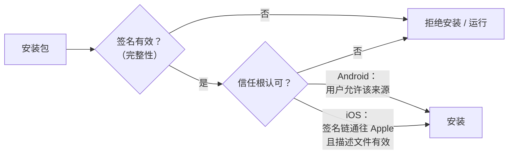
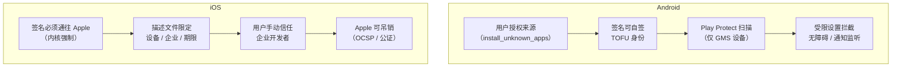
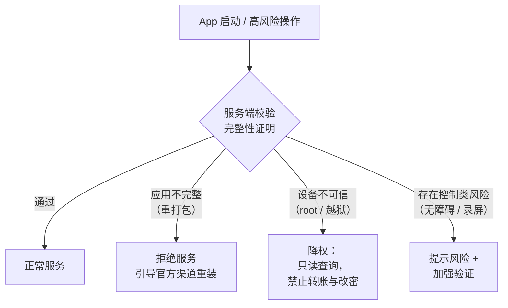

# 移动 App 侧载攻击：Android 与 iOS 的信任链、突破口与防护

侧载（sideloading）本身不是漏洞，而是一个**被刻意留下的信任例外**。本文从"操作系统凭什么决定一段代码能不能装、能不能跑"这个第一性问题出发，分别拆开 Android 和 iOS 的安装信任链，看攻击者如何利用这个例外，最后落到银行类 App 的防护设计。

本文只讲机制与防御，不提供可直接落地的利用步骤。

## 缩写对照表

| 缩写 | 英文全称 | 中文 |
|---|---|---|
| OS | Operating System | 操作系统 |
| APK | Android Package Kit | Android 安装包 |
| IPA | iOS App Store Package | iOS 安装包 |
| DEX | Dalvik Executable | Android 字节码文件 |
| SDK | Software Development Kit | 软件开发工具包 |
| CA | Certificate Authority | 证书颁发机构 |
| TOFU | Trust On First Use | 首次使用即信任 |
| AMFI | Apple Mobile File Integrity | Apple 移动文件完整性（内核扩展） |
| UDID | Unique Device Identifier | 设备唯一标识 |
| MDM | Mobile Device Management | 移动设备管理 |
| OCSP | Online Certificate Status Protocol | 在线证书状态协议 |
| DMA | Digital Markets Act | 欧盟《数字市场法》 |
| SEP | Secure Enclave Processor | 安全隔区处理器 |
| SSV | Signed System Volume | 签名系统卷 |
| OTP | One-Time Password | 一次性密码 |
| RASP | Runtime Application Self-Protection | 运行时应用自我保护 |
| CVE | Common Vulnerabilities and Exposures | 通用漏洞披露编号 |

## 1. 第一性问题：OS 凭什么决定一段代码能不能运行

一个移动 OS 面对一个安装包，要回答三个问题：

1. **它是谁写的？**（身份）
2. **它有没有被改过？**（完整性）
3. **我该不该相信这个作者？**（授权 / 信任根）

两个平台都用**代码签名**回答前两个问题：签名者用私钥对包内容的摘要签名，OS 用公钥验证——改一个字节，签名就失效。分歧出在第三个问题：

- **Android**：签名证书**可以自签**，OS 不问"作者是不是好人"，只保证"同一个包名之后的更新必须来自同一把钥匙"。信任根是**用户的安装决定**加上**分发渠道的审核**（Google Play 等）。
- **iOS**：签名证书**必须由 Apple 颁发**，内核在每次执行代码时都检查签名链是否通往 Apple。信任根是 **Apple 本身**。

**官方商店**把三个问题打包回答：商店审核过作者和代码，商店保证分发过程不被篡改。**侧载**就是绕开商店、直接把安装包交给 OS——前两个问题签名依然回答得了，但第三个问题的答案从"商店审核过"退化成了"用户（或某个证书持有者）说可以"。

**那为什么还要留口子？** 因为完全封死会伤害正当需求：开发调试、企业内部分发、测试分发、开源与替代商店、以及（在欧盟等地）法律要求。所以两家的设计都是"默认关闭 + 有门槛地打开"。攻击者的工作，就是让受害者（或被盗用的证书）替他迈过这道门槛。

*这张图回答：两个平台在安装时分别把"信任"交给了谁？*

## 2. Android 侧载

### 2.1 签名：身份等于钥匙，而不是证书上的名字

Android 不验证签名证书是否由 CA 签发。一个 App 的身份就是 **"包名 + 签名证书"**：

- **更新**：新 APK 的签名证书必须与已安装版本一致（或有合法的密钥轮换证明），否则安装失败。
- **签名级权限**（`protectionLevel="signature"`）与早期的 `sharedUserId`：只有同一签名者的 App 才能共享。
- 这是一种 **TOFU（Trust On First Use，首次使用即信任）** 模型：第一次安装时信了谁，之后就只认这把钥匙。

TOFU 的含义很直接：**如果用户第一次装的就是攻击者的版本，签名机制会忠实地保护攻击者。**

签名方案的演进，本质是在修补"签名到底覆盖了哪些字节"：

| 方案 | 引入版本 | 覆盖范围 | 关键点 |
|---|---|---|---|
| v1（JAR 签名） | Android 1.0 | 逐个 ZIP 条目签名 | ZIP 的元数据和条目之外的字节**不受保护**；校验要解压，慢 |
| v2 | Android 7.0 | 整个文件（在中央目录前插入 APK Signing Block） | 任何字节改动都会失效；安装时无需解压即可校验 |
| v3 | Android 9 | 同 v2 | 增加**密钥轮换**（proof-of-rotation），可以换签名钥匙而保持身份 |
| v3.1 | Android 13 | 同 v3 | 轮换可以按 SDK 版本定向生效 |
| v4 | Android 11 | 基于 fs-verity 的 Merkle 树，放在单独文件 | 支持增量安装（ADB incremental），需同时有 v2/v3 |

**Janus（CVE-2017-13156）** 是"签名没覆盖到的字节"最典型的教训：一个文件可以同时是合法的 DEX（从文件头解析）和合法的 APK/ZIP（从文件尾的中央目录解析）。对**只有 v1 签名**的 APK，在文件头部前置一段 DEX 不会破坏 v1 签名，但运行时（在 Android 5.0–8.0 的部分路径上）会把它当 DEX 执行。于是攻击者能在**不改变签名身份**的前提下替换代码，甚至以"合法更新"的形式覆盖已安装 App。2017 年 12 月的安全补丁修复了它；v2/v3 签名因为覆盖整个文件，从机制上免疫。**对开发者的结论：必须启用 v2 及以上签名，并把 `minSdk` 设得足够高，避免只靠 v1 的旧设备路径。**

### 2.2 安装流程：PackageManager 与"未知来源"开关

APK 最终都要交给系统的 PackageManager / PackageInstaller 安装。区别在于**谁来发起**：

- **Google Play 等预装商店**：持有系统级安装权限，可静默安装和更新。
- **普通 App（浏览器、文件管理器、聊天软件）**：只能通过 PackageInstaller 弹出系统确认界面，由用户点"安装"。

"允许这个来源安装"的门槛经历过一次关键变化：

| 时期 | 机制 | 后果 |
|---|---|---|
| Android 7.1 及以前 | 全局开关 **"未知来源"（Unknown sources）** | 一旦打开，**任何** App 都能发起安装 |
| Android 8.0 起 | 按来源授权：发起方需声明 `REQUEST_INSTALL_PACKAGES`，且用户在"安装未知应用"（`install_unknown_apps`）里**逐个 App** 授权 | 用户给了浏览器权限，不等于给了聊天软件权限 |
| Android 12 起 | 安装器可通过 `setRequireUserAction` 对**自己装的** App 做免确认更新 | 第三方商店的体验接近官方，但只限它自己的 App |
| Android 13 起 | **受限设置（Restricted settings）**：从非会话式安装器（典型如浏览器下载后点开）装的 App，默认**不能**直接被授予无障碍服务、通知监听等高危能力，需用户额外手动解除 | 直接针对"侧载木马 + 滥用无障碍"的套路 |
| Android 14 起 | 拒绝安装 `targetSdkVersion` < 23 的 App | 封死"用老 targetSdk 绕过运行时权限"的路 |
| Android 15 起 | 受限设置扩大覆盖面（更多安装方式与权限） | 继续收紧 |

"受限设置"值得多说一句：它不是不让你装，而是**把"装上"和"拿到危险能力"拆成两道门**。侧载银行木马的核心收益来自无障碍服务（读屏、代点击）和通知/短信读取（截 OTP），这两样正是被单独加锁的。

### 2.3 安全边界在哪里被突破

侧载本身只是"装上"。真正让攻击成立的，是装上之后 App 能拿到多大的能力，以及目标 App 自身有没有漏洞可钻：

| 突破口 | 机制 | 现状 |
|---|---|---|
| **低 `targetSdkVersion`** | Android 6.0 之前的 App 在安装时一次性获得全部危险权限；系统对旧 targetSdk 的 App 保留兼容行为 | Android 14 起禁止安装 targetSdk < 23；但兼容行为在更高版本间仍有差异 |
| **`requestLegacyExternalStorage`** | Android 10 中可以申请退出分区存储（scoped storage），获得宽泛的外部存储访问 | targetSdk ≥ 30 时被忽略 |
| **签名方案降级** | 只有 v1 签名的 APK 在旧系统上受 Janus 类问题影响 | 已打补丁 + 现代工具默认 v2/v3 |
| **`sharedUserId`** | 同签名的 App 可共享同一 Linux UID、互访数据；钥匙泄露就等于全家沦陷 | API 29 起废弃 |
| **导出组件** | `exported="true"` 的 Activity / Service / Receiver / Provider 可被任意 App（包括侧载的恶意 App）调用；缺权限保护时成为跳板 | Android 12 起，带 intent-filter 的组件必须**显式**声明 `exported` |
| **Manifest 错误配置** | `debuggable="true"`、`allowBackup="true"`、过宽的 `FileProvider` 路径、明文流量许可等 | 靠开发者自查与 lint |

最后两行说明一点：**侧载的恶意 App 是"同设备上的另一个攻击者进程"**。它不需要攻破 OS，只需要找到目标 App 自己开着的门。

### 2.4 实际威胁模型

| 攻击 | 机制 | 为什么能成 |
|---|---|---|
| **重打包（repackaging）** | 反编译正版 APK → 注入恶意代码或替换收款信息 → 用**攻击者自己的钥匙**重新签名 → 通过钓鱼链接、仿冒网站、第三方市场分发 | TOFU：用户没装过正版，或者先卸载了正版；签名只保证"没被**再**改过" |
| **Janus 类签名覆盖缺口** | 利用签名没覆盖的字节，在**保持原签名身份**的情况下改代码 | 只依赖 v1 签名的旧 App + 未打补丁的旧系统 |
| **木马化的"加固包"/"破解版"/"去广告版"** | 打着"官方加固"或"VIP 破解"旗号的 APK，本身就是重打包产物 | 用户主动寻求侧载 |
| **银行木马（短信/社交工程投递）** | 短信或聊天消息诱导下载 APK → 诱导开启无障碍服务 → 覆盖层钓鱼、截取 OTP、远程代操作 | 社交工程迈过"未知来源"与"无障碍"两道门 |
| **滴管（dropper）** | 第一阶段 App 看似无害（可能甚至上架商店），运行后再下载并请求安装真正的载荷 | 把危险行为推迟到审核与扫描之后 |

### 2.5 Play Protect 与"验证应用"：作用和局限

Google Play Protect（前身"验证应用"，Verify Apps）是 Google 移动服务（GMS）的一部分，在**认证设备**上运行：

- **安装前**：对侧载 APK 做本地 + 云端扫描，命中已知恶意样本就警告或阻止。
- **安装后**：周期性扫描，可禁用或移除恶意 App。
- **实时代码级扫描**：对从未见过的侧载 App 提取特征送云端分析（Android 14 及以后逐步推出）。
- **增强欺诈防护**（自 2024 年起在部分国家/地区试点）：从浏览器、聊天软件、文件管理器等"互联网侧载"来源安装、且申请短信、通知监听、无障碍等敏感权限的 App，会被直接拦截。
- **开发者验证**：Google 在 2025 年宣布，认证设备上的 App（包括侧载）将逐步要求来自已验证身份的开发者，计划自 2026 年起先在部分国家生效、此后扩展到全球。具体范围与豁免（例如面向高级用户的安装流程）以 Google 当前公告为准。

**局限**，也就是攻击者的绕过面：

- **签名与样本库是"已知"导向**：新的重打包变种、强混淆、按地区或时间延迟激活的载荷，都能在初次扫描时躲过。
- **用户可以关闭它，也可以无视警告**：社交工程脚本里常有"关闭 Play Protect"这一步。
- **只存在于带 GMS 的认证设备上**：国内大量设备、AOSP 定制系统、无 GMS 的设备上根本没有这一层，由各厂商的安全中心替代，能力参差。
- **dropper 模式**把恶意行为推迟到扫描之后。

结论：Play Protect 是**提高成本**的一层，而不是 App 可以依赖的安全边界。

## 3. iOS 侧载

### 3.1 官方约束：内核强制的代码签名

iOS 的规则一句话就能说完：**任何可执行代码页，签名链都必须通往 Apple，否则内核不让它执行。** 机制分几层：

1. **安全启动链**：Boot ROM → iBoot → 内核，每一级验证下一级的签名。这条链保证运行的是 Apple 的内核，后面的一切强制才可信。
2. **签名系统卷（SSV）**：系统分区以密码学方式封存，篡改即无法启动。
3. **AMFI + 内核代码签名强制**：每个 Mach-O 文件带有 CodeDirectory（各页的哈希）和签名；页面被换入内存时，内核核对该页的哈希。**未签名或签名不符的代码页无法执行**——这同时堵死了"运行时下载并执行新代码"（JIT 只对少数被授予特定权限的进程开放）。
4. **dyld 与库验证**：动态加载的库也必须签名，且默认必须与主程序同一 Team ID（或由 Apple 签名），这挡住了往进程里塞第三方 dylib。
5. **描述文件（Provisioning Profile）+ 授权（Entitlements）**：非 App Store 签名的代码要附带 Apple 签发的描述文件，写明 Team ID、允许的设备（或企业范围）、允许的能力、有效期。

**App Store 渠道**：开发者上传 → 审核 → **Apple 用自己的证书重新签名**，并加上 FairPlay DRM 加密 → 设备只认 Apple 的签名。

关于 **Secure Enclave（SEP）**：它负责的是密钥保护（Touch ID / Face ID、数据保护密钥、App Attest 密钥），**并不参与 App 代码签名的校验**。代码签名的信任根是 Boot ROM 中烧录的 Apple 根公钥和由它启动的内核。SEP 在侧载语境里真正重要的作用，是第 5 节讲的 **App Attest**——它能证明"发起请求的是 Apple 签过名的、属于你的 App ID 的那个 App"。

### 3.2 合法的例外口子

| 例外 | 证书 / 描述文件 | 设备范围 | 门槛 |
|---|---|---|---|
| **开发（Development）** | 开发证书 + 列出 UDID 的描述文件 | 注册过的设备 | 付费账号；**免费 Apple ID 也可以，但签出的 App 7 天过期，数量有限** |
| **Ad Hoc** | 发布证书 + 列出 UDID 的描述文件 | 每个账号每年有限数量的注册设备 | 付费开发者账号 |
| **企业内部分发（In-House / Enterprise）** | 企业证书 + 不限设备的描述文件 | **任何设备** | Apple Developer Enterprise Program，**只允许发给本企业员工**；用户需在"设置 → 通用 → VPN 与设备管理"中手动信任该开发者 |
| **TestFlight** | Apple 签名 | 受邀测试者 | 外部测试需经 Beta 审核；构建有有效期 |
| **欧盟替代分发（DMA）** | Apple 签名 + **公证（Notarization）** | 欧盟地区账户与设备 | 见 3.4 |

这些口子共同的前提是：**最终签名仍然通往 Apple**，而 Apple 能随时吊销。

### 3.3 攻击路径与实例

**① 滥用企业证书。** 企业证书是唯一"不限设备、不需审核"的口子，因此最常被滥用：赌博、色情、盗版、仿冒金融 App 都曾借用（或购买、盗用）企业证书分发。用户被引导去"信任"一个陌生企业开发者——这一步就是社交工程迈过信任门槛。Apple 的反制是**吊销证书**：设备在联网启动 App 时会通过 OCSP 检查证书状态，吊销后 App 将无法启动。实际效果取决于设备是否联网及本地缓存的状态，所以吊销生效会有时间差，不是瞬间全网失效。

**② "超级签名"（滥用 Ad Hoc / 开发证书）。** 分发方用（往往是批量注册或买来的）个人开发者账号，通过安装描述文件收集用户设备的 UDID，把设备加进账号的设备列表，再为**这一台设备**签一个 Ad Hoc 包。因为不是企业证书，不会因企业证书吊销而批量失效；代价是每个账号的设备名额有限，所以是"按设备付费"的灰色生意。这同样违反 Apple 的开发者协议，账号会被封禁。

**③ 免费账号自签与第三方"商店"（AltStore / SideStore 一类）。** 它们利用免费 Apple ID 的开发签名能力，在本地或配套程序里为用户重新签名 IPA，并在 7 天到期前自动续签。机制上合法，但它把"签什么"完全交给了用户：**用户拿到的 IPA 是否被改过，没有任何第三方审核**。（在欧盟，AltStore PAL 以经过公证的替代市场形态存在，属于另一条合规路径。）

**④ 重签名的克隆 App（iOS 上的重打包）。** 流程是：拿到**已解密**的 IPA（App Store 包有 FairPlay 加密，需要先在越狱设备上脱壳）→ 修改二进制或**注入一个 dylib**（修改 Mach-O 的加载命令）→ 用攻击者自己的证书（企业、Ad Hoc 或免费账号）整体重签名。注入的 dylib 与主程序一起被重签名，所以同 Team ID 的库验证照样通过。**结果是一个签名完全合法、但 Team ID 已经不是你的"你的 App"。** 这是"非越狱环境下的 Tweak"的本质，也是第 5 节服务端校验 Team ID 的原因。

**⑤ 利用签名校验本身的漏洞。** TrollStore 是代表：它利用 CoreTrust 的签名验证漏洞（CVE-2022-26766、CVE-2023-41991），让任意 App 以伪造的签名**永久安装**、不过期，并可携带任意 entitlements。这类漏洞修补后只在旧版本 iOS 上可用，但它说明了一点：**签名强制的强度，等于签名校验代码的正确性。**

**⑥ 地域与资格绕过（DMA 语境）。** 欧盟替代分发的资格由账户地区和设备所在地共同决定，离开欧盟有宽限期。资格判断依赖的地区信号可以被伪造或"借用"，从而把本应只在欧盟出现的分发渠道带到别处。

### 3.4 欧盟 DMA 侧载：开了门，但留着 Apple 这道闸

iOS 17.4（2024 年 3 月）起，欧盟用户可以从**替代应用市场**安装 App，iOS 17.5 起还可以从开发者网站直接下载。关键约束：

- **公证（Notarization）**：所有在欧盟以替代方式分发的 iOS App，仍需提交给 Apple 做自动化 + 人工的基线审查（恶意软件、诈骗、基本功能），通过后由 **Apple 签名**。不审内容合规，但审"是不是恶意的、是不是在冒充别人"。
- **市场开发者授权**：开商店的主体需要获得 Apple 授权，并满足财务与合规条件。
- **系统安装界面**：安装时由系统显示 App 名称、开发者、截图、年龄分级等信息，而不是由商店自绘——防止商店伪造这些信息。
- **吊销**：公证后发现是恶意软件，Apple 仍可吊销，已安装的 App 将无法启动。

所以 DMA 并没有改变 iOS 的信任根——**签名仍然通往 Apple**，只是把"审核"从全面的 App Review 缩小成了安全基线的公证。（日本依据《移动软件竞争法》要求的类似开放，Apple 也已公布相应方案；细节以 Apple 当前公告为准。）

### 3.5 越狱：彻底拆掉代码签名强制

越狱的本质，是**利用内核或更底层的漏洞，获得修改内核行为的能力**，然后把上面 3.1 的几层强制挨个关掉或旁路：

- **修补 AMFI / 代码签名检查**，或把自签的二进制哈希注入内核信任缓存（trust cache），让内核把它们当作"Apple 认可"。
- **打开动态注入**：通过 Substrate / ElleKit 一类框架，让 Tweak 的 dylib 被注入到任意进程（包括你的银行 App），在运行时挂钩（hook）任何函数。
- **开放文件系统与包管理器**：Cydia、Sileo 这类包管理器从任意源安装软件。
- **"无根"越狱（rootless）**：iOS 15 以后由于 SSV，越狱不再修改系统卷，改为把文件放在独立目录中——但内核层面的签名强制同样被绕过。

越狱之后，"侧载"已经不是问题：**任何代码都能运行，任何 App 的内存都能被读写和挂钩。** 这是为什么越狱检测在金融 App 里是标配，也是为什么它永远是"猫鼠游戏"——检测代码自己也运行在一个已被攻破的内核上。

## 4. 两个平台的威胁模型对比

*这张图回答：一个侧载 App 在两个平台上分别要过哪几道门？*

| 维度 | Android | iOS |
|---|---|---|
| **典型攻击者** | 银行木马团伙、诈骗团伙、重打包刷量者 | 企业证书 / 超级签名分发商、克隆 App 制作者、越狱 Tweak 作者 |
| **入口** | 钓鱼短信 / 聊天链接下载 APK；第三方市场；"破解版" | 诱导信任企业开发者；超级签名网站；越狱源；自签工具 |
| **OS 防御边界** | 应用沙箱 + 权限模型 + 按来源授权 + 受限设置 | 内核代码签名强制 + 沙箱 + 库验证 + 描述文件 |
| **签名的信任根** | **开发者自己**（自签证书，TOFU） | **Apple**（所有签名必须通往 Apple 根） |
| **集中撤销能力** | 弱：Play Protect 可远程禁用已知恶意 App，但无法"吊销签名" | 强：吊销证书或公证，已装 App 无法启动 |
| **侧载默认难度** | 低：几次点击即可 | 高：需要开发账号、企业证书或越狱 |
| **最大单点风险** | 用户被说服授予无障碍服务 | 企业证书外泄或被滥用；越狱 |
| **用户能否自防** | 能，但依赖警惕性：不开未知来源、不授无障碍、保持 Play Protect 开启 | 较能：不信任陌生企业开发者、不越狱、不装来路不明的描述文件 |

一句话：**Android 的身份由开发者自证，安全靠"用户决定 + 扫描兜底"；iOS 的身份由 Apple 背书，安全靠"Apple 可以随时收回背书"。** 前者被攻破在用户那一步，后者被攻破在证书管理或内核漏洞那一步。

## 5. 给银行 App 开发者的防护

设计原则只有一条：**客户端的任何检查都运行在攻击者可能完全控制的环境里，只能当减速带；真正的判定要放在服务端，基于平台签发、客户端无法伪造的证明。**

### 5.1 服务端可验证的完整性证明（主防线）

| 平台 | 机制 | 能证明什么 |
|---|---|---|
| Android | **Play Integrity API**：服务端解密并校验 Google 签发的 verdict | `appIntegrity`：是否为 Play 认可的、你签名的正版二进制（重打包版本会显示未识别）；`deviceIntegrity`：设备是否通过完整性检查（root、改机、非认证系统通常不过）；`accountDetails`：授权状态；`appAccessRiskVerdict`：设备上是否有可能截屏、录屏或控制界面的 App 在运行 |
| Android | **Key Attestation**：在 Android Keystore 硬件中生成密钥，由硬件出具证书链 | 密钥确实在可信硬件中；证书扩展里带有调用方 App 的包名与签名摘要、设备启动状态 |
| iOS | **App Attest**（DeviceCheck 框架）：在 SEP 中生成密钥，由 Apple 出具证明 | 请求来自**你的 Team ID + Bundle ID** 的正版 App，运行在真实 Apple 设备上；重签名的克隆 App Team ID 不同，拿不到有效证明 |
| iOS | **DeviceCheck** | 每台设备的少量持久状态位，可用于标记滥用设备 |

做法：登录、绑卡、转账等高风险接口要求附带**新鲜的**完整性证明（服务端下发一次性 nonce，防重放），服务端校验失败就降级或拒绝。

### 5.2 客户端检查（纵深防御，不可单独依赖）

- **签名自检**：Android 在运行时读取自身签名证书摘要，与内置的期望值比对；iOS 检查描述文件与 Team ID。容易被 hook 掉，但能挡住低成本的重打包。
- **安装来源检查（Android）**：通过 `PackageManager.getInstallSourceInfo()` 判断安装者是否为预期的商店；侧载来源可以触发风险评分上调，而不是直接拒绝（企业 MDM 分发等是正当来源）。
- **Root / 越狱 / 模拟器检测**：文件与路径特征、可疑进程与端口、`su` 可执行文件、越狱残留、系统属性等。结论应**上报服务端参与风控**，而不只是本地弹窗。
- **Hook 与调试检测**：检测 Frida、Substrate 等注入框架的特征，以及调试器附加。
- **无障碍与覆盖层风险（Android）**：检查已启用的无障碍服务，对敏感页面设置 `FLAG_SECURE` 防截屏，使用 `setFilterTouchesWhenObscured` 防覆盖层点击劫持。
- **代码混淆与加固**：提高逆向和重打包的成本（R8/ProGuard、字符串加密、native 层关键逻辑）。商业 RASP 方案集成了以上多项，见 [RASP 提纲](./RASP-for-mobile.md)。
- **证书固定**：防止重打包或越狱环境中的流量被中间人改写，见 [Certificate pinning](./cert-pinning.md) 与 [Mobile App Certificate Pinning](./Cert-Pinning-Swift.md)。

### 5.3 构建与发布侧

- Android 启用 **v2 + v3 签名**，`minSdk` 不低于团队能支持的最高水平；签名私钥放入 HSM 或使用 Play App Signing，**私钥泄露 = 身份被冒充**。
- Manifest 审查：组件 `exported` 显式且最小化，敏感组件加签名级权限；关闭 `debuggable`、审慎设置 `allowBackup`。
- iOS 只走 App Store（或受控的 MDM 企业分发）；**不要用企业证书对公众分发**——这既违规，也会让你的证书和你的用户一起暴露在吊销风险里。
- 在官网和 App 内明确告知"唯一官方下载渠道"，并监测仿冒 App 与仿冒下载站。

### 5.4 风险响应与合规

*这张图回答：服务端拿到完整性结论后，应如何分级处置？*

- **分级而不是一刀切**：重打包 App 应直接拒绝；root/越狱设备通常降权（例如允许查询、禁止转账）；存在可疑无障碍服务时提示并加强验证。
- **合规**：多地金融监管对移动银行有"检测设备是否被 root/越狱、检测 App 是否被篡改、并据此提示或限制交易"一类要求。具体条款以所在辖区的监管文件为准，安全设计评审时应逐条对照。
- **可观测性**：把完整性结论、安装来源、root/越狱信号作为风控特征入库，用于发现成批出现的重打包版本或仿冒分发。

## 6. 结论

- **侧载不是漏洞，而是信任例外**：签名保证"是谁、有没有被改"，侧载改变的是"凭什么信"。
- **Android 的身份由开发者自签、首次安装即信任**；攻击的主战场是社交工程——让用户允许来源、授予无障碍。Android 8 的按来源授权、Android 13 的受限设置、Play Protect 的增强欺诈防护和开发者验证，都是在给这两道门加锁。
- **iOS 的每一页代码都必须通往 Apple 的签名**；攻击要么借用 Apple 签发的身份（企业证书、超级签名、免费账号、重签名克隆），要么攻破签名校验或内核本身（TrollStore 类漏洞、越狱）。Apple 的核心反制是吊销，DMA 也没有改变这个信任根。
- **对银行 App，客户端检查只是减速带。** 主防线是服务端校验平台签发的完整性证明——Android 的 Play Integrity / Key Attestation，iOS 的 App Attest——并据此做分级的风险处置。

## 参考资料

- Android Developers：*APK Signature Scheme v2 / v3 / v3.1 / v4*；*Install unknown apps*；*Restricted settings*；*Play Integrity API*；*Key and ID attestation*。
- Android 安全公告，2017 年 12 月（CVE-2017-13156，Janus）；GuardSquare, "New Android vulnerability allows attackers to modify apps without affecting their signatures", 2017。
- Google Security Blog：Play Protect 实时代码级扫描、增强欺诈防护试点；Android Developers Blog：开发者验证要求（2025）。
- Apple Platform Security Guide：Secure boot、Signed System Volume、App code signing process in iOS、Secure Enclave。
- Apple Developer：*Establishing your app's integrity*（App Attest）；*DeviceCheck*；*Distributing proprietary in-house apps*；Apple Developer Enterprise Program License Agreement。
- Apple Developer：*Getting started with alternative app distribution in the European Union*；*Notarization for iOS apps*。
- CVE-2022-26766、CVE-2023-41991（CoreTrust 签名校验漏洞）。
- 同目录相关：[Certificate pinning](./cert-pinning.md) · [Mobile App Certificate Pinning: Underlying Principle and a Swift Example](./Cert-Pinning-Swift.md) · [Mobile API Token Security](./Mobile-API-Token-Security.md) · [Runtime application self-protection](./RASP-for-mobile.md)。
